<h1 align="center">Bookfin</h1>

<p align="center">
  Audiobooks and ebooks from your Jellyfin server, on your Android phone.<br>
  Listen offline, read offline, and never lose your place.
</p>

<p align="center">
  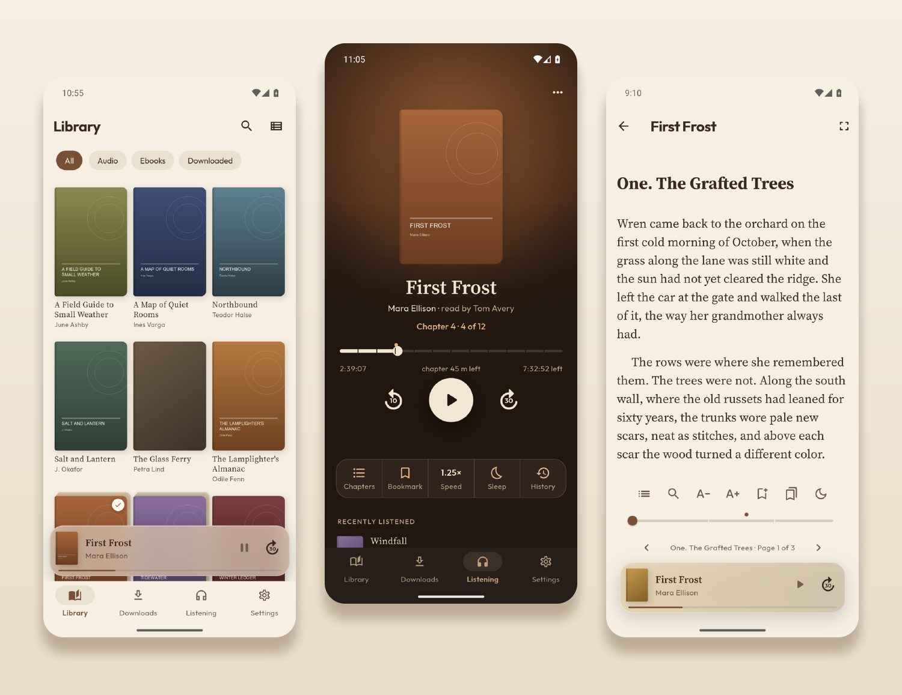
</p>

<p align="center">
  <a href="#features">Features</a> ·
  <a href="#the-bookfin-storage-plugin">Sync plugin</a> ·
  <a href="#build-the-app">Build</a> ·
  <a href="#status">Status</a>
</p>

---

Bookfin is an Android app for people who keep their books on a Jellyfin server.
It shows only your book libraries.
An audiobook and its ebook show as one book, with one cover.
The app keeps a copy of your library on the phone, so it works without a connection.
It saves every pause, seek and chapter jump, so you can always go back.

The look is warm paper by day and a dim, brown night theme after sunset.
Titles and reading text use Source Serif 4. Headings use Outfit.

The screenshots come from the real app on an Android emulator.
The library in them is made-up test data from `tool/showcase_fixture.dart`.

## Features

### Your library, grouped into series

<p align="center">
  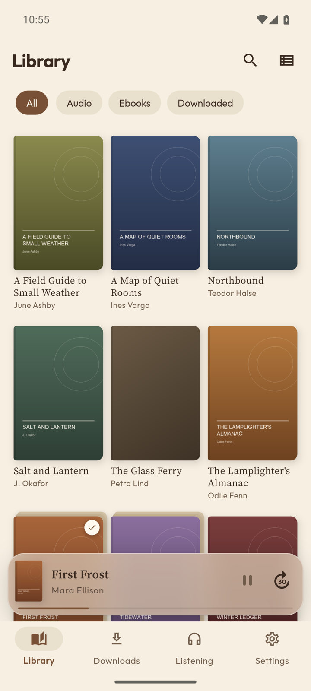
  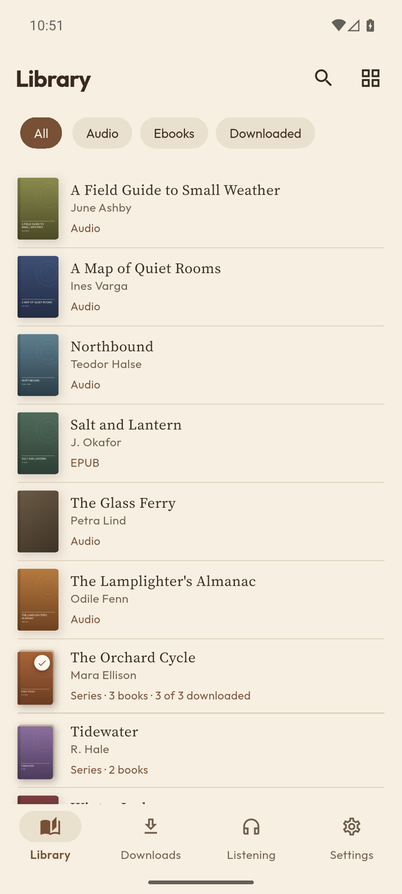
  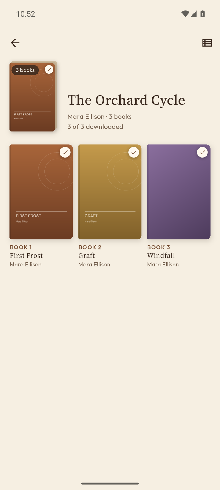
</p>

- The library shows books as a grid of covers or as a list. One button in the top bar switches between them.
- A series with two or more books shows as one stacked card. The card opens the series in reading order.
- Bookfin reads the series from the Jellyfin series field, from a collection that holds the book, or from a title that ends in "(Series #N)".
- Filters show all books, only audiobooks, only ebooks, or only downloaded books.
- A checkmark on a cover means that the book is on the phone. A series card says how many of its books are downloaded.
- Search has its own screen. It finds books by title, author or series.
- Covers are kept on the phone. A book without a cover gets a generated cover with its title.

### A page for every book

<p align="center">
  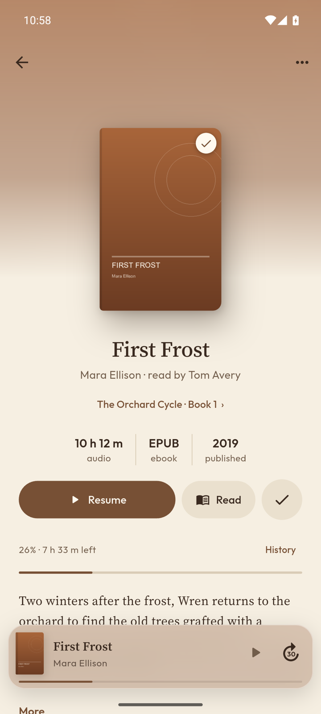
  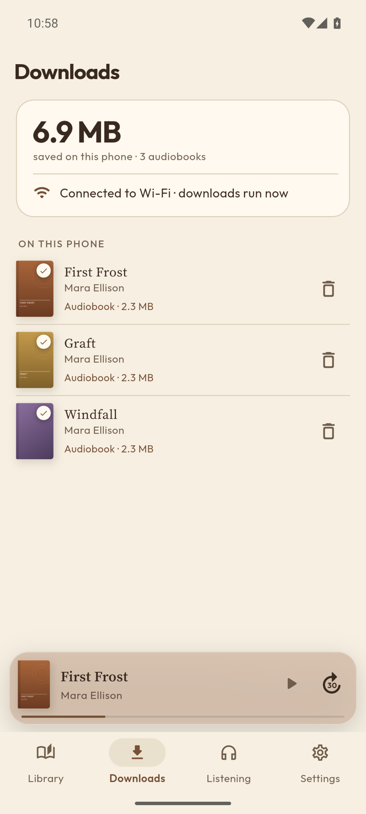
</p>

- The book page shows the cover, the author and narrator, the series, the length, your progress and the description.
- From the book page you listen, read, download or remove the book.
- Audio and ebook downloads are separate. A downloaded ebook does not mean that the audiobook is downloaded.
- Downloads run on Wi-Fi. On mobile data, a download waits for Wi-Fi, unless you allow mobile data for the session.
- An interrupted download continues later. Bookfin marks a file as downloaded only after it checks the complete file.

### A player made for long books

<p align="center">
  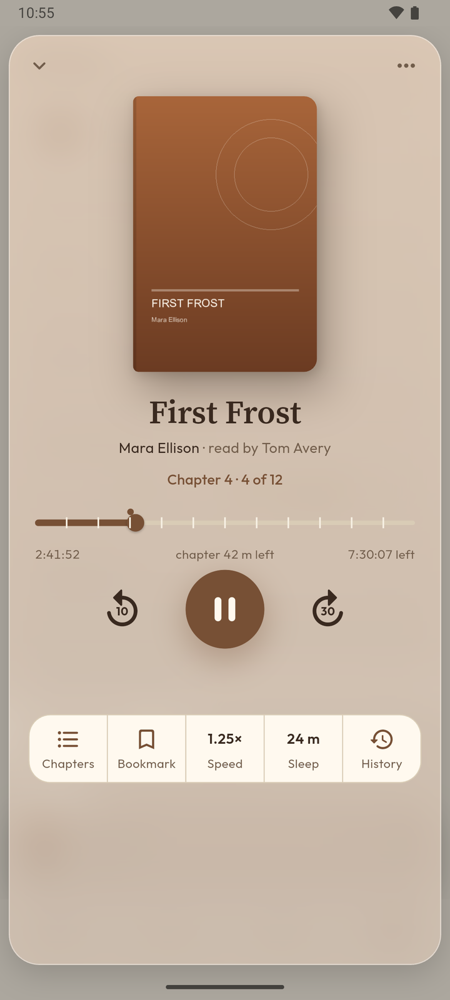
  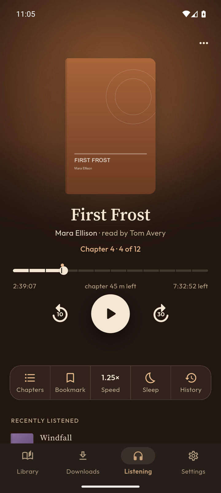
  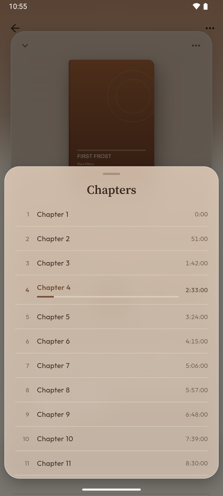
</p>

- The player shows the current chapter and its place, for example "Chapter 4 · 4 of 12".
- The position bar has a mark at the start of each chapter and at each bookmark.
- Below the bar are the elapsed time, the time left in the chapter and the time left in the book.
- The jump buttons go back and forward by a length that you choose. Hold either button to change it.
- Speed goes from 0.5× to 3×. The sleep timer stops playback after 5 to 60 minutes.
- A mini player stays at the bottom of every tab. The lock screen and the notification have play controls.
- Bookfin plays downloaded audio, so playback never depends on the network.

### Every move is saved, and you can go back

<p align="center">
  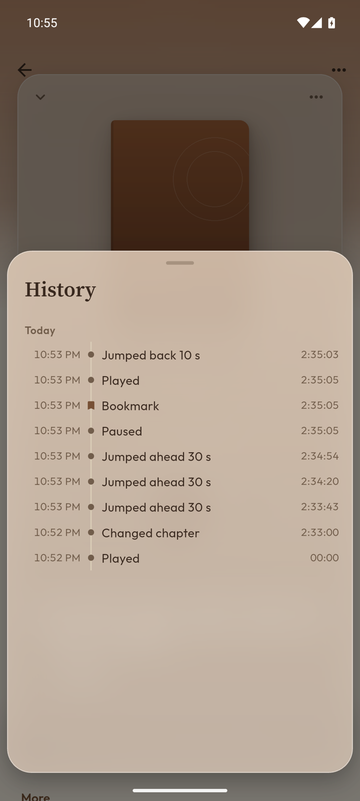
  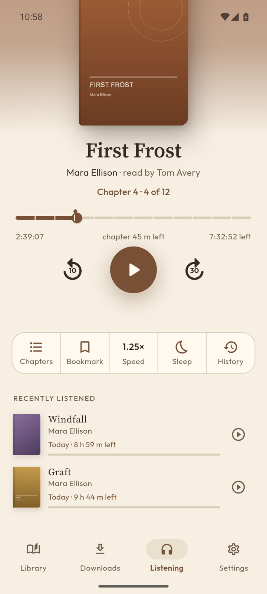
</p>

- After a seek or a chapter jump, an Undo button takes you back to where you were.
- The history timeline keeps every pause, seek, chapter jump and bookmark, newest first, grouped by day.
- Tap an entry to go back to where an action began or to where it ended. Going back is also an entry, so nothing is erased.
- A tap on Bookmark saves your place at once. Tap again within 15 seconds to give the bookmark a name.
- History stays until you delete it. Bookfin writes each change to the phone before it syncs.

### Read EPUB, MOBI and PDF

<p align="center">
  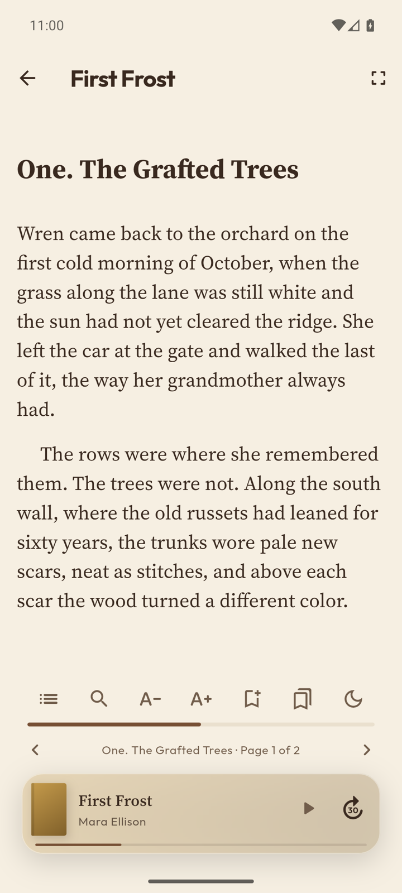
  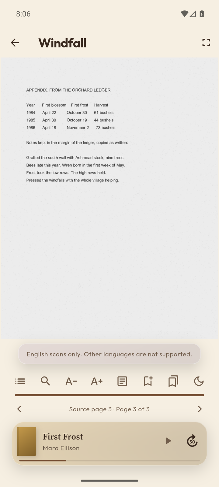
  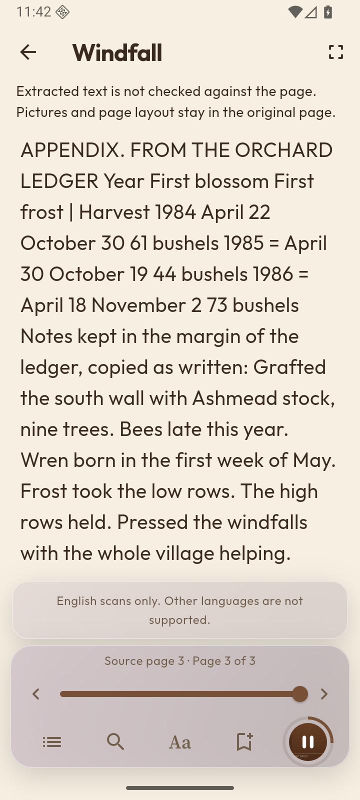
</p>

- The reader opens EPUB, unencrypted MOBI, and PDF files.
- It has contents, search, text size, bookmarks, and a saved place for each book.
- Reading is immersive. A tap shows the controls, and another tap hides them.
- A PDF can show its original pages, or its text reflowed to the width of the phone.
- For scanned pages, Bookfin recognizes the text on the phone with Tesseract (English only). OCR (optical character recognition) needs no network.
- The original page is always one tap away, because recognized text can lose columns and tables.

### Start from the phone, then refresh

<p align="center">
  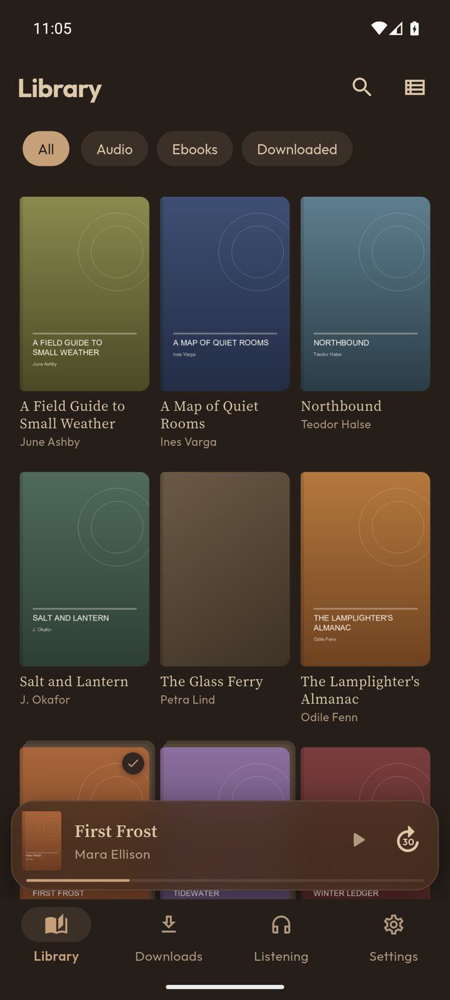
  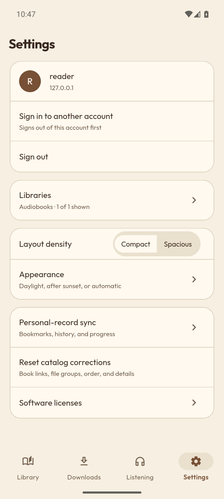
</p>

- At launch, Bookfin loads the library and your place in each book from the phone, not from the network.
- It refreshes from Jellyfin in the background and changes the screen in place.
- If Jellyfin cannot be reached, the library shows your downloaded books and says so. The next refresh brings back the full library.
- The night theme starts at local sunset and ends at sunrise. Bookfin calculates the times on the phone from a city that you choose. You can also keep day or night all the time.
- Settings holds your account, the libraries to show, layout density, appearance, sync, and Clear data.

### Your place on every device

- Bookfin reports normal playback progress to Jellyfin, like other Jellyfin apps.
- Bookmarks, listening history and reading places go to the Bookfin Storage plugin on your server.
- If two phones change the place in the same book offline, Bookfin keeps both places. When you choose one, both places stay as bookmarks.
- Without the plugin, all listening and reading works. Your records then stay on the phone.

## The Bookfin Storage plugin

The plugin keeps your personal records on your Jellyfin server.
Each Jellyfin user sees only their own records.
The records are plain text in a SQLite database on the server, not end-to-end encrypted.

The plugin was tested only with Jellyfin 12.4.0 on Apple Silicon macOS.
It is not a published release, and it is not in a Jellyfin plugin repository.

Build the plugin package from the checkout root:

```sh
nix develop ./tool/research/sync --command bash -c '
  PYTHONDONTWRITEBYTECODE=1 python3 tool/plugin/package.py
'
```

The package is `.cache/plugin/package/Bookfin.Storage_0.1.1.0.zip`.
A `.sha256` file next to it holds the hashes of both ZIP files.

To install the plugin on your server, do these steps:

1. Stop Jellyfin.
2. Make a backup of the Jellyfin program-data directory and the configuration directory.
3. Make sure that the hash of the ZIP file matches the `.sha256` file.
4. Extract the ZIP file into `plugins/Bookfin Storage_0.1.1.0/` in the program-data directory.
5. Start Jellyfin.
6. In the Jellyfin dashboard, make sure that one plugin named Bookfin Storage, version 0.1.1.0, is active.
7. In Bookfin, open Settings, then Personal-record sync, then tap Sync now.

The program-data directory is the one that you give Jellyfin with `--datadir`.
Jellyfin writes the path in its startup log.
For backups, upgrades and rollback, read [`plugin/Bookfin.Storage/README.md`](plugin/Bookfin.Storage/README.md).

## Build the app

Bookfin builds on an Apple Silicon Mac with Nix.
A Nix flake pins Flutter, Dart, Java, the Android SDK and NDK, and the native reader libraries.
You do not install a toolchain globally.

Run these commands from the checkout root:

```sh
nix develop --command flutter pub get
nix develop --command bash tool/bookfin test
nix develop --command bash tool/bookfin build-android
```

The first command downloads the pinned tools, which takes some time.
The build makes a debug APK for 64-bit ARM phones at `build/app/outputs/flutter-apk/app-debug.apk`.
Install it with `adb install`.
Then sign in with the address of your Jellyfin server, your user name and your password.

To try the app without a real server, start the fixture server in `tool/showcase_fixture.dart`.
A fixture server is a small fake Jellyfin server for tests.
It serves a made-up library with generated covers, silent audio, two EPUB books and a PDF with a scanned page.

```sh
nix develop --command dart run tool/showcase_fixture.dart 8096
```

The fixture listens on 127.0.0.1 only.
On an emulator, run `adb reverse tcp:8096 tcp:8096`, then sign in at `http://127.0.0.1:8096` with any user name and password.

For the emulator, the T3 device panel and hot reload, read [`docs/setup.md`](docs/setup.md).

## Status

Bookfin is a personal project.
It targets Android first. It was tested on one phone and one Jellyfin library.
There is no signed release and no store listing yet.

| Area | State |
| --- | --- |
| Library, series, search, covers | Works |
| Downloads and offline listening | Works |
| Player, chapters, bookmarks, history | Works |
| EPUB, MOBI, PDF reading and reflow | Works |
| OCR for scanned PDF pages | Works, English only |
| Sync through the Bookfin Storage plugin | Works, tested with Jellyfin 12.4.0 |
| Release builds and store listing | Not started |
| iOS | Not planned |

The product plan is in [`docs/plans/bookfin.md`](docs/plans/bookfin.md).
The approved design mockup is in [`docs/mockups/bookfin.html`](docs/mockups/bookfin.html).
