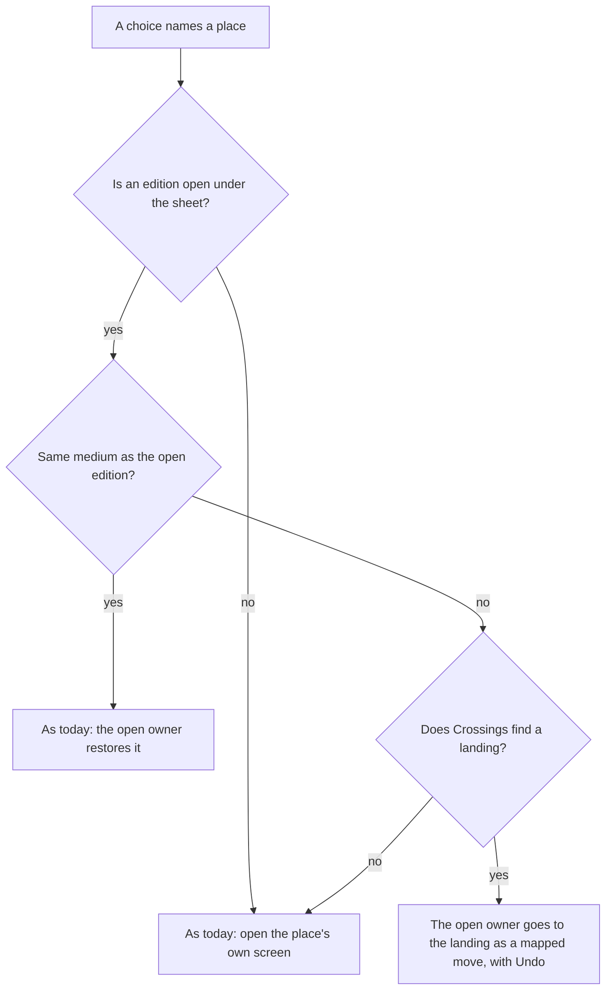
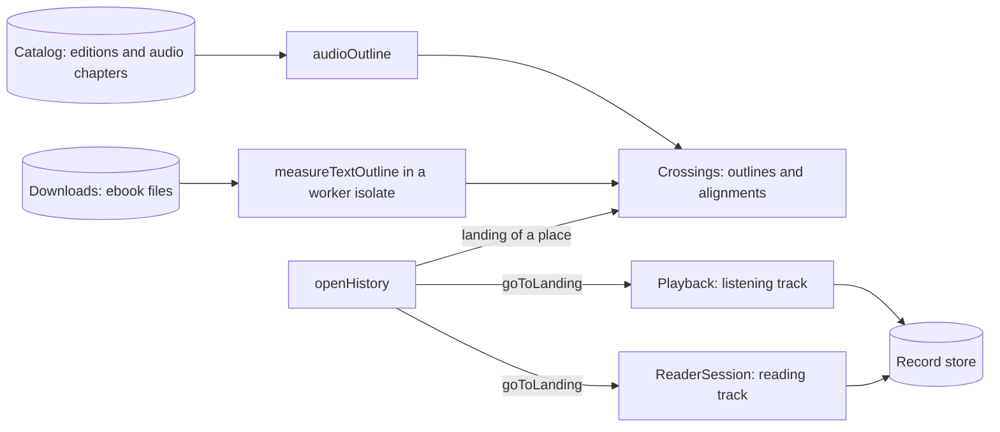

# Go to a place of the other edition inside the open edition

Epic: boo-z3is, under boo-fs0n. Written 2026-11-11 with two designs, A and B. Status: the user chose design A (see "Decision" at the end). Steps 2 to 7 of design A are built. Step 8, the PDF outline, waits. Design B is not scheduled.

Read this with three other documents:

- `docs/plans/bookfin.md`: the edition model, the personal record store and sync.
- `docs/plans/reading-history.md`: places, moves, bookmarks and the shared History timeline.
- AGENTS.md: UI rules 1 to 4 and engine rules 1 to 3.

## The request

The user asked on 2026-11-11, in these words:

```text
If the user clicks on a history entry in the reader, even if it was a location in the audiobook, we try to map that location to what it would be in the e-book and jump there, and vice versa if they click on a location in the listener that was a reader location. We should still keep the histories conceptually separate, though, so that they are two separate tracks of history with separate icons and so on, so that they know if they are risking an exact location jump by jumping to a history, and so that, like, if you jump to a reader location in your audiobook, it's easy to go back to the location you are at in your audiobook, without messing up the location in the e-book at all.
```

The goal is to read and listen together, as on a Kindle.

## Terms

The terms of `docs/plans/reading-history.md` apply: place, move, bookmark, timeline and Undo offer. This design adds these:

- Open edition: the edition that the screen under the History sheet shows. It is the audio edition in the player and the ebook edition in the reader. The book page and the Listening tab have no open edition.
- Track: the moves and bookmarks of one medium of a book. Playback owns the listening track. `ReaderSession` owns the reading track.
- Counterpart: the place in the open edition that holds the same words as a place of another edition.
- Landing: the counterpart that Bookfin found for a choice, and how it found it. "By chapters" is an estimate. "By speech" is the spoken sentence.
- Mapped move: a move in the open edition's track that ends at a landing. It also records the place of the other edition that it went to.
- Audio outline: the chapters of an audio edition, each with its title and its start in milliseconds from the edition's start, and the edition's length.
- Text outline: the contents entries of an ebook edition, each with its title, its depth and its start in visible characters from the book's start. A visible character is a character of the body text that is not white space, as `BookMap` counts it. The outline also holds the visible characters of each part: an EPUB section or a PDF page.
- Anchor: an audio chapter start and a contents entry start that the matcher pairs.
- Span: the audio time and the text between two neighboring anchors.
- Page: in this document, 582 visible characters. That is the median page of the corpus books at 412 × 671 px with 20 px text. A narrator reads one page in about 51 s, at the measured median of 11.4 visible characters per second.

## What changes

| Situation | Today | After |
| --- | --- | --- |
| Go to on a listening entry in the reader | Closes the reader and opens the player at that time | Stays in the reader and shows the counterpart page, as a reading move with Undo |
| Go to on a reading entry in the player | Opens the reader at that place | Stays in the player and plays from the counterpart time, as a listening move with Undo |
| No defensible counterpart | Not applicable | As today, and the entry says why before the tap |
| Go to on the book page or the Listening tab | Opens the screen of the entry's medium | Unchanged |
| Go to on an entry of another edition of the same medium | Opens that edition | Unchanged |
| The other edition's place, track and bookmarks | Unchanged by a jump | Unchanged by a jump |
| The timeline rail | One rail, a glyph of the medium on each entry | Two lanes, one per medium, each with its own glyph and its own line |

## Measured facts

### Method

The user's library was not measured. Its saved copies on this Mac and on the shared emulators hold only the 14-book demonstration library. A measurement on the server needs a sign-in. Ticket t3-a4fi measures the real library. The data of this section is public:

- 155 LibriVox recordings of 29 works. Their public section lists give each section's title, length and readers.
- 39 EPUB editions of the same works from the reader corpus (`tool/reader/epub_corpus.json`): Standard Ebooks and Project Gutenberg.
- 206 pairings of one recording and one ebook edition. In 138 of them, one person reads the whole book, as in a commercial audiobook.

The scripts are in `tool/research/cross_edition`. The matcher there is a prototype of design A's matching, described under design A.

`docs/research/jellyfin.md` holds the only facts about the real library: 27 of 30 sampled audiobooks had embedded chapters, one sampled MP3 had 21 chapter starts, and one sampled M4B had four.

### Chapter titles and counts

- Audio section titles: 55% give a number only ("Chapter 03"), 22% a number and words ("1: Loomings"), and 23% words only ("Down the Rabbit-Hole"). No LibriVox section is named "Track 01".
- Counts rarely agree. Only 38 of the 201 pairings with an anchor have as many audio sections as ebook entries at the chapter level. Ebook contents also list title pages, imprints, dedications, endnotes, licenses and, in some Gutenberg books, illustrations.
- 32 of 155 recordings read front matter as a section of its own.
- 15 recordings split chapters into parts ("Chapter 1, Part 2").
- 11 recordings number chapters inside volumes ("Volume 2, Chapter 3") where the ebook numbers them through the book, or the reverse.
- 10 recordings merge chapters into one section ("Chapters 1-3").
- 8 recordings are dramatic readings or stage adaptations.
- Titles alone mislead. The Gutenberg "A Christmas Carol" lists an illustration titled "Marley's Ghost" 20,000 characters after the stave of the same name. Numbers alone pair "Volume 3, Chapter 19" with chapter XIX.

### Matching result

With titles, a tie-break by the whole-book share, a check of the reading rate and an ordinal fill (see design A):

- 175 of 206 pairings anchor 90% or more of their audio sections. Titles alone reach 90% in 158 pairings.
- 15 pairings anchor fewer than half of their sections.
- 8 pairings have fewer than two anchors, so design A refuses them. Examples: a Walden recording titled "Chapter 1, Part 1" against an ebook whose chapters are titled "Economy", and a four-act stage adaptation of Pride and Prejudice.

### Placement error

The measurement hides one known chapter start at a time and places it from the other anchors. The table covers 2,900 chapter starts: those of the 127 one-reader pairings with at least five title anchors.

| Method | Median error | 90th percentile |
| --- | --- | --- |
| Whole-book share: time share equals character share | 5.2 pages (4.4 min) | 22.4 pages (19 min) |
| Only the first and the last matched chapter | 3.0 pages (2.6 min) | 13.3 pages (11 min) |
| Matched chapters (design A), one start hidden | 0.36 pages (18 s) | 1.39 pages (69 s) |

- A hidden start lies in the middle of a span of two chapters, which has a median length of 46 pages. A place inside one matched chapter has a shorter span, so these numbers are an upper bound for it.
- The error grows with the span. It is 0.8% of the span's length at the median and 2.7% at the 90th percentile.
- Recordings with several readers double the error: 0.74 and 3.35 pages.
- Most whole-book error comes from text that only one edition has: front matter, endnotes, and the Project Gutenberg license of about 14,000 characters (24 pages).
- A direct check inside chapters agrees. The speech probe below found the true place of 12 windows in three one-reader chapters of 13 to 45 pages. Design A's estimate was 0.03 to 0.72 pages away (1 to 34 s), with a median of 0.18 pages (8 s).

### Speech probe

The probe used whisper.cpp 1.9.5 from nixpkgs with the English models tiny.en and base.en. It transcribed 15 s at 20, 40, 60 and 80 percent of three LibriVox chapters, and searched the words in the matching Standard Ebooks chapter.

- All 12 windows were found at one clear place. 10 to 12 of the first 12 transcribed words matched in order. The best other place matched 3 to 6.
- Time per window on the CPU only, with 4 threads, on an Apple M1 Max at a load of 17 on 10 cores: tiny.en 0.7 to 0.9 s (2.0 to 2.5 CPU seconds), base.en 1.05 to 1.26 s (3.3 to 4.4 CPU seconds). The times include the load of the model. Whisper pads each window to 30 s, so a 30 s window costs the same.
- Model files: tiny.en 78 MB at 16 bits, 44 MB at 8 bits, 32 MB at 5 bits. base.en 148, 82 and 60 MB. The 5-bit tiny model gave the same words.
- `docs/research/on-device-tts.md` finds that a Pixel 8 needs 2.0 to 2.7 times the Mac's time at 4 threads. So one window takes about 1.4 to 2.5 s with tiny.en and 2.1 to 3.4 s with base.en on the phone. This estimate is not measured on a phone.

### Limits of the measurement

- Commercial audiobooks differ from LibriVox. One narrator reads, and no spoken notice of 15 to 20 s starts each section. That notice adds to the measured error, so commercial recordings can do better. Chapter marks come from the publisher or from a ripping tool: "Chapter 1", "Track 01", "Opening Credits", or none.
- PDF editions were not measured. A MOBI book converts to EPUB first, so it behaves as an EPUB.
- Abridged recordings and other translations appear only as the refusals above.

## What each technique was made for

| Technique | Made for | Our situation | Verdict |
| --- | --- | --- | --- |
| Proportional placement inside matched chapters (design A) | An estimate from metadata that both editions already carry. It assumes a steady reading rate inside a chapter. | The same metadata exists: Jellyfin chapter marks and EPUB contents. | Fits. Measured above. |
| Kindle Whispersync for Voice and Immersion Reading | Pairs of a Kindle book and an Audible recording that Amazon sells together. Amazon prepares the sync data of each pair ahead of time, and the apps look places up in it. Target: the spoken word highlighted. | Arbitrary editions from Jellyfin. No server prepares sync data. The phone is often offline. | The product idea fits. The technique does not transfer. |
| Storyteller and similar read-along builders | A home server transcribes a whole audiobook with Whisper, aligns it with the EPUB once, and writes EPUB 3 media overlays. Target: word highlighting for a whole book. It transcribes every hour of audio, so it needs much server CPU time or a GPU. | One place at a time, on a phone, at a tap. | Whole-book alignment is out of scale for a phone. Transcription of one window, then a word search, transfers. |
| Forced aligners: aeneas, Gentle, Montreal Forced Aligner, WhisperX | Desktop tools that align a known transcript with its audio, word by word, in batches | Bookfin does not know which text a window holds until it finds it. | Not needed. A transcription and a word search find the sentence. |
| Whisper tiny or base through whisper.cpp (design B) | Offline transcription of 30 s windows of general English on laptops and phones | 30 s windows of clean narration | Fits. Measured above. |
| Android's on-device `SpeechRecognizer` | Dictation from the microphone. Android 13 added audio from a file. Models and languages differ by phone, and it promises no word times. | One app on many phones | An option to test later, not a base |

In the reader, design B's gain is a step from about a third of a page to the sentence. In the player, it is a step from about 18 s to about 1 s. Its constant cost is a model download, a native runtime, an audio decoder and 1.4 to 3.4 s per window on the phone. Bookfin pays it once for each Go to, never for a whole book.

## The model that both designs share

### One routing rule

Today `openHistory` sends each choice to the owner of the chosen place's medium. That owner shows the place in the place's own edition, and the sheet brings that medium's screen to the front.

After this change, the rule is one rule for every choice:

1. A choice goes to the owner of the open edition, the screen under the sheet.
2. A place of the open edition's medium goes to that owner's existing verbs, as today. This covers other editions of the same medium.
3. A place of the other medium goes to its landing in the open edition, as a mapped move.
4. When no landing exists, when the place belongs to another book, or when nothing is open, the choice behaves as today.



### Owners

| Fact or decision | Owner | Readers |
| --- | --- | --- |
| Listening track, listening Undo offer, listening bookmarks | `Playback`, unchanged | Player, timeline controller |
| Reading track, reading Undo offer, reading bookmarks | `ReaderSession`, unchanged | Reader, timeline controller |
| Audio outline of an audio edition | `audioOutline(Edition)`, a pure function of the catalog. `Playback.chapters` uses it too. | `Crossings`, `Playback` |
| Text outline of an ebook edition | `measureTextOutline`, in the reader package, in a worker isolate | `Crossings` |
| The anchors of a pair of editions, and the landing of a place | `Crossings`, a new app-wide data source. It keeps the outlines and alignments that it derives. | Timeline controller |
| Which landing a choice uses, and the fallback | `openHistory`, the timeline controller | `HistoryTimeline` |
| A landing in words | The open owner: `Playback.describe` for an audio landing, `ReaderSession.describeLanding` (new) for a text landing | `HistoryTimeline` |



`Crossings` reads records and files. It writes no record. Only the open owner writes, and only its own track.

### Usage code

The controller's call for Go to on a place of the other medium. This is proposed code.

```dart
final landing = await crossings.landing(place, into: openEdition);
if (landing == null) return goAsToday(place, restore);
await switch (landing) {
  AudioLanding() => playback.goToLanding(landing, kind),
  TextLanding() => reader.goToLanding(landing, kind),
};
```

where

- `crossings` = the app's one `Crossings`.
- `place` = the place that the choice names: where an entry's move began or ended, or a bookmark's place.
- `openEdition` = the edition of the screen under the sheet.
- `landing` = the counterpart of `place` in `openEdition` and how it was found. If no defensible counterpart exists, it is null.
- `restore` = the call that restores the place through its own owner, as today, for example `reader.restoreHistory(event.id)`.
- `goAsToday` = today's `go(place, restore)` in `openHistory`: close the sheet, restore the place in its own edition, show its screen.
- `kind` = the kind of the choice: `historyRestore` for a move, `bookmarkRestore` for a bookmark.
- `goToLanding` = the new verb of each owner. It goes to the landing as a move of `kind` in its own track.

The payload:

```dart
/// Where a choice on a place of another edition lands in the open edition.
sealed class Landing {
  /// The place of the other edition that the choice named.
  Place get from;

  /// How Bookfin found the landing.
  MatchedBy get matchedBy;
}

final class AudioLanding extends Landing { final AudioPosition place; ... }
final class TextLanding extends Landing { final BookPlace place; ... }

enum MatchedBy { chapters, speech }
```

where

- `AudioLanding.place` = a time in the open audio edition, in the form that Playback already restores.
- `TextLanding.place` = a part of the open ebook and the share of the part's visible characters before the landing. It is the target form that `BookMap` and the navigator's `seek` already use.
- `MatchedBy.chapters` = an estimate from matched chapters. The words of such a landing say "about".
- `MatchedBy.speech` = the sentence that the speech stage found. Only design B makes it.

### Records

`HistoryEvent` gets two optional fields. A mapped move has both. Every other move has neither, so its JSON stays byte for byte as it is.

```json
{"id": "5a1c…", "at": "2026-11-11T21:40:00.000Z", "kind": "historyRestore",
 "before": {"edition": "…", "source": "…", "revision": "…", "anchor": "{…}"},
 "after":  {"edition": "…", "source": "…", "revision": "…", "anchor": "{…}"},
 "bookTitle": "Moby-Dick", "editionLabel": "EPUB",
 "counterpartOf": {"edition": "…", "source": "…", "revision": "…", "milliseconds": 3735000},
 "matchedBy": "chapters"}
```

where

- `before` and `after` = places of the open edition, as in every move.
- `counterpartOf` = the place of the other edition that the move went to the counterpart of. Its keys tell its medium: `milliseconds` for audio, `anchor` for text.
- `matchedBy` = `chapters` or `speech`.

`HistoryEvent.fromJson` reads named keys only, so an older build reads a mapped move as an ordinary history restore. No migration is needed.

### The move, Undo and the other edition

- The kind of a mapped move is the kind of the choice. Its before is the shown place. Its after is the landing. The rules of moves in `docs/plans/reading-history.md` apply unchanged: the pending move, the first reported place, and one change set for the move and the new place.
- Undo is the open owner's Undo offer, as after any move. It returns to the exact place before the jump. So after a jump to a reading place in the player, Undo returns to the audiobook's own place.
- No record of the other edition changes: not its resume, not its track, not its bookmarks. The other owner is not called. A test with a store spy proves that a mapped jump writes nothing in the other medium's domain.

### What the person sees

The timeline keeps one list per book, newest first and grouped by day. It shows each medium as its own track:

1. The rail has two lanes: listening on the left and reading on the right. Each lane has its own line. An entry sits in its medium's lane with its medium's glyph.
2. A row keeps its own place in its own words. A listening entry in the reader still reads "1:02:15".
3. An open entry of the other medium shows where its places land. If no landing exists, the entry says why and which screen Go to opens: "The chapters of these editions do not match, so this opens the audiobook."
4. Each choice that goes to a place names the landing. By chapters, it reads "about p. 134" or "about 1:02:15". By speech, it reads "p. 134". If Go to switches screens as today, the choice names the place in its own words, such as "1:02:15", beside the reason of item 3.
5. A mapped move appears in the open edition's lane: "Went to about where you listened", "Went to where you listened" by speech, or "Went to about a listening bookmark".

| Time | Listening lane | Reading lane | What happened | Place |
| --- | --- | --- | --- | --- |
| 9:41 PM | line | book glyph | Went to about where you listened | p. 134 |
| 9:40 PM | line | book glyph | Opened | p. 120 |
| 8:15 PM | headphones glyph | line | Paused | 1:02:15 |

The timeline gets one new input: `landingOf(place)`, the words of where a choice that names `place` lands. For a place of the open edition's medium, it equals `describe(place)`. boo-hyl4 redesigns the before and after choices in the same sheet. Whatever buttons it picks name their places through `landingOf`, so this design does not depend on its outcome.

As built in t9-4v0r, on the Before, After and Go to tiles of boo-hyl4:

- A tile of a place of the other medium names its landing, such as "about p. 134", and its detail line names the landing's chapter in the open edition.
- If no landing exists, the tile keeps the place's own words, such as "1:02:15". A note says why and which screen opens, for example "The chapters of these editions do not match, so this opens the audiobook." The note wraps, so the whole reason shows. When both ends of a move share one note, it shows once, under both tiles, and each tile still reads it to a screen reader.
- The sheet starts the alignment of the open edition with the book's editions of the other medium as it opens. Until the alignment arrives, a tile shows the place's own words. The landing words replace them when `Crossings` notifies, and only the open tiles follow that signal.
- When the history holds one medium, the rail keeps its one lane.

### Bookmarks of the other edition

- Go to on a listening bookmark in the reader is a mapped move of kind `bookmarkRestore`, with Undo. The same holds for a reading bookmark in the player.
- The Bookmarked state, the scrub bar marks and the position slider marks show only the open edition's bookmarks, as today.
- Name, Rename and Delete still change the bookmark through its own owner. They are explicit actions on that record, not a change of place.
- No bookmark is copied into the open edition.

### Fallback when no landing exists

`Crossings` gives no landing in these cases. Design B removes some of them, as its section says.

1. The audio edition has no chapter marks, or the ebook has no contents.
2. Fewer than two anchors survive the rate check.
3. The place lies more than one page (45 s) outside every span. Such places are in text that only one edition has, for example an introduction that the narrator does not read.
4. The anchors cover less than half of the audio time. This catches abridged recordings and other editions.
5. In the player: no text outline exists for the ebook edition, because this phone never downloaded it.
6. The ebook is a PDF. Bookfin cannot measure a PDF's outline until t9-nl30, so the note says that Bookfin cannot yet match this kind of ebook.

Then the choice names the place in its own words ("1:02:15"), a note says why and which screen opens, and Go to behaves as today. Two more cases give no landing: the ebook is a PDF (item 6), and Bookfin cannot read the downloaded ebook.

### Engine rules

- `measureTextOutline` parses every section of the book once, in one `Isolate.run` for each ebook edition. The matching runs in a second hop, once for each pair of editions. Its table has at most about 200 × 200 cells.
- `Crossings` keeps each text outline in a small JSON cache, keyed by edition id and file revision, with an atomic write. A removed download keeps its outline, so its reading places still map. A later launch does not parse the book again.
- The History sheet draws at once with each entry's own words. After the alignment arrives, the landing words fill in. No spinner shows.
- A mapped move saves through the existing move path. These new tests prove the data safety of engine rule 3:
  - A refused landing changes no record.
  - A mapped jump writes no record of the other medium.
  - Undo returns to the exact place before the jump.
  - A kill during the save keeps the old place, or the new place with its move.

### Contracts

`Crossings` keeps derived caches that must match their sources, so it gets contracts. Its invariants, which `Crossings.checkInvariants()` checks on demand:

- An outline belongs to the current revision of its edition's file.
- Anchors increase strictly in time and in characters.
- Every span reads at 0.5 to 2 times the median rate of the pair.
- A landing by chapters lies inside its span, or within one page of it.

## Design A: matched chapters and proportional placement

### How it maps

1. Titles. Each audio chapter title and contents entry title gives a chapter number and its content words. If the title has "chapter", "stave" or "letter", the number is the one after that word. Otherwise it is the last number. Roman numerals and number words count. "1-3" and "1 & 2" are ranges. The content words leave out stop words.
2. Pairing. A dynamic program finds the monotone pairing with the most title agreement. A number match or a shared set of content words makes an anchor. A tie goes to the pair whose time share and character share differ least.
3. Rate check. While a span reads at less than half or more than twice the median rate, the check drops the anchor whose removal helps most.
4. Ordinal fill. In a gap between anchors with as many audio chapters as contents entries at the anchors' depth, the fill pairs them in order. This repairs numbering by volume.
5. Placement. Inside a span, the landing lies at the same share of the span's characters as the place's share of the span's time, and the reverse.
6. Refusal: the fallback cases above.

### Usage example

The person listened to Moby-Dick in the car and paused at 1:02:15. On the train, they open the EPUB in the reader and open History. The pause sits in the listening lane. Its choice reads "Go to about p. 134". A tap shows p. 134 at once. The new reading move says "Went to about where you listened". The sentence that they heard last is on that page or the next one. Undo returns to p. 120.

### Expected error and cost

| Aspect | Value |
| --- | --- |
| Error in the reader | Median 0.18 to 0.36 pages, 90th percentile 1.4 pages |
| Error in the player | Median 8 to 18 s, 90th percentile 69 s |
| Wait at Go to | None. The History sheet starts the alignment of a pair as it opens, and the alignment stays cached. Estimate: 0.1 to 0.5 s for a large EPUB, in a worker isolate. The outline ticket measures it. |
| Phone cost | No model and no download |
| Build work | About six tickets, listed in the order of work |

## Design B: design A, then speech matching of one window

### How it maps

1. Design A runs first. Where design A refuses only because the chapters do not match, design B starts from the whole-book share instead.
2. When an entry of the other medium shows its choices, `Crossings` starts the speech stage in the background.
3. In the reader, for a listening place: decode 30 s of the downloaded audio at the place, transcribe it, and normalize the words. Search them in the text: first within 3 pages of design A's estimate, then in the span, then in the book. Accept a place where at least 6 of 12 words match in order and the best other place matches at most half as many. The landing is the place of the first matched word.
4. In the player, for a reading place: transcribe 30 s at design A's estimate and find those words in the text. Turn the character distance to the reading place into time at the span's rate. Transcribe once more at the corrected time and use the word times there.
5. If the speech landing is ready, Go to uses it. Otherwise Go to uses design A's landing and says "about". It never moves the place twice.

### Usage example

The same person opens the player on the train, after reading to p. 134 the night before. The reading entry's choice first reads "Go to about 1:02:15". About two seconds later, it reads "Go to 1:02:09". A tap plays from the sentence where they stopped reading. Undo returns to the audiobook's own place.

### Expected error and cost

| Aspect | Value |
| --- | --- |
| Error | The sentence: about 1 s of audio, or the first word of the sentence on the page |
| Wait at Go to | Estimate for a Pixel 8: one window (1.4 to 3.4 s) in the reader, two windows (2.8 to 6.8 s) in the player. The background start hides most of it. Go to never waits. If the speech stage is not done, it takes design A's landing. |
| Model | tiny.en at 5 bits, 32 MB, or base.en at 5 bits, 60 MB. Downloaded on first use and kept like the OCR data. English only. Other languages need a multilingual model. |
| Memory | Estimate: 150 to 300 MB while one window transcribes, then released |
| Battery | 2 to 9 CPU seconds for each Go to. No work in the background beyond the open entry. |
| Build work | Design A, then about five tickets: the speech runtime, an audio window decoder for Android and macOS, word normalization and search, the speech stage in `Crossings`, and phone acceptance |

If the read-aloud epic lands first, the speech runtime can share its ONNX Runtime (t0-f9iu). Otherwise whisper.cpp joins the flake as a native dependency with pinned sources. The normalization can reuse the English rules of t0-bv9p in reverse, for example numbers that a narrator speaks.

### When design B falls back to design A

- The audio edition is not downloaded. The media policy does not stream a window for this.
- The speech model is not downloaded, or the book's language has no model.
- The words are not found: an abridged recording, another translation, music.
- The best place is not clear: a refrain or another repeated passage.
- The phone does not finish within 8 s.

### Does design B keep design A unchanged?

Yes. Design B uses design A's estimate and span to limit its search, and it falls back to design A's landing. The outlines, the matcher, the routing, the records, Undo and the words stay the same. Design B adds one stage inside `Crossings` and the value `MatchedBy.speech`. So build design A first. The question for design B can wait until after the person tries design A on real books.

## The two designs side by side

| Design | Placement in the reader | Placement in the player | Chapters that do not match | Wait at Go to | Phone cost | Build work |
| --- | --- | --- | --- | --- | --- | --- |
| A: matched chapters | About a third of a page at the median, 1.4 pages at the 90th percentile, labeled "about" | 8 to 18 s at the median, 69 s at the 90th percentile, labeled "about" | Go to switches screens as today | None | None | About six tickets |
| B: A, then speech | The sentence | The sentence, about 1 s | If the audio is downloaded, speech finds the place | Usually hidden. At worst design A's landing. | 32 to 60 MB model, a few CPU seconds for each Go to | Design A plus about five tickets |

Both designs share these points:

- One routing rule: a choice goes to the owner of the open edition.
- A mapped move in the open edition's own track, with Undo, and no change to the other edition.
- `counterpartOf` and `matchedBy` on `HistoryEvent`, with no migration.
- Two lanes on the timeline rail and the landing in each choice's words. If no landing exists, the detail line gives the reason.
- Bookmarks of the other edition behave as entries do, and nothing copies them.
- Text outlines measured off the UI isolate and kept by edition revision.
- The design does not depend on boo-hyl4's choice buttons.

## Questions for the user

Each question covers one point where the designs differ. Any answer that picks speech brings design B's model and costs, and that work follows design A.

1. Placement in the reader. How exact must a jump from a listening place to the ebook be?
   - Matched chapters (Recommended): the right page or the next one in most cases, instantly, with no download. It costs a look over about a page to find the sentence.
   - Speech: the spoken sentence. It costs a 32 to 60 MB model and about 1.4 to 3.4 s of phone CPU, mostly hidden.
2. Placement in the player. How exact must a jump from a reading place to the audiobook be?
   - Matched chapters: instant and free. It plays 8 to 18 s off at the median and up to about a minute off. The person then uses the short jump buttons.
   - Speech: plays from the sentence. It costs the model and about 2.8 to 6.8 s of phone CPU, mostly hidden.
   - Decide after using design A (Recommended): design B keeps design A unchanged, so nothing is lost. It costs a second decision later.
3. Books whose chapters do not match. If the two editions' chapters cannot be paired, what does Go to do?
   - Switch screens as today, and say why: no download and no wait. It costs the person a trip to the other screen.
   - Find the place by speech: works for numbered parts against titled chapters, missing chapter marks and "Track 01" names. It costs the model, and it needs the audio downloaded.

## Order of work

Design A:

| Order | Work | Depends on |
| --- | --- | --- |
| 1 | t3-a4fi: measure chapter matching on the user's Jellyfin library | A sign-in |
| 2 | Audio outline: one pure function of a catalog edition, used by `Playback.chapters` and `Crossings` | None |
| 3 | Text outline of an EPUB or MOBI edition, measured in a worker isolate and cached by revision, and a text place in characters | None |
| 4 | Edition alignment: titles, pairing, rate check, ordinal fill, placement and refusal. Tests use small fixtures of the measured public data. | 2, 3 |
| 5 | `Crossings`: landings, caches and invariants | 4 |
| 6 | Mapped moves: `counterpartOf` and `matchedBy`, `goToLanding` in `ReaderSession` and `Playback`, with the data-safety tests | 5 |
| 7 | The History sheet: the routing rule, `landingOf`, the detail line, the fallback and the two lanes | 6 |
| 8 | PDF editions: the PDF outline from PDFium bookmarks and characters from the text layer. Until then a PDF refuses. | 7 |

The thresholds of step 4 (the rate band, the coverage limit and the one-page margin) can change after step 1 measures the real library. Step 7 and boo-hyl4 both change `lib/playback/timeline.dart`, so they merge one after the other.

If the answers pick speech, design B adds five tickets. All of them follow step 7:

1. The speech runtime and the model download.
2. The audio window decoder for Android and macOS.
3. Word normalization and search.
4. The speech stage in `Crossings`.
5. Acceptance on the Pixel 8.

## Not in this epic

- Counterparts between two ebook editions, for example an EPUB entry while reading the PDF. The saved quote finds the exact place. It fits the same routing rule.
- Marks of the other edition's bookmarks on the scrub bar or the position slider.
- Whole-book alignment in the background and highlighting of the spoken word while listening.
- Keeping the two editions' places in step automatically. The user's rule is that a jump never changes the other edition's place.

## Decision (user, 2026-11-11)

1. Listening place into the ebook: design A, matched chapters. The landing
   is labeled as approximate ("about p. 134").
2. Reading place into the audiobook: build design A now. The user decides
   on speech (design B) after using A on real books.
3. Chapters that cannot be matched: Go to switches screens as today, and
   the entry says why before the tap.

Design B is not scheduled. It stays recorded here for the later decision.
