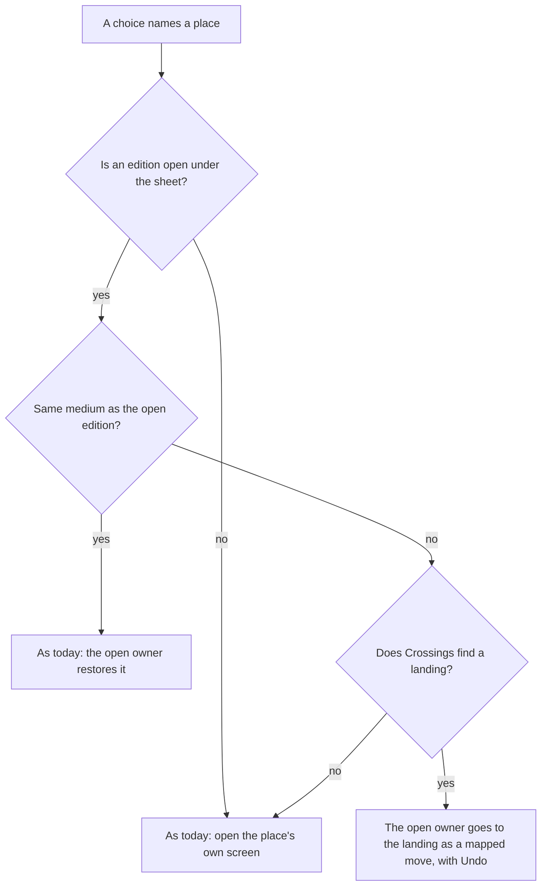
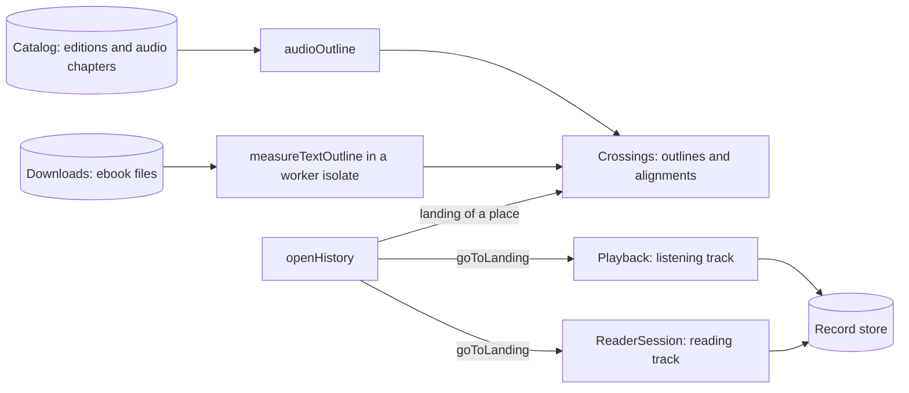
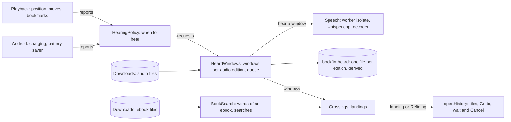

# Go to a place of the other edition inside the open edition

Epic: boo-z3is, under boo-fs0n. Written 2026-11-11 with two designs, A and B. Status: the user chose design A (see "Decision" at the end). Steps 2 to 8 of design A are built, with the self-check of boo-bxap. Design B is not scheduled. Ticket boo-snng prototyped speech search and an anchor map: see "Speech search prototype" at the end, with two build designs and questions for the user.

Read this with three other documents:

- `docs/plans/bookfin.md`: the edition model, the personal record store and sync.
- `docs/plans/reading-history.md`: places, moves, bookmarks and the shared History timeline.
- AGENTS.md: UI rules 1 to 4 and engine rules 1 to 3.

## The request

The user asked on 2026-11-11, in these words:

```text
If the user clicks on a history entry in the reader, even if it was a location in the audiobook, we try to map that location to what it would be in the e-book and jump there, and vice versa if they click on a location in the listener that was a reader location. We should still keep the histories conceptually separate, though, so that they are two separate tracks of history with separate icons and so on, so that they know if they are risking an exact location jump by jumping to a history, and so that, like, if you jump to a reader location in your audiobook, it's easy to go back to the location you are at in your audiobook, without messing up the location in the e-book at all.
```

The goal is to read and listen together, as on a Kindle.

## Terms

The terms of `docs/plans/reading-history.md` apply: place, move, bookmark, timeline and Undo offer. This design adds these:

- Open edition: the edition that the screen under the History sheet shows. It is the audio edition in the player and the ebook edition in the reader. The book page and the Listening tab have no open edition.
- Track: the moves and bookmarks of one medium of a book. Playback owns the listening track. `ReaderSession` owns the reading track.
- Counterpart: the place in the open edition that holds the same words as a place of another edition.
- Landing: the counterpart that Bookfin found for a choice, and how it found it. "By chapters" is an estimate. "By speech" is the spoken sentence.
- Mapped move: a move in the open edition's track that ends at a landing. It also records the place of the other edition that it went to.
- Audio outline: the chapters of an audio edition, each with its title and its start in milliseconds from the edition's start, and the edition's length.
- Text outline: the contents entries of an ebook edition, each with its title, its depth and its start in visible characters from the book's start. A visible character is a character of the body text that is not white space, as `BookMap` counts it. The outline also holds the visible characters of each part: an EPUB section or a PDF page.
- Anchor: an audio chapter start and a contents entry start that the matcher pairs.
- Span: the audio time and the text between two neighboring anchors.
- Page: in this document, 582 visible characters. That is the median page of the corpus books at 412 × 671 px with 20 px text. A narrator reads one page in about 51 s, at the measured median of 11.4 visible characters per second.

## What changes

| Situation | Today | After |
| --- | --- | --- |
| Go to on a listening entry in the reader | Closes the reader and opens the player at that time | Stays in the reader and shows the counterpart page, as a reading move with Undo |
| Go to on a reading entry in the player | Opens the reader at that place | Stays in the player and plays from the counterpart time, as a listening move with Undo |
| No defensible counterpart | Not applicable | As today, and the entry says why before the tap |
| Go to on the book page or the Listening tab | Opens the screen of the entry's medium | Unchanged |
| Go to on an entry of another edition of the same medium | Opens that edition | Unchanged |
| The other edition's place, track and bookmarks | Unchanged by a jump | Unchanged by a jump |
| The timeline rail | One rail, a glyph of the medium on each entry | Two lanes, one per medium, each with its own glyph and its own line |

## Measured facts

### Method

The user's library was not measured. Its saved copies on this Mac and on the shared emulators hold only the 14-book demonstration library. A measurement on the server needs a sign-in. Ticket t3-a4fi measured the real library later. "Measured on the user's library" gives its result. The data of this section is public:

- 155 LibriVox recordings of 29 works. Their public section lists give each section's title, length and readers.
- 39 EPUB editions of the same works from the reader corpus (`tool/reader/epub_corpus.json`): Standard Ebooks and Project Gutenberg.
- 206 pairings of one recording and one ebook edition. In 138 of them, one person reads the whole book, as in a commercial audiobook.

The scripts are in `tool/research/cross_edition`. The matcher there is a prototype of design A's matching, described under design A.

`docs/research/jellyfin.md` holds the only facts about the real library: 27 of 30 sampled audiobooks had embedded chapters, one sampled MP3 had 21 chapter starts, and one sampled M4B had four.

### Chapter titles and counts

- Audio section titles: 55% give a number only ("Chapter 03"), 22% a number and words ("1: Loomings"), and 23% words only ("Down the Rabbit-Hole"). No LibriVox section is named "Track 01".
- Counts rarely agree. Only 38 of the 201 pairings with an anchor have as many audio sections as ebook entries at the chapter level. Ebook contents also list title pages, imprints, dedications, endnotes, licenses and, in some Gutenberg books, illustrations.
- 32 of 155 recordings read front matter as a section of its own.
- 15 recordings split chapters into parts ("Chapter 1, Part 2").
- 11 recordings number chapters inside volumes ("Volume 2, Chapter 3") where the ebook numbers them through the book, or the reverse.
- 10 recordings merge chapters into one section ("Chapters 1-3").
- 8 recordings are dramatic readings or stage adaptations.
- Titles alone mislead. The Gutenberg "A Christmas Carol" lists an illustration titled "Marley's Ghost" 20,000 characters after the stave of the same name. Numbers alone pair "Volume 3, Chapter 19" with chapter XIX.

### Matching result

With titles, a tie-break by the whole-book share, a check of the reading rate and an ordinal fill (see design A):

- 175 of 206 pairings anchor 90% or more of their audio sections. Titles alone reach 90% in 158 pairings.
- 15 pairings anchor fewer than half of their sections.
- 8 pairings have fewer than two anchors, so design A refuses them. Examples: a Walden recording titled "Chapter 1, Part 1" against an ebook whose chapters are titled "Economy", and a four-act stage adaptation of Pride and Prejudice.

### Placement error

The measurement hides one known chapter start at a time and places it from the other anchors. The table covers 2,900 chapter starts: those of the 127 one-reader pairings with at least five title anchors.

| Method | Median error | 90th percentile |
| --- | --- | --- |
| Whole-book share: time share equals character share | 5.2 pages (4.4 min) | 22.4 pages (19 min) |
| Only the first and the last matched chapter | 3.0 pages (2.6 min) | 13.3 pages (11 min) |
| Matched chapters (design A), one start hidden | 0.36 pages (18 s) | 1.39 pages (69 s) |

- A hidden start lies in the middle of a span of two chapters, which has a median length of 46 pages. A place inside one matched chapter has a shorter span, so these numbers are an upper bound for it.
- The error grows with the span. It is 0.8% of the span's length at the median and 2.7% at the 90th percentile.
- Recordings with several readers double the error: 0.74 and 3.35 pages.
- Most whole-book error comes from text that only one edition has: front matter, endnotes, and the Project Gutenberg license of about 14,000 characters (24 pages).
- A direct check inside chapters agrees. The speech probe below found the true place of 12 windows in three one-reader chapters of 13 to 45 pages. Design A's estimate was 0.03 to 0.72 pages away (1 to 34 s), with a median of 0.18 pages (8 s).

### Speech probe

The probe used whisper.cpp 1.9.5 from nixpkgs with the English models tiny.en and base.en. It transcribed 15 s at 20, 40, 60 and 80 percent of three LibriVox chapters, and searched the words in the matching Standard Ebooks chapter.

- All 12 windows were found at one clear place. 10 to 12 of the first 12 transcribed words matched in order. The best other place matched 3 to 6.
- Time per window on the CPU only, with 4 threads, on an Apple M1 Max at a load of 17 on 10 cores: tiny.en 0.7 to 0.9 s (2.0 to 2.5 CPU seconds), base.en 1.05 to 1.26 s (3.3 to 4.4 CPU seconds). The times include the load of the model. Whisper pads each window to 30 s, so a 30 s window costs the same.
- Model files: tiny.en 78 MB at 16 bits, 44 MB at 8 bits, 32 MB at 5 bits. base.en 148, 82 and 60 MB. The 5-bit tiny model gave the same words.
- `docs/research/on-device-tts.md` finds that a Pixel 8 needs 2.0 to 2.7 times the Mac's time at 4 threads. So one window takes about 1.4 to 2.5 s with tiny.en and 2.1 to 3.4 s with base.en on the phone. This estimate is not measured on a phone.

### Limits of the measurement

- Commercial audiobooks differ from LibriVox. One narrator reads, and no spoken notice of 15 to 20 s starts each section. That notice adds to the measured error, so commercial recordings can do better. Chapter marks come from the publisher or from a ripping tool: "Chapter 1", "Track 01", "Opening Credits", or none.
- PDF editions were not measured. A MOBI book converts to EPUB first, so it behaves as an EPUB.
- Abridged recordings and other translations appear only as the refusals above.

## Measured on the user's library

Ticket t3-a4fi measured design A on the user's Jellyfin library on 2026-11-11, with the shipped code of commit 7d3ccb16. A scratch test outside the repository ran these functions:

- `buildBooks` and `possibleMatches`, to pair editions as the catalog does.
- `audioOutline`, for the audio outline.
- `measureDownloadedOutline`, for the text outline of EPUB and AZW3 files.
- `alignEditions`, for the result.

A copy of the matcher with its steps exposed counted the anchors of each step. It agreed with `alignEditions` on every pairing. The requests were read-only. The scripts and the downloaded books were deleted after the run. This section gives counts only. Letters replace book titles, and W replaces a title word.

### The library

- 1,478 audiobook items, each one file: 1,095 MP3, 347 M4B and 36 M4A. Bookfin makes each item an audio edition of its own book.
- 24 ebook items: 12 EPUB and 12 PDF. No MOBI.
- Bookfin's automatic grouping needs a series, a title and an author that agree. It pairs no ebook with an audio edition. The catalog's suggestion (`possibleMatches`) offers an audio book for 2 of the 24 ebooks.
- A looser search by title words and author finds no other counterpart. For each of the other 22 ebooks, the best audio title shares at most half of the ebook title's words, and its author differs.

So the library holds 2 books with both editions, in 3 pairings, because one book has two recordings. Both ebooks are EPUB. No PDF ebook has an audio counterpart, so PDF support (t9-nl30) changes no result here.

Three pairings are too few to set thresholds. So the measurement also used the user's own recordings of 9 public-domain works. It paired them with the EPUB editions of these works in the reader corpus (`tool/reader/epub_corpus.json`). This gave 10 recordings and 15 pairings. One pairing used an AZW3 file, which went through the MOBI path. The chapter marks of these pairings are the user's real commercial marks. The ebooks are Standard Ebooks and Project Gutenberg editions, not the user's commercial ebooks.

### Chapter marks of all 1,478 recordings

Each recording has the class of most of its chapter titles. The classes are a heuristic of the scratch test, not of Bookfin. Some "words only" titles are track codes such as "W157".

| Class | Example shapes | Recordings | Share | Median chapters |
| --- | --- | --- | --- | --- |
| No chapter marks: one chapter named after the file | none | 357 | 24.2% | 1 |
| Generic: track, disc or file names | "Book A 044", "D03T10 The W W", "Book A 33" | 350 | 23.7% | 25 |
| Number and words | "72. W", "61 W", "6. The W W W W" | 275 | 18.6% | 21 |
| Labeled number | "Chapter 9", "Part 2, Chapter 7", "Part 16" | 217 | 14.7% | 28 |
| Words only | "Introduction: W the W", "The W W W" | 176 | 11.9% | 35 |
| Bare number | "068", "80" | 103 | 7.0% | 31 |

- 1,121 recordings (75.8%) have chapter marks. `docs/research/jellyfin.md` sampled 27 of 30.
- 50 recordings with marks start with "Opening Credits". 45 end with "End Credits".
- 146 recordings with marks have inner chapters whose lengths vary by less than 10%. A tool cut them at fixed times.
- The LibriVox sections of the public measurement had no track names and always had marks. In the user's library, 24.2% have no marks, and 30.7% have generic titles or bare numbers. Such titles name tracks or files, not chapters.

### Contents of the user's ebooks

- Bookfin opens 9 of the 12 EPUBs. Two list one contents entry whose file is not in the book, and one fails a ZIP check. Ticket t5-gk30 records this.
- The 9 open EPUBs have 6 to 279 contents entries, with a median of 27. 6 of them use two levels.
- In 7 of the 9, most entries have words only, such as the title of an essay. One numbers its chapters with words ("3. The W W"). One lists 279 entries of the form "Chapter 12".
- So a numbered audio chapter rarely finds a numbered entry in the user's own ebooks. Words-only and number-and-words audio titles can still pair by shared words.

### Matching result

Each row is one pairing of a recording and an ebook edition. "Title pairs" counts the pairs that titles make. "Checked" counts what remains after the rate check. "Filled" counts what the ordinal fill adds. "Depth" is the contents depth of most anchors. "Coverage" is the share of the recording that the spans cover. "Right" is a hand label from the title shapes and the anchor places: yes when the anchors name the same chapters. "Hidden error" is the median leave-one-out error: each inner anchor is hidden and placed from its two neighbors, in pages.

| Book | Source | Ebook | Audio class | Audio chapters | Entries | Depth | Title pairs | Checked | Filled | Anchors | Coverage | Result | Right | Hidden error |
| --- | --- | --- | --- | --- | --- | --- | --- | --- | --- | --- | --- | --- | --- | --- |
| A | Server | EPUB | Number and words | 7 | 12 | 0 | 5 | 5 | 0 | 5 | 0.91 | Matched | Yes | 0.64 |
| B | Server | EPUB | Labeled number | 16 | 23 | | 0 | 0 | 0 | 0 | 0 | `fewMatches` | No anchor exists | |
| B | Server | EPUB | Labeled number | 4 | 23 | | 0 | 0 | 0 | 0 | 0 | `fewMatches` | No anchor exists | |
| C | Corpus | EPUB | Labeled number | 33 | 39 | 1 | 13 | 12 | 0 | 12 | 0.35 | `partCovered` | Yes | 0.14 |
| C | Corpus | EPUB | Labeled number | 33 | 32 | 0 | 13 | 12 | 0 | 12 | 0.35 | `partCovered` | Yes | 0.14 |
| D | Corpus | EPUB | Bare number | 39 | 46 | 1 | 38 | 33 | 5 | 33 | 0.91 | Matched | No | 6.04 |
| D | Corpus | EPUB | Bare number | 39 | 42 | 0 | 38 | 33 | 5 | 33 | 0.91 | Matched | No | 6.04 |
| E | Corpus | EPUB | No chapter marks | 1 | 102 | | 0 | 0 | 0 | 0 | 0 | `noChapters` | No anchor exists | |
| E | Corpus | EPUB | Labeled number | 3 | 102 | 1 | 3 | 3 | 0 | 3 | 0.68 | Matched | No | 220.9 |
| F | Corpus | EPUB | Labeled number | 98 | 25 | 1 | 18 | 12 | 3 | 12 | 0.14 | `partCovered` | No | 31.1 |
| F | Corpus | EPUB | Labeled number | 98 | 87 | 1 | 18 | 12 | 3 | 12 | 0.14 | `partCovered` | No | 20.4 |
| G | Corpus | EPUB | Labeled number | 248 | 251 | 1 | 246 | 239 | 0 | 239 | 1.00 | Matched | Yes | 0.16 |
| H | Corpus | EPUB | Number and words | 43 | 55 | 2 | 14 | 10 | 0 | 10 | 0.63 | Matched | No | 3.19 |
| I | Corpus | EPUB | Bare number | 57 | 100 | 2 | 11 | 7 | 3 | 7 | 0.10 | `partCovered` | No | 3.91 |
| I | Corpus | EPUB | Bare number | 57 | 63 | 0 | 11 | 7 | 3 | 7 | 0.10 | `partCovered` | No | 3.92 |
| I | Corpus | AZW3 | Bare number | 57 | 63 | 0 | 11 | 7 | 3 | 7 | 0.10 | `partCovered` | No | 3.92 |
| J | Corpus | EPUB | Generic | 21 | 24 | 0 | 20 | 18 | 2 | 19 | 0.99 | Matched | No | 6.21 |
| K | Corpus | EPUB | Labeled number | 3 | 6 | 0 | 3 | 3 | 0 | 3 | 1.00 | Matched | Yes | 0.53 |

In sum, over 18 pairings, 13 recordings and 11 books:

| Outcome | Pairings | Share |
| --- | --- | --- |
| Matched, right anchors | 3 | 17% |
| Matched, wrong anchors | 5 | 28% |
| Refused, `partCovered` | 7 | 39% |
| Refused, `fewMatches` | 2 | 11% |
| Refused, `noChapters` | 1 | 6% |

So design A refuses 10 of 18 pairings (56%). 2 of these refusals (book C) lose right anchors. The other 8 refusals have no right anchor to find. Of the 3 pairings of the user's own ebooks, design A matches 1 and refuses 2 (`fewMatches`).

### Why pairings fail

1. Titles that number tracks, not chapters. Books D and I have "001" to "039" or "057". Book H has CD track names with a disc part. Book J has "01 Book J" to "21 Book J", where track 01 holds the credits and the preface. These numbers pair with chapter numbers by chance. The spans of such chance anchors read at 0.54 to 1.99 times their median rate. That is inside the band, so the rate check keeps most of them. Design A matches D, H and J and lands a chapter or more away from the true place. In J, every landing is one chapter late. Design A refuses I only because its chance anchors cover 10% of the recording.
2. "Chapter N" marks that a tool cut. Book F has 98 marks for 18 episodes. Their numbers also pair by chance. The coverage limit refuses F at 14% to 16%.
3. An ebook that collects several works. Book E's three anchors land in three different works. With three anchors there are two spans, and the median is one of them, so the rate check cannot fail.
4. Numbered audio chapters against contents entries with words only. Book B makes no title pair, so `fewMatches`.
5. Chapters numbered inside volumes, with "Volume 2" as an audio chapter of its own, and a long final "End Credits" chapter. Book C's 12 anchors in volume 1 are right. The tail gap holds 19 audio chapters for 16 entries, so the ordinal fill does not run. The anchors cover 35%, so `partCovered`.
6. No chapter marks: one recording of book E, so `noChapters`.

The three right matches place a hidden chapter start 0.16 to 0.64 pages from its known start at the median. That agrees with the LibriVox result above.

The largest pairing (248 audio chapters against 251 entries) took 110 ms in `alignEditions`, in a test on the M1 Max. The others took 7 ms or less.

### Thresholds

| Threshold | Now | Evidence | Recommendation |
| --- | --- | --- | --- |
| Rate band | 0.5 to 2 times the median rate | Bands from 1/3 to 3 down to 0.75 to 1.33 change no result. The check removes anchors and never refuses a pairing. The right pairings keep all their anchors even at 0.67 to 1.5. The wrong matches keep 3 to 36 anchors at every band. | Keep 0.5 to 2. A narrower band does not catch chance anchors. |
| Coverage limit | Half of the recording | It refuses 7 pairings. 5 have chance anchors at 5% to 16% coverage. 2 have right anchors at 35% (book C). | Lower it to 0.3. This keeps book C, and every wrong pairing here stays refused. The evidence is one book. No abridged recording was in the sample, so the limit's first purpose is not tested. |
| One-page margin | 582 visible characters, or 51 s | In the right pairings, 0 to 40 s of audio lie before the first anchor (opening credits and a volume mark). 1.4 to 24.5 pages of front matter lie before the first anchor in the text. A place in 40 s of credits lands at most 0.8 pages before chapter 1, inside the margin. | Keep it. |

The thresholds alone do not stop the wrong matches. The measurement suggests one new refusal, a self-check of design A by its own placement:

- Design A hides each inner anchor in turn and places it from its two neighbors. If the median distance from the known start is more than 2 pages, design A refuses the pairing.
- Right pairings: 0.14 to 0.64 pages on the user's recordings, and 0.22 to 1.25 pages on the nine LibriVox fixtures in `test/crossings/fixtures`. The largest value is "A Christmas Carol", whose staves are long.
- Wrong pairings: 3.19 to 220.9 pages.
- Assume this rule and a coverage limit of 0.3. Then design A matches 5 of the 18 pairings, all with right anchors, and refuses 13.
- The check needs at least three anchors. A pairing of exactly two anchors stays unchecked. None occurred in this sample.
- The spread of span rates separates less well. Its 90th percentile is 1.19 times the median rate or less in right pairings and 1.43 to 1.84 in most wrong ones. But it misses book E (1.0) and book I (1.2).

As built in boo-bxap:

- `alignEditions` runs the self-check after the coverage limit, which is now 0.3. A pairing that fails both gets the coverage reason.
- The limit is two pages for every chapter length. The error of a hidden anchor grows with the length of its chapters, so a right pairing of a few very long chapters can fail. "A Christmas Carol" (five staves) is at 1.25 pages.
- A chance pairing by numbers with exactly three anchors can pass, when its two spans read at about the same rate. Ticket t3-b7wc measures a check of this case.
- The new refusal is `Refusal.misaligned`. Its note reads "The chapters of these editions do not line up, so this opens the audiobook."
- A pairing of exactly two anchors has no inner anchor to hide. It is kept only when both anchors pair by the words of their titles, such as "Marley's Ghost" with "MARLEY'S GHOST.". A pairing by numbers alone or by the ordinal fill is refused as `fewMatches`. The reason is the evidence above: all 5 wrong matches paired titles by their numbers, as track numbers or as the chapter numbers of several works. So a titled number match is no evidence that a pairing is right. The measurement found no wrong match that shared title words caused. No two-anchor pairing occurred, so this rule costs no measured match.
- `test/crossings/alignment_test.dart` reproduces two of the wrong shapes: tracks one chapter late, with the credits and the preface in track 01 (book J), and a work of three chapters against an anthology of three works (book E). The self-check refuses both. The seven public recordings that matched still match.

With the rule, design A refuses 72% of these pairings, where it now refuses 56%. A refusal sends Go to to the other screen, as today. A wrong match plays or shows the wrong chapter with the word "about". The user chose the refusal for chapters that do not match ("Decision", item 3).

### Limits of this measurement

- 18 pairings of 13 recordings and 11 books. Only 3 pairings use the user's own ebooks.
- The corpus ebooks are public editions. The user's commercial ebooks name chapters with words more often.
- The labels "right" and "wrong" come from a reading of the title shapes and the anchor places, not from a sentence-level check.

## What each technique was made for

| Technique | Made for | Our situation | Verdict |
| --- | --- | --- | --- |
| Proportional placement inside matched chapters (design A) | An estimate from metadata that both editions already carry. It assumes a steady reading rate inside a chapter. | The same metadata exists: Jellyfin chapter marks and EPUB contents. | Fits. Measured above. |
| Kindle Whispersync for Voice and Immersion Reading | Pairs of a Kindle book and an Audible recording that Amazon sells together. Amazon prepares the sync data of each pair ahead of time, and the apps look places up in it. Target: the spoken word highlighted. | Arbitrary editions from Jellyfin. No server prepares sync data. The phone is often offline. | The product idea fits. The technique does not transfer. |
| Storyteller and similar read-along builders | A home server transcribes a whole audiobook with Whisper, aligns it with the EPUB once, and writes EPUB 3 media overlays. Target: word highlighting for a whole book. It transcribes every hour of audio, so it needs much server CPU time or a GPU. | One place at a time, on a phone, at a tap. | Whole-book alignment is out of scale for a phone. Transcription of one window, then a word search, transfers. |
| Forced aligners: aeneas, Gentle, Montreal Forced Aligner, WhisperX | Desktop tools that align a known transcript with its audio, word by word, in batches | Bookfin does not know which text a window holds until it finds it. | Not needed. A transcription and a word search find the sentence. |
| Whisper tiny or base through whisper.cpp (design B) | Offline transcription of 30 s windows of general English on laptops and phones | 30 s windows of clean narration | Fits. Measured above. |
| Android's on-device `SpeechRecognizer` | Dictation from the microphone. Android 13 added audio from a file. Models and languages differ by phone, and it promises no word times. | One app on many phones | An option to test later, not a base |

In the reader, design B's gain is a step from about a third of a page to the sentence. In the player, it is a step from about 18 s to about 1 s. Its constant cost is a model download, a native runtime, an audio decoder and 1.4 to 3.4 s per window on the phone. Bookfin pays it once for each Go to, never for a whole book.

## The model that both designs share

### One routing rule

Today `openHistory` sends each choice to the owner of the chosen place's medium. That owner shows the place in the place's own edition, and the sheet brings that medium's screen to the front.

After this change, the rule is one rule for every choice:

1. A choice goes to the owner of the open edition, the screen under the sheet.
2. A place of the open edition's medium goes to that owner's existing verbs, as today. This covers other editions of the same medium.
3. A place of the other medium goes to its landing in the open edition, as a mapped move.
4. When no landing exists, when the place belongs to another book, or when nothing is open, the choice behaves as today.



### Owners

| Fact or decision | Owner | Readers |
| --- | --- | --- |
| Listening track, listening Undo offer, listening bookmarks | `Playback`, unchanged | Player, timeline controller |
| Reading track, reading Undo offer, reading bookmarks | `ReaderSession`, unchanged | Reader, timeline controller |
| Audio outline of an audio edition | `audioOutline(Edition)`, a pure function of the catalog. `Playback.chapters` uses it too. | `Crossings`, `Playback` |
| Text outline of an ebook edition | `measureTextOutline` for an EPUB or MOBI, in a worker isolate. `PdfRuntime.measureOutline` for a PDF, on PDFium's worker isolate. | `Crossings` |
| The anchors of a pair of editions, and the landing of a place | `Crossings`, a new app-wide data source. It keeps the outlines and alignments that it derives. | Timeline controller |
| Which landing a choice uses, and the fallback | `openHistory`, the timeline controller | `HistoryTimeline` |
| A landing in words | The open owner: `Playback.describe` for an audio landing, `ReaderSession.describeLanding` (new) for a text landing | `HistoryTimeline` |



`Crossings` reads records and files. It writes no record. Only the open owner writes, and only its own track.

### Usage code

The controller's call for Go to on a place of the other medium. This is proposed code.

```dart
final landing = await crossings.landing(place, into: openEdition);
if (landing == null) return goAsToday(place, restore);
await switch (landing) {
  AudioLanding() => playback.goToLanding(landing, kind),
  TextLanding() => reader.goToLanding(landing, kind),
};
```

where

- `crossings` = the app's one `Crossings`.
- `place` = the place that the choice names: where an entry's move began or ended, or a bookmark's place.
- `openEdition` = the edition of the screen under the sheet.
- `landing` = the counterpart of `place` in `openEdition` and how it was found. If no defensible counterpart exists, it is null.
- `restore` = the call that restores the place through its own owner, as today, for example `reader.restoreHistory(event.id)`.
- `goAsToday` = today's `go(place, restore)` in `openHistory`: close the sheet, restore the place in its own edition, show its screen.
- `kind` = the kind of the choice: `historyRestore` for a move, `bookmarkRestore` for a bookmark.
- `goToLanding` = the new verb of each owner. It goes to the landing as a move of `kind` in its own track.

The payload:

```dart
/// Where a choice on a place of another edition lands in the open edition.
sealed class Landing {
  /// The place of the other edition that the choice named.
  Place get from;

  /// How Bookfin found the landing.
  MatchedBy get matchedBy;
}

final class AudioLanding extends Landing { final AudioPosition place; ... }
final class TextLanding extends Landing { final BookPlace place; ... }

enum MatchedBy { chapters, speech }
```

where

- `AudioLanding.place` = a time in the open audio edition, in the form that Playback already restores.
- `TextLanding.place` = a part of the open ebook and the share of the part's visible characters before the landing. It is the target form that `BookMap` and the navigator's `seek` already use.
- `MatchedBy.chapters` = an estimate from matched chapters. The words of such a landing say "about".
- `MatchedBy.speech` = the sentence that the speech stage found. Only design B makes it.

### Records

`HistoryEvent` gets two optional fields. A mapped move has both. Every other move has neither, so its JSON stays byte for byte as it is.

```json
{"id": "5a1c…", "at": "2026-11-11T21:40:00.000Z", "kind": "historyRestore",
 "before": {"edition": "…", "source": "…", "revision": "…", "anchor": "{…}"},
 "after":  {"edition": "…", "source": "…", "revision": "…", "anchor": "{…}"},
 "bookTitle": "Moby-Dick", "editionLabel": "EPUB",
 "counterpartOf": {"edition": "…", "source": "…", "revision": "…", "milliseconds": 3735000},
 "matchedBy": "chapters"}
```

where

- `before` and `after` = places of the open edition, as in every move.
- `counterpartOf` = the place of the other edition that the move went to the counterpart of. Its keys tell its medium: `milliseconds` for audio, `anchor` for text.
- `matchedBy` = `chapters` or `speech`.

`HistoryEvent.fromJson` reads named keys only, so an older build reads a mapped move as an ordinary history restore. No migration is needed.

### The move, Undo and the other edition

- The kind of a mapped move is the kind of the choice. Its before is the shown place. Its after is the landing. The rules of moves in `docs/plans/reading-history.md` apply unchanged: the pending move, the first reported place, and one change set for the move and the new place.
- Undo is the open owner's Undo offer, as after any move. It returns to the exact place before the jump. So after a jump to a reading place in the player, Undo returns to the audiobook's own place.
- No record of the other edition changes: not its resume, not its track, not its bookmarks. The other owner is not called. A test with a store spy proves that a mapped jump writes nothing in the other medium's domain.

### What the person sees

The timeline keeps one list per book, newest first and grouped by day. It shows each medium as its own track:

1. The rail has two lanes: listening on the left and reading on the right. Each lane has its own line. An entry sits in its medium's lane with its medium's glyph.
2. A row keeps its own place in its own words. A listening entry in the reader still reads "1:02:15".
3. An open entry of the other medium shows where its places land. If no landing exists, the entry says why and which screen Go to opens: "The chapters of these editions do not match, so this opens the audiobook."
4. Each choice that goes to a place names the landing. By chapters, it reads "about p. 134" or "about 1:02:15". By speech, it reads "p. 134". If Go to switches screens as today, the choice names the place in its own words, such as "1:02:15", beside the reason of item 3.
5. A mapped move appears in the open edition's lane: "Went to about where you listened", "Went to where you listened" by speech, or "Went to about a listening bookmark". The timeline now shows "From audiobook" or "From audiobook bookmark", and a screen reader reads the longer words ("Short row labels" in `docs/plans/history-choice.md`).

| Time | Listening lane | Reading lane | What happened | Place |
| --- | --- | --- | --- | --- |
| 9:41 PM | line | book glyph | Went to about where you listened | p. 134 |
| 9:40 PM | line | book glyph | Opened | p. 120 |
| 8:15 PM | headphones glyph | line | Paused | 1:02:15 |

The timeline gets one new input: `landingOf(place)`, the words of where a choice that names `place` lands. For a place of the open edition's medium, it equals `describe(place)`. boo-hyl4 redesigns the before and after choices in the same sheet. Whatever buttons it picks name their places through `landingOf`, so this design does not depend on its outcome.

As built in t9-4v0r, on the Before, After and Go to tiles of boo-hyl4:

- A tile of a place of the other medium names its landing, such as "about p. 134", and its detail line names the landing's chapter in the open edition.
- If no landing exists, the tile keeps the place's own words, such as "1:02:15". A note says why and which screen opens. An example: "The chapters of these editions do not match, so this opens the audiobook." The note wraps, so the whole reason shows. When both ends of a move share one note, it shows once, under both tiles, and each tile still reads it to a screen reader.
- The sheet starts the alignment of the open edition with the book's editions of the other medium as it opens. Until the alignment arrives, a tile shows the place's own words. When `Crossings` notifies, the landing words replace them. Only the open tiles follow that signal.
- In the reader, a landing reads as its page by the open book's map, as every reading place does. The map knows the pages only after the reader lays out the book. Before that, the tile names the landing by its share of the book's visible characters and by its chapter. The text outline gives both, for example "about 23%" and "Chapter 4". Then the tile changes to "about p. 134" (t9-m4fw). The landing carries its share and its chapter, so the reader does not need the outline. Where the map names no chapter, as in a PDF, the chapter still comes from the outline.
- Before the reader shows the book at all, Go to cannot show the landing in it. Then the tile keeps the place's own words, such as "1:02:15". The tile names a landing exactly when Go to can show it.
- When the history holds one medium, the rail keeps its one lane.

### Bookmarks of the other edition

- Go to on a listening bookmark in the reader is a mapped move of kind `bookmarkRestore`, with Undo. The same holds for a reading bookmark in the player.
- The Bookmarked state, the scrub bar marks and the position slider marks show only the open edition's bookmarks, as today.
- Name, Rename and Delete still change the bookmark through its own owner. They are explicit actions on that record, not a change of place.
- No bookmark is copied into the open edition.

### Fallback when no landing exists

`Crossings` gives no landing in these cases. Design B removes some of them, as its section says.

1. The audio edition has no chapter marks, or the ebook has no contents.
2. Fewer than two anchors survive the rate check. Two anchors also count as too few unless both pair by the words of their titles (boo-bxap).
3. The place lies more than one page (45 s) outside every span. Such places are in text that only one edition has, for example an introduction that the narrator does not read.
4. The anchors cover less than three tenths of the audio time. This catches abridged recordings and other editions. Until boo-bxap, the limit was half.
5. The anchors fail the self-check: hidden one at a time, the inner anchors land more than two pages from their own starts, at the median. The note says "The chapters of these editions do not line up" (boo-bxap).
6. In the player: no text outline exists for the ebook edition, because this phone never downloaded it.
7. The ebook is a PDF without bookmarks. Its outline has no contents entries, so the note says that one of the editions has no chapters (t9-nl30).

Then the choice names the place in its own words ("1:02:15"), a note says why and which screen opens, and Go to behaves as today. One more case gives no landing: Bookfin cannot read the downloaded ebook, as for a damaged or encrypted PDF.

### The PDF outline

As built in t9-nl30, `pdfOutlineOf` makes the text outline of a PDF edition:

- Each source page is a part, named `page:N` as a PDF place names its page. A part holds the visible characters of the page's text layer, as the reader extracts it.
- Each bookmark is a contents entry at its nesting depth, in the order of the outline. The matcher pairs titles at every depth, as it does with the levels of an EPUB's contents. The ordinal fill uses the depth of its neighboring anchors. So the PDF path needs no choice of one level.
- A bookmark starts at its page, after the visible characters above its place there. An /XYZ destination names the height of its place. Other destinations start at the top of their page.
- A PDF reading place lies at the start of its source page. In the reader, a landing in a PDF shows the start of its page. Ticket t3-tkpa can place a reading place of the PDF text view inside its page.
- A page without a text layer is a picture or a blank page when at least half of the book's pages have a text layer. It holds no characters.
- A book where most pages have no text layer is a scan. Each of its pages without a text layer counts as 1600 visible characters, a printed page of about 330 words. So places fall by pages, the way the scrub bar already measures a PDF. Recognition of every page would cost minutes of phone CPU for one Go to. A refusal would lose every scanned book with bookmarks, and Bookfin reads scanned books.

### Engine rules

- `measureTextOutline` parses every section of the book once, in one `Isolate.run` for each ebook edition. The matching runs in a second hop, once for each pair of editions. Its table has at most about 200 × 200 cells.
- A PDF outline needs PDFium, which runs on pdfrx's one worker isolate. `measurePdfOutline` opens its own handle of the file there and reads all the bookmarks in one step. Then it counts each page's text layer in slices of about 8 ms, as low-priority work. A page that the reader asks for waits at most about one slice, or the time to open the file and read its bookmarks. Only the bookmarks and the counts come back to the UI isolate.
- The first outline of a long PDF reads the text layer of every page. Its time on a phone is not measured yet (ticket t3-l03x). Go to on a listening place waits for the outline.
- `Crossings` keeps each text outline in a small JSON cache, keyed by edition id and file revision, with an atomic write. A removed download keeps its outline, so its reading places still map. A later launch does not parse the book again.
- The History sheet draws at once with each entry's own words. After the alignment arrives, the landing words fill in. No spinner shows.
- A mapped move saves through the existing move path. These new tests prove the data safety of engine rule 3:
  - A refused landing changes no record.
  - A mapped jump writes no record of the other medium.
  - Undo returns to the exact place before the jump.
  - A kill during the save keeps the old place, or the new place with its move.

### Contracts

`Crossings` keeps derived caches that must match their sources, so it gets contracts. Its invariants, which `Crossings.checkInvariants()` checks on demand:

- An outline belongs to the current revision of its edition's file.
- Anchors increase strictly in time and in characters.
- Every span reads at 0.5 to 2 times the median rate of the pair.
- Hidden one at a time and placed from their two neighbors, the inner anchors land at most two pages from their own starts, at the median.
- A landing by chapters lies inside its span, or within one page of it.

## Design A: matched chapters and proportional placement

### How it maps

1. Titles. Each audio chapter title and contents entry title gives a chapter number and its content words. If the title has "chapter", "stave" or "letter", the number is the one after that word. Otherwise it is the last number. Roman numerals and number words count. "1-3" and "1 & 2" are ranges. The content words leave out stop words.
2. Pairing. A dynamic program finds the monotone pairing with the most title agreement. A number match or a shared set of content words makes an anchor. A tie goes to the pair whose time share and character share differ least.
3. Rate check. While a span reads at less than half or more than twice the median rate, the check drops the anchor whose removal helps most.
4. Ordinal fill. In a gap between anchors with as many audio chapters as contents entries at the anchors' depth, the fill pairs them in order. This repairs numbering by volume.
5. Placement. Inside a span, the landing lies at the same share of the span's characters as the place's share of the span's time, and the reverse.
6. Self-check. Each inner anchor is hidden in turn and placed from its two neighbors by the rule of step 5. If the median distance from its own start is more than two pages, the pairing is refused (boo-bxap).
7. Refusal: the fallback cases above.

### Usage example

The person listened to Moby-Dick in the car and paused at 1:02:15. On the train, they open the EPUB in the reader and open History. The pause sits in the listening lane. Its choice reads "Go to about p. 134". A tap shows p. 134 at once. The new reading move says "Went to about where you listened". The sentence that they heard last is on that page or the next one. Undo returns to p. 120.

### Expected error and cost

| Aspect | Value |
| --- | --- |
| Error in the reader | Median 0.18 to 0.36 pages, 90th percentile 1.4 pages |
| Error in the player | Median 8 to 18 s, 90th percentile 69 s |
| Wait at Go to | None. The History sheet starts the alignment of a pair as it opens, and the alignment stays cached. Estimate: 0.1 to 0.5 s for a large EPUB, in a worker isolate. The outline ticket measures it. |
| Phone cost | No model and no download |
| Build work | About six tickets, listed in the order of work |

## Design B: design A, then speech matching of one window

### How it maps

1. Design A runs first. Where design A refuses only because the chapters do not match, design B starts from the whole-book share instead.
2. When an entry of the other medium shows its choices, `Crossings` starts the speech stage in the background.
3. In the reader, for a listening place: decode 30 s of the downloaded audio at the place, transcribe it, and normalize the words. Search them in the text: first within 3 pages of design A's estimate, then in the span, then in the book. Accept a place where at least 6 of 12 words match in order and the best other place matches at most half as many. The landing is the place of the first matched word.
4. In the player, for a reading place: transcribe 30 s at design A's estimate and find those words in the text. Turn the character distance to the reading place into time at the span's rate. Transcribe once more at the corrected time and use the word times there.
5. If the speech landing is ready, Go to uses it. Otherwise Go to uses design A's landing and says "about". It never moves the place twice.

### Usage example

The same person opens the player on the train, after reading to p. 134 the night before. The reading entry's choice first reads "Go to about 1:02:15". About two seconds later, it reads "Go to 1:02:09". A tap plays from the sentence where they stopped reading. Undo returns to the audiobook's own place.

### Expected error and cost

| Aspect | Value |
| --- | --- |
| Error | The sentence: about 1 s of audio, or the first word of the sentence on the page |
| Wait at Go to | Estimate for a Pixel 8: one window (1.4 to 3.4 s) in the reader, two windows (2.8 to 6.8 s) in the player. The background start hides most of it. Go to never waits. If the speech stage is not done, it takes design A's landing. |
| Model | tiny.en at 5 bits, 32 MB, or base.en at 5 bits, 60 MB. Downloaded on first use and kept like the OCR data. English only. Other languages need a multilingual model. |
| Memory | Estimate: 150 to 300 MB while one window transcribes, then released |
| Battery | 2 to 9 CPU seconds for each Go to. No work in the background beyond the open entry. |
| Build work | Design A, then about five tickets: the speech runtime, an audio window decoder for Android and macOS, word normalization and search, the speech stage in `Crossings`, and phone acceptance |

If the read-aloud epic lands first, the speech runtime can share its ONNX Runtime (t0-f9iu). Otherwise whisper.cpp joins the flake as a native dependency with pinned sources. The normalization can reuse the English rules of t0-bv9p in reverse, for example numbers that a narrator speaks.

### When design B falls back to design A

- The audio edition is not downloaded. The media policy does not stream a window for this.
- The speech model is not downloaded, or the book's language has no model.
- The words are not found: an abridged recording, another translation, music.
- The best place is not clear: a refrain or another repeated passage.
- The phone does not finish within 8 s.

### Does design B keep design A unchanged?

Yes. Design B uses design A's estimate and span to limit its search, and it falls back to design A's landing. The outlines, the matcher, the routing, the records, Undo and the words stay the same. Design B adds one stage inside `Crossings` and the value `MatchedBy.speech`. So build design A first. The question for design B can wait until after the person tries design A on real books.

## The two designs side by side

| Design | Placement in the reader | Placement in the player | Chapters that do not match | Wait at Go to | Phone cost | Build work |
| --- | --- | --- | --- | --- | --- | --- |
| A: matched chapters | About a third of a page at the median, 1.4 pages at the 90th percentile, labeled "about" | 8 to 18 s at the median, 69 s at the 90th percentile, labeled "about" | Go to switches screens as today | None | None | About six tickets |
| B: A, then speech | The sentence | The sentence, about 1 s | If the audio is downloaded, speech finds the place | Usually hidden. At worst design A's landing. | 32 to 60 MB model, a few CPU seconds for each Go to | Design A plus about five tickets |

Both designs share these points:

- One routing rule: a choice goes to the owner of the open edition.
- A mapped move in the open edition's own track, with Undo, and no change to the other edition.
- `counterpartOf` and `matchedBy` on `HistoryEvent`, with no migration.
- Two lanes on the timeline rail and the landing in each choice's words. If no landing exists, the detail line gives the reason.
- Bookmarks of the other edition behave as entries do, and nothing copies them.
- Text outlines measured off the UI isolate and kept by edition revision.
- The design does not depend on boo-hyl4's choice buttons.

## Questions for the user

Each question covers one point where the designs differ. Any answer that picks speech brings design B's model and costs, and that work follows design A.

1. Placement in the reader. How exact must a jump from a listening place to the ebook be?
   - Matched chapters (Recommended): the right page or the next one in most cases, instantly, with no download. It costs a look over about a page to find the sentence.
   - Speech: the spoken sentence. It costs a 32 to 60 MB model and about 1.4 to 3.4 s of phone CPU, mostly hidden.
2. Placement in the player. How exact must a jump from a reading place to the audiobook be?
   - Matched chapters: instant and free. It plays 8 to 18 s off at the median and up to about a minute off. The person then uses the short jump buttons.
   - Speech: plays from the sentence. It costs the model and about 2.8 to 6.8 s of phone CPU, mostly hidden.
   - Decide after using design A (Recommended): design B keeps design A unchanged, so nothing is lost. It costs a second decision later.
3. Books whose chapters do not match. If the two editions' chapters cannot be paired, what does Go to do?
   - Switch screens as today, and say why: no download and no wait. It costs the person a trip to the other screen.
   - Find the place by speech: works for numbered parts against titled chapters, missing chapter marks and "Track 01" names. It costs the model, and it needs the audio downloaded.

## Order of work

Design A:

| Order | Work | Depends on |
| --- | --- | --- |
| 1 | t3-a4fi: measure chapter matching on the user's Jellyfin library | A sign-in |
| 2 | Audio outline: one pure function of a catalog edition, used by `Playback.chapters` and `Crossings` | None |
| 3 | Text outline of an EPUB or MOBI edition, measured in a worker isolate and cached by revision, and a text place in characters | None |
| 4 | Edition alignment: titles, pairing, rate check, ordinal fill, placement and refusal. Tests use small fixtures of the measured public data. | 2, 3 |
| 5 | `Crossings`: landings, caches and invariants | 4 |
| 6 | Mapped moves: `counterpartOf` and `matchedBy`, `goToLanding` in `ReaderSession` and `Playback`, with the data-safety tests | 5 |
| 7 | The History sheet: the routing rule, `landingOf`, the detail line, the fallback and the two lanes | 6 |
| 8 | PDF editions: the PDF outline from PDFium bookmarks and characters from the text layer (t9-nl30, see "The PDF outline") | 7 |

The thresholds of step 4 (the rate band, the coverage limit and the one-page margin) can change after step 1 measures the real library. Step 7 and boo-hyl4 both change `lib/playback/timeline.dart`, so they merge one after the other.

If the answers pick speech, design B adds five tickets. All of them follow step 7:

1. The speech runtime and the model download.
2. The audio window decoder for Android and macOS.
3. Word normalization and search.
4. The speech stage in `Crossings`.
5. Acceptance on the Pixel 8.

## Not in this epic

- Counterparts between two ebook editions, for example an EPUB entry while reading the PDF. The saved quote finds the exact place. It fits the same routing rule.
- Marks of the other edition's bookmarks on the scrub bar or the position slider.
- Whole-book alignment in the background and highlighting of the spoken word while listening.
- Keeping the two editions' places in step automatically. The user's rule is that a jump never changes the other edition's place.

## Decision (user, 2026-11-11)

1. Listening place into the ebook: design A, matched chapters. The landing
   is labeled as approximate ("about p. 134").
2. Reading place into the audiobook: build design A now. The user decides
   on speech (design B) after using A on real books.
3. Chapters that cannot be matched: Go to switches screens as today, and
   the entry says why before the tap.

Design B is not scheduled. It stays recorded here for the later decision.

## Speech search prototype

Ticket boo-snng, 2026-11-11. This section measures the user's later idea. It is a prototype and a measurement. Nothing in `lib/` changed.

### The idea

The user asked for "whole book progress" as the first estimate. They accept speech "only if we find it faster", or if it is less accurate but uses a search to make up for it. So the prototype has two steps:

1. A coarse estimate: the whole-book share, or the landing of matched chapters (design A) where the leave-one-out check of boo-bxap passes.
2. Speech recognition on the phone plus a word search near the estimate, to land on the sentence. The search fails early when no place is clear.

The parent task added a second variant, the anchor map. It moves the speech work from the tap to the time of listening.

### Terms

- Window: a stretch of the audiobook that whisper transcribes at once, here 3 to 15 s.
- Coarse estimate: where the place lies before speech, by whole-book share or by matched chapters.
- Search radius: how many pages around the estimate the search reads. The radii grow until a place is clear: 8, 24 and 72 pages, then the whole book. From matched chapters: 3 and 24 pages, then the whole book.
- Confident match: at least 6 heard words, and at least half of them, match the book in order. The best other place, more than 30 words away, matches at most half as many.
- Round: one window and one search in the reading-place loop.
- Reference map: for each recording, where each spoken word lies in the book. It is the measure of truth here.
- Anchor: one audio time and the book word spoken then, found from one window.
- Anchor map: the anchors of one audio edition, kept while the person listens.
- Audio context: the length of audio that whisper's encoder reads. Whisper pads every window to 30 s unless the context is cut to the window's length. "Reduced context" below cuts it.
- Heard words: whisper's words, in lower case, with punctuation and dashes left out and numbers as words. The book's words get the same treatment.

### Method

#### Data

| Source | Recordings | Audio | Ebook | Reference map |
| --- | --- | --- | --- | --- |
| LibriVox, whole books | Alice in Wonderland (900), The Time Machine (5630), Heart of Darkness (64) | 10.6 h, one reader each | Standard Ebooks. Heart of Darkness is inside a 2,060,876-character Conrad collection, so the whole-book share is wrong by about 2,300 pages at the 90th percentile. | Every section |
| LibriVox, long books | Pride and Prejudice (1480), Moby-Dick (21919), Jane Eyre (2192) | 53 h downloaded, 5 sections of each transcribed | Standard Ebooks | 15 sections, 4.6 h |
| The user's Jellyfin server | Letters A, B, C, E, G | 52 h. A, C and G are M4B. B is a 64 kb/s MP3. E is a VBR MP3 without chapter marks. C and G have "Opening Credits" and "End Credits" chapters. | Corpus editions of the same works. E and G pair with the Conrad collection. | A stronger reference per place, see below |

- The reference map comes from base.en on the Mac's GPU over whole sections (`speech_truth.py`). It aligns the heard words with the book by word sequences of four that occur once in the book, kept in increasing order. 94% of the heard words got a place. The probe under test never reads it.
- The server recordings have no reference map. There, base.en on 30 s around the place, searched in the whole book with a stricter rule (60% of words, best other place at most 35%), stands in. 148 of 150 places got such a reference.
- The server was read with GET requests only, through a local proxy (`speech_server.py`). Each window fetched byte ranges near its place, plus the M4B index. The private map of letters to items and the server's books were deleted after the run.

#### The harness

- `tool/research/cross_edition/speech_probe` is a scratch Flutter app. It is not wired into Bookfin. The same Dart code places on the Mac (`bin/host_eval.dart`) and on Android (`lib/main.dart`): `text.dart` normalizes words, `search.dart` finds them, and `place.dart` holds the two directions.
- whisper.cpp 1.9.5 runs through Dart FFI and a small C face, `native/speech_probe.c`. The Mac and Android builds compile the same pinned source on the CPU only, with 4 threads, greedy decoding and token times. `nix/whisper.nix` pins the source and six model files. `nix develop .#speech` gives them.
- The Mac is an Apple M1 Max. Other agents loaded it during every run: a load average of 6 to 25 on 10 cores. So the Mac times are pessimistic.
- The emulator is an arm64 Android 16 AVD of my own, with 4 cores, on the same Mac. On Android, MediaCodec decodes each window, and one long-lived worker isolate transcribes and searches.

#### The search

1. Each heard word votes for the diagonals (book word minus heard index) where it occurs in the radius, weighted by its rarity.
2. The eight best diagonals are aligned word by word (longest common subsequence). Words of five letters or more match when they differ in at most one letter after their first four, as "colour" and "color" do.
3. The best alignment wins if it is a confident match. Otherwise the radius grows. If the whole book gives no confident match, the search fails.
4. The search reads the body text only. Back matter (endnotes, colophon, license) is left out. One Moby-Dick endnote quotes a passage that the narrator reads in chapter 45.

#### The two directions

- Listening place into the ebook: transcribe 15 s centered on the place, search near the estimate, and land on the book word of the heard word nearest the place's time.
- Reading place into the audiobook: transcribe 15 s at the estimated time, find the window in the book, and move the time by the words between the window and the target at the reading rate. Repeat until a window holds the target word. Then read the target's time from the token times. Give up after 6 rounds. The first rate is the recording's length over the book's words, kept between 270 and 540 ms per word. Two found windows more than 20 s apart give a local rate.

The reading-place loop changed four times on this data. The first version used the unclamped book rate, so the anthology never converged (80% in all). The second clamped the rate and dropped stray end matches. The third searched the body only and let a window hold the middle of the file it reads. The fourth accepts a target within 12 words of a window's words on the second time in a row, for headings that the narrator words differently. The tables give the fourth version, except the server rows, which ran with the second.

### Timings per step

Medians, with the 90th percentile in brackets. tiny.en at 5 bits (q5_1), 15 s window, full 30 s context, 4 threads.

| Step | Mac M1 Max | Emulator, 4 cores | Phone estimate (Pixel 8) |
| --- | --- | --- | --- |
| Model load | 35 to 66 ms | 106 to 253 ms | Not estimated. Read from flash. |
| Book words, parse and index, once per book | 5 + 2 ms (28k words), 93 + 32 ms (456k words) | 19 + 3 ms (28k words) | Not estimated |
| Decode 15 s from a downloaded MP3 | 90 [123] ms (ffmpeg, with its process start) | 832 [878] ms wall, 73 ms CPU in the app (MediaCodec) | 0.2 to 0.8 s |
| Fetch and decode 15 s from Jellyfin | 198 [399] ms (ffmpeg, bit-rate seek) | MP3 1.30 s, M4B 1.18 s (MediaExtractor) | Network-bound, see "Streaming" |
| Transcribe 15 s | 506 [855] ms, 1.70 [2.95] s CPU | 696 to 785 [1,069 to 1,108] ms, 2.2 to 2.3 s CPU | 1.0 to 1.4 [1.7 to 2.3] s |
| Search, 8-page radius | 0.30 [0.60] ms | 0.67 to 0.74 [1.0 to 1.1] ms | Under 3 ms |
| Search, whole 456k-word book | 5.7 ms, at most 44 ms | Not run | Under 0.12 s |
| One listening place into the ebook | 0.6 [1.0] s | 1.5 to 1.7 s | 1.2 to 2.2 s |
| One reading place into the audiobook, from whole-book share | 1.72 [3.53] s, 5.4 [8.7] s CPU | Not run | 3.4 to 4.6 [7.1 to 9.5] s |
| One reading place into the audiobook, from matched chapters | 1.03 [1.77] s, 3.0 [5.2] s CPU | Not run | 2.1 to 2.8 [3.5 to 4.8] s |

- The emulator's MediaCodec time is mostly the codec process, which runs outside the app, plus a binder call for each of the window's 574 MP3 frames. The harness did not measure that process. A real phone makes these calls faster, and an in-process decoder avoids them.
- The emulator ran the tiny models' transcription at 1.0 to 1.55 times the Mac's time, on the same cores.
- The phone's decode range: 0.2 s is the Mac's ffmpeg time scaled by the factor below, and 0.8 s is the emulator's MediaCodec time.

#### The phone estimate

The estimate multiplies the Mac's time by 2.0 to 2.7. `docs/research/on-device-tts.md` derives that factor for 4 threads on a Pixel 8 (one Cortex-X3 and three Cortex-A715 cores) from Geekbench 6 scores against an M1 Max core. It was made for ONNX Runtime. whisper.cpp's matrix code is different, so the factor is an assumption here. Nobody measured it on a phone. The emulator is no phone either: it runs on the Mac's own cores.

### Accuracy

#### Listening place into the ebook

| Recordings | Estimate | Places | Landed | Same sentence | Within 2 words | Largest error | Wrong page |
| --- | --- | --- | --- | --- | --- | --- | --- |
| LibriVox | Whole-book share | 240 | 239 (99.6%) | 225 (94%) | 235 (98%) | 3 words | 0 |
| LibriVox | Matched chapters | 200 | 200 | 190 (95%) | 198 (99%) | 3 words | 0 |
| LibriVox | No estimate, whole book | 240 | 238 | 224 (93%) | 234 (98%) | 3 words | 0 |
| Server, CBR MP3 and M4B (A, B, C, G) | Whole-book share | 118 | 118 | 111 (94%) | 113 (96%) | Not counted | 0 |
| Server, VBR MP3 without chapter marks (E) | Whole-book share | 30 | 30 | 26 (87%) | 27 (90%) | Not counted | 0 |

- Every sentence miss lies 1 to 3 words from the true word, across a sentence's edge.
- The one refusal was a whisper loop: it repeated one 9-word phrase 15 times. The search refused it, as it must.
- The radius that found the place, from whole-book share on LibriVox: 8 pages for 171 places, 24 for 29, 72 for 1, and the whole book for 38. All 38 whole-book searches were in the Conrad collection, where the share is wrong by hundreds of pages.
- tiny.en at 16 and 8 bits and base.en at 5 bits gave the same result on 60 places: 53 or 54 in the same sentence, none wrong. base.en took 3.5 times as long.

#### Reading place into the audiobook

| Recordings | Estimate | Places | Converged | Rounds: median [90th] | Error: median [90th], largest | Within 1 s | In the target sentence |
| --- | --- | --- | --- | --- | --- | --- | --- |
| LibriVox | Whole-book share (estimate error: median 213 s, 90th 5,498 s) | 147 | 145 (99%) | 3 [4] | 0.20 [0.89] s, 2.19 s | 134 (91%) | 132 (90%) |
| LibriVox | Matched chapters (estimate error: median 8 s, 90th 19 s) | 122 | 122 | 2 [2] | 0.16 [0.81] s, 4.36 s | 116 (95%) | 107 (88%) |
| Server, CBR MP3 and M4B | Whole-book share | 117 | 117 | 3 [4] | 0.30 [1.2] s, 2.35 s | 97 (83%) | Not counted |
| Server, VBR MP3 (E) | Whole-book share | 30 | 27 | 4 [6] | 0.55 [29] s, 38 s | 18 (60%) | Not counted |

- "In the target sentence" means from 0.5 s before its first word to the start of the next sentence. A landing early by a few hundred milliseconds plays the end of the sentence before.
- Rounds from whole-book share: 1 round for 2 places, 2 for 70, 3 for 45, 4 for 19, 5 for 9, 6 for 2. From matched chapters: 1 round for 55, 2 for 66, 3 for 1.
- The two places that did not converge: a chapter's first words right after LibriVox's spoken notice, and a passage where the Standard Ebooks text differs from the edition that the reader read.
- E's errors come from seeking, not from speech. See "Failure modes".

#### Intros, credits and missing chapter marks

- LibriVox notice: 45 windows 5 s into a section, inside the spoken notice ("Chapter 3 of ... This is a LibriVox recording ..."). 24 landed, all at the chapter's start: 0 to 22 words after the first word of the chapter. 21 refused. None landed elsewhere.
- Commercial credits: 4 windows 10 s into an "Opening Credits" or "End Credits" chapter. 3 refused. One landed in the book's last sentences, which the reference confirmed: that "End Credits" mark starts before the text ends.
- No chapter marks: recording E. All 30 listening places landed, none wrong. The whole-book share was wrong by about 1,960 pages at the 90th percentile, because the ebook is an anthology. The growing radius found the place.

### The shortest window

The anchor map transcribes the last L seconds heard before a time. 25 places of each of the 6 LibriVox books, 150 windows for each row. "Near" searches 3 pages around the place, as an anchor map does from its previous anchor. "Whole book" searches everything.

| Window | Context | Near: confident | Near: within 5 words | Whole book: confident | Wrong | Mac CPU [90th] | Mac wall | Emulator wall (CPU) |
| --- | --- | --- | --- | --- | --- | --- | --- | --- |
| 3 s | Reduced | 69% | 61% | 45% | 0 | 288 ms [9.6 s] | 102 ms | Not run |
| 5 s | Reduced | 91% | 83% | 78% | 0 | 398 [627] ms | 139 ms | 128 ms (330 ms) |
| 8 s | Reduced | 99% | 85% | 93% | 0 | 667 [1,256] ms | 230 ms | 211 ms (564 ms) |
| 10 s | Reduced | 98% | 89% | 97% | 0 | 870 [1,493] ms | 297 ms | Not run |
| 15 s | Reduced | 99% | 86% | 99% | 0 | 1,584 [4,234] ms | 498 ms | 400 ms (1,134 ms) |
| 5 s | Full 30 s | 96% | 87% | 87% | 0 | 1,468 [2,355] ms | 426 ms | 502 ms (1,750 ms) |
| 8 s | Full 30 s | 98% | 84% | 95% | 0 | 1,664 [3,223] ms | 504 ms | 534 ms (1,798 ms) |

- The shortest window that still gives a unique, confident match is 8 s with reduced context: 99% near, 93% in the whole book, and none wrong. At 5 s, 1 window in 11 fails near the place, so an anchor must retry.
- "Within 5 words" counts the anchor word, the last word of the window, where whisper's word times are least sure. An anchor off by a few words does not matter next to the interpolation error below.
- A reduced context costs a quarter to a half of the CPU of a full one. It also makes whisper loop on some short windows: the 3 s row's 90th percentile is 9.6 s of CPU. A build must cap the tokens of a window.

### The anchor map

#### Interpolation between anchors

`speech_anchor_map.py` keeps an exact anchor every N minutes of continuous listening and places every fifth word of the reference map between two anchors by straight interpolation, in both directions. The three whole LibriVox books, 17,664 to 18,458 places for each row:

| Anchor every | Into the ebook: median [90th], 99th | Same sentence | Into the audiobook: median [90th], 99th |
| --- | --- | --- | --- |
| 1 min | 0.02 [0.06] pages, 0.19 | 84% | 0.9 [3.0] s, 13 s |
| 2 min | 0.03 [0.09] pages, 0.31 | 75% | 1.4 [4.8] s, 19 s |
| 5 min | 0.06 [0.23] pages, 0.57 | 56% | 2.9 [12.1] s, 30 s |
| 10 min | 0.09 [0.38] pages, 0.85 | 44% | 4.8 [19.6] s, 45 s |
| 20 min | 0.15 [0.55] pages, 0.98 | 32% | 7.7 [27.7] s, 50 s |

- So at 5 minutes, a place between anchors lands on the shown page or the next one at the 99th percentile, with no speech at the tap. The sections of the long books agree up to their length of 10 to 54 minutes.
- In the audiobook, the error is larger at the 99th percentile because LibriVox notices and pauses between chapters hold time without book words.
- A place that has its own window (a bookmark, a jump, a pause) lands on its sentence with a search of its kept words: 0.3 to 0.7 ms on the emulator, no speech.

#### Energy and windows per listening hour

The energy of a window is the phone's estimated wall time times 3 to 6 W for four busy cores. `docs/research/on-device-tts.md` uses the same power. It is an assumption, not a measurement. The Pixel 8 battery holds about 17.7 Wh, or 63.7 kJ.

| Work | Phone time (estimate) | Energy | Share of the battery |
| --- | --- | --- | --- |
| One 5 s window, reduced context | 0.28 to 0.38 s | 0.8 to 2.3 J | 0.001 to 0.004% |
| One 8 s window, reduced context | 0.46 to 0.62 s | 1.4 to 3.7 J | 0.002 to 0.006% |
| One 15 s window, full context | 1.0 to 1.4 s | 3.0 to 8.2 J | 0.005 to 0.013% |
| Anchor map, 8 s every 5 min, plus 4 moves or bookmarks: 16 windows per listening hour | 7.4 to 9.9 s | 22 to 59 J | 0.03 to 0.09% per hour |
| Anchor map, 8 s every 2 min, plus 4: 34 windows per listening hour | 16 to 21 s | 47 to 127 J | 0.07 to 0.2% per hour |
| One listening place into the ebook at the tap | 1.2 to 2.2 s | 4 to 13 J | 0.01 to 0.02% |
| One reading place into the audiobook at the tap, 3 windows | 3.4 to 4.6 s | 10 to 28 J | 0.02 to 0.04% |

- The windows run while the audio plays, so the phone is awake anyway. They need no extra wake-ups.
- One anchor keeps about 150 bytes: a time and the heard words. That is about 2 KB per listening hour.

### Streaming the audio from Jellyfin

| File | Index (moov) | Where | Bytes for one 15 s window |
| --- | --- | --- | --- |
| MP3, 64 kb/s (B) | None needed | Not applicable | 120 KB of audio. ffmpeg read about 1.8 MB: 1 MB at the file's start and 0.8 MB at the place. |
| M4B, 3.8 h (G) | 1.7 MB | File end | Index once, then about 120 KB |
| M4B, 8.6 h (C) | 3.3 MB | File end | Index once, then about 120 KB |
| M4B, 22.9 h, 127 kb/s (A) | 14.2 MB | File start | Index once, then about 240 KB |

- The server sent its first byte in 13 to 15 ms (median) to this Mac. A phone away from home waits longer.
- ffmpeg's exact seek read an MP3 from its first byte: 116 MB for one window. A bit-rate seek fixed it: 0.11 s.
- Android's MediaExtractor asked for open-ended ranges (`bytes=N-`) and read ahead until it closed the stream. It read the M4B index again for every window. A build must fetch bounded ranges and keep each M4B index per edition.

### Model size and memory

| Model | File | Mac, 15 s | Emulator, 15 s | Same sentence (60 places) |
| --- | --- | --- | --- | --- |
| tiny.en, 5 bits (q5_1) | 32 MB | 506 ms | 696 to 785 ms | 53 |
| tiny.en, 8 bits (q8_0) | 44 MB | 567 ms | 566 to 604 ms | 54 |
| tiny.en, 16 bits | 78 MB | 671 ms | 690 ms | 54 |
| base.en, 5 bits | 60 MB | 2,083 ms | 1,246 ms | 53 |
| base.en, 8 bits | 82 MB | Not run | 808 ms | Not run |

- On the emulator's ARM cores, 8 bits ran faster than 5 bits. The Mac runs of the other models ran at a load of 23 to 25, so the Mac column compares poorly.
- The harness, with tiny.en and four books loaded, used 225 MB (PSS), of which 158 MB was native heap.
- English only. Another language needs a multilingual model.

### Failure modes

| Failure | Seen | What happens |
| --- | --- | --- |
| Whisper loops on one phrase | 1 of 240 listening places, and short windows with reduced context | The search refuses. A build caps the tokens of a window. |
| Spoken notice or credits | 21 of 45 notices and 3 of 4 credits refused | Fail early. The other notices landed at the chapter's start. |
| An anthology or wrong edition makes the whole-book share wrong by hundreds of pages | Conrad collection: Heart of Darkness, E and G | The radius grows to the whole book. Listening places still landed. The reading-place loop needs the clamped rate. |
| The ebook repeats a passage | A Moby-Dick endnote quotes chapter 45 | Search the body only. Without that, one place went to the endnote. |
| The ebook's text differs from the read edition | One Moby-Dick passage | Windows there are not confident. The loop steps on and can run out of rounds. |
| A chapter's first words follow a notice or a heading that the narrator words differently | One place | The near-target rule lands it on the second try. One place still failed. |
| A VBR MP3 seeked by bytes | E | A byte seek at 2 h landed about 10 s early. Reading places were off by up to 38 s. Exact times need the frame index from the file's start, so streamed VBR MP3 needs a full read once, or speech only after download. |

No place in this measurement landed on a wrong page. Every failure was a refusal, which falls back.

### Verdict

Speech search works as a correction of the whole-book share. It lands a listening place on its sentence 94% of the time and within 3 words always. It places a reading place within 0.9 s at the 90th percentile. It refused instead of guessing in every hard case seen here.

It is not faster than design A at the tap. Design A answers at once. On the phone, speech at the tap is estimated at 1.2 to 2.2 s for a listening place and 3.4 to 4.6 s for a reading place from the whole-book share (2.1 to 2.8 s from matched chapters). The anchor map makes History fast: it does the speech work while the person listens, for under 0.1% of the battery per listening hour. Then History opens with no speech work, and its landings are within a page at the 99th percentile, or on the sentence for places with their own window.

So the approach is viable if the speech work happens before the tap: in the background when the sheet opens, or in an anchor map. It is the user's decision whether that counts as "faster".

### Two build designs

Both build on design A's routing, records, Undo and words, and both add `MatchedBy.speech`.

| Design | When speech runs | History open | Listening place into the ebook | Reading place into the audiobook | Battery | Build work |
| --- | --- | --- | --- | --- | --- | --- |
| S1: speech at the tap | When the History sheet shows an entry of the other medium | "about" at once, the sentence 1 to 5 s later | 1.2 to 2.2 s, then the sentence | 2.1 to 4.6 s median, up to 9.5 s, then the sentence | 4 to 28 J per jump, only when used | Five tickets, as design B listed |
| S2: anchor map, then speech at the tap | While listening: 8 s every 5 min and at each move or bookmark. At the tap only for places outside the map. | No speech work. Every place in the map has its landing at once. | At once: the sentence for places with a window, within a page otherwise | At once within 12 s at the 90th percentile, then one window (1 to 1.4 s) for the sentence | 0.03 to 0.09% per listening hour, plus S1's cost outside the map | S1's tickets, plus a heard-words store and a listening policy: about seven tickets |

S1 in use: the person reads to p. 134, then opens the player and History. The reading entry says "about 1:02:15". About 3 s later it says "1:02:09". A tap plays from the sentence.

S2 in use: the person listened in the car. A window ran every 5 minutes and at the pause. That evening they open the ebook and History. The pause entry says "p. 134" at once, because the pause has its own window. A tap shows the sentence that they heard last.

Both designs share these points:

- whisper.cpp tiny.en, 8 or 5 bits (44 or 32 MB), downloaded on first use, pinned in `nix/whisper.nix`, run in a worker isolate.
- The normalized word search, body text only, with the confidence rule and the growing radius.
- The coarse estimate: matched chapters where they pass the leave-one-out check, else the whole-book share.
- Fail early, then fall back to design A's landing or to the screen switch of today.
- Audio from the download, or bounded byte ranges from Jellyfin with each M4B index kept per edition. A streamed VBR MP3 gets no speech landing for reading places.
- No change to the other edition's place, track or bookmarks.

In S2, a new data source owns the heard windows of each audio edition: their times and words. Playback reports its position and its moves, and the new owner decides when to transcribe. `Crossings` reads the windows and searches their words in the ebook when History opens. The windows keep heard words, not ebook offsets, so a new ebook revision or another ebook edition reuses them. Places outside the map (old or synced entries, places never played) take S1's path at the tap, or a fill when the phone is idle and charging, newest first, and never in battery saver.

### Questions for the user

1. Which design to build? S2 (Recommended) makes most History landings instant and exact, for under 0.1% of the battery per listening hour, and costs about two more tickets. S1 costs nothing until a jump, and makes each jump wait 1 to 5 s for the sentence, up to about 10 s.
2. How often does the anchor map keep an anchor? Every 5 minutes (Recommended): within a quarter page at the 90th percentile, 0.03 to 0.09% battery per hour. Every 2 minutes: within a tenth of a page, up to 0.2% per hour. Every 10 minutes: within 0.4 pages, half the cost of 5 minutes.
3. Audiobooks that are not downloaded: fetch the needed byte ranges from Jellyfin (about 120 to 240 KB per window, and each M4B index of 0.4 to 0.6 MB per hour of audio once), or use speech only for downloaded audiobooks?
4. While speech works at the tap, does Go to wait for the sentence (up to a few seconds) or take the "about" landing at once? Design B's rule was never to wait.

### Limits of this measurement

- Nothing ran on a phone. The phone numbers scale the Mac's by an assumed factor, and the energy assumes a power.
- The Mac and the emulator shared the machine with other agents at a load of 6 to 25.
- The public recordings are LibriVox, with spoken notices. Five server recordings are commercial. The ebooks are public editions of the same works, not the user's own ebooks.
- The reference map comes from a larger whisper model, not from a forced aligner. Its own error is a few hundred milliseconds of token time.
- The anchor map simulation used exact anchors and continuous listening. Real anchors are off by a few words, and listening skips around.
- Each reading-place version was tuned on the data that measured it. The fourth version ran on the LibriVox places only.

## Decision on speech search (user, 2026-11-11)

1. Build S2: the anchor map plus speech at the tap.
2. The anchor map keeps an anchor every 5 minutes of listening, plus one at
   each bookmark and jump.
3. Speech works only on downloaded audiobooks. Streamed audiobooks use
   matched chapters, or switch screens and say why.
4. When speech is still working at the tap, Go to waits for the sentence,
   with a short progress state and Cancel.
5. The speech model ships inside the app: tiny.en at 5 bits (q5_1, 32 MB)
   as an uncompressed APK asset, with no download. The package check
   (`tool/reader/speech_package.py verify <apk>`) confirms that an APK holds
   the model with its pinned SHA-256, stored uncompressed.
   `tool/bookfin build-android` runs it on the debug APK. The repository
   has no release build command yet (t5-vbno), so run the check by hand on
   a release APK. Decided before the build of boo-vh77.

## Build design of S2 (boo-vh77)

Written 2026-11-11 at the start of the build. It applies the decision above to the code of design A.

### Owners

| Fact or decision | Owner | Readers |
| --- | --- | --- |
| The whisper model, the decoder and the worker that runs them | `Speech`, the speech runtime: one long-lived worker isolate over the native library `bookfin_speech` | `HeardWindows` |
| The heard windows of each audio edition, and the queue of windows to hear | `HeardWindows`, a new app-wide data source | `Crossings` |
| When a window is heard: every 5 minutes of listening, at moves and bookmarks, the fill | `HearingPolicy`, from the position and the records that `Playback` publishes, and the power state that Android reports | `HeardWindows`, which takes its requests |
| The words of an ebook edition, and the searches in them | `BookSearch`, a worker isolate that `SpeechPlaces`, the speech stage of `Crossings`, owns | `Crossings` |
| The anchor map of each pair of an audio and an ebook edition | `SpeechPlaces` | `Crossings` |
| The landing of a place, by chapters or by speech | `Crossings`, as in design A | Timeline controller |
| Whether Go to waits, and Cancel | `openHistory`, the timeline controller | `HistoryTimeline` |



A heard window is one transcribed stretch of a downloaded audio file: its edition, file, file revision, start and length in milliseconds, and its heard words, each with its time from the window's start. It names no ebook place, so a new ebook revision or another ebook edition reuses it.

### When a window is heard

- Listening: after each 5 minutes of listening on this phone, the 8 s heard last.
- Moves and bookmarks: a new listening move, pause or bookmark of this phone gets one 8 s window centered on each place that it names. A window centered on a place puts the place's word in the middle of the window, where whisper's word times are surest.
- The fill: a place that the listening timeline names and no window covers, such as an old entry or one that another device synced. It waits until the phone charges with battery saver off and the queue is otherwise empty, newest first.
- The tap: a place that History needs now. It goes first in the queue.

Only downloaded audio editions get windows, and only when their book also has an ebook. A window serves only a landing in an ebook, so listening to any other audiobook would use battery for nothing (user decision, 2026-11-12). The worker runs whisper on a native thread at a low priority (nice 10), with 2 threads, or 4 for a tap. No window starts before the first useful frame.

### How Crossings lands a place by speech

A listening place into the ebook:

1. A kept window covers the place: search its words near the estimate, and land on the book word of the heard word nearest the place's time.
2. Two found windows lie on both sides of the place, at most 10 minutes apart, and read at a narration rate: interpolate between them. The 99th percentile error at 10 minutes is under a page ("The anchor map"), so the landing names its page without "about".
3. Otherwise, hear a window at the place, as at a tap, then step 1.

A reading place into the audiobook:

1. Estimate the time: between the two nearest found windows, else by matched chapters, else by the whole-book share.
2. Run the reading-place loop of the prototype (version 4) from the estimate. A kept window that already holds the target word ends it at once.

The estimate of matched chapters, or of found windows, shows with "about" while speech works. Crossings then reports `Refining`. Go to waits for the end of the work, with a progress state and Cancel on the History tile. If speech refuses, the landing of matched chapters stays, or Go to switches screens and says why, as in design A. Speech starts when an entry of the other medium opens, so most taps do not wait.

### Not in the build

- PDF editions: t2-9csd.
- The macOS desktop app: t2-0kl0. The host library serves tests only.

### Measurements on the emulator (t2-4ci0)

Measured 2026-11-11 on bookfin-vh77, an Android 36 arm64 emulator with 4 cores and 4 GB, in a profile build. The app read the showcase fixture: `dart run tool/showcase_fixture.dart 8197 --narrated=<folder> --narrated-ebook=<epub>` serves First Frost as the LibriVox recording of The Time Machine (3 h 39 min, one 64 kbps MP3 of 12 parts) and the Standard Ebooks EPUB. No real server or account took part. Temporary prints, which are not committed, gave the times. Other sessions loaded the Mac's 10 cores at 27 to 56 during the run, so the emulator's times are upper bounds. The emulator plugged in to AC power with battery saver off, so the fill ran.

| Quantity | Result |
| --- | --- |
| One 8 s window in the background, decode included: 2 threads at nice 10 | 3.1 s wall at the median, 2.1 to 18.2 s over 15 windows. 4.0 s of the app's CPU at the median. |
| One 8 s window for a tap: 3 threads, the emulator's 4 cores less one | 10.3 s wall at the median, 7.4 to 16.5 s over 6 windows, all at a host load near 54. |
| The same windows on the Mac's host library, 2 threads | 365 ms at the median and 415 ms at the 90th percentile, over 30 windows. |
| Playback while 21 windows ran, 6 of them for taps | 0 underruns in 11.8 min of mixer output: the app's track and both mixer counters. |
| History, from the tap to its first frame | 77 ms in the reader. 71 to 523 ms in the player over 4 opens, 268 ms at the median. |
| Both ends of a listening move, landed from kept windows | 72 and 76 ms from the open of the entry. |
| Go to on a listening place with a kept window | No wait. |
| Go to on a reading bookmark in the middle of chapter VIII | 8.7 s of wait: one window for a tap. |
| Go to on a reading place at the start of chapter VIII | 36.9 s of wait: four windows for taps, through LibriVox's spoken preamble (t2-p5or). |
| APK size | 35.1 MB more: the model, 32,166,155 bytes, and the library, 2,972,136 bytes, both stored. The arm64 profile APK is 97.3 MB. |

Checks of the landings against the Mac's own hearing of the same seconds:

- A listening place at 3:20 landed on page 6 of the ebook, on the paragraph that ends with the sentence that the narrator says there.
- A reading bookmark whose page starts with "deadened our footsteps" landed at 2:34:02. The narrator says "deadened" 208.95 s into chapter 8, which starts at 2:30:33.

What the measurements changed or found:

- Whisper's fallback is off. When a window fails whisper's checks, the fallback decodes it again at up to five higher temperatures. On 30 windows of chapter 8 it fired once, took 2,170 ms against 482 ms without it, and gave the same repeated phrase. The other 29 windows heard the same words either way. The 18.2 s background window above is such a case.
- A window for a tap was slower than a background window on the emulator. The taps fell in the time of the highest host load, and their CPU time ran at only 1.7 times their wall time with 3 threads, so the emulator's cores waited for the Mac's. The Pixel 8 acceptance (t2-02vi) measures the phone's own times.
- In some windows, whisper gives every word after about 4 s the window's last time, 7,990 ms. A window centered on its place keeps the place's word in the first half, where the times hold.
