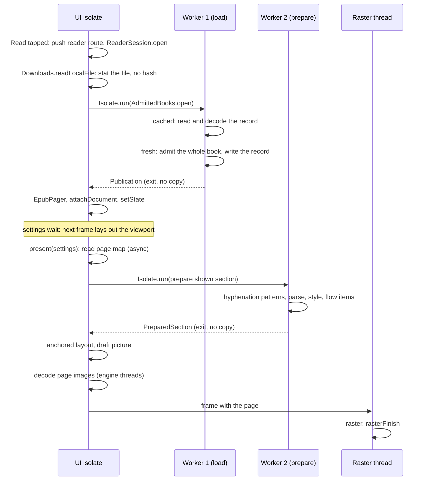

# Faster book opening

Date: 2026-11-11. Ticket: boo-tam0. Epic: boo-fs0n. Status: exploration and two designs for the user. This ticket changed no production code.

The user asked to "look at how to make opening books way faster". The benchmark of 2026-11-11 (docs/marketing/epub-renderer/README.md, "Rerun timed through each engine's drawing") gave these means on a host-GPU emulator:

| Action | Bookfin | KOReader | WebView |
| --- | ---: | ---: | ---: |
| Fresh open | 370 ms | 118 ms | 360 ms |
| Cached reopen | 47 ms | 17 ms | 285 ms |

This document traces the open from the tap on Read to the first drawn page. It measures each step and compares the techniques of other readers with our situation. Then it proposes two designs.

## The answer in short

- A fresh open spends 60 to 95 percent of its time in admission. Admission is a pass over the whole book that the first page does not need: it inflates, checks, parses, cleans, serializes and hashes every file. The illustrated book spends most of its open on byte work in pure Dart: SHA-256 of 18 MB of images, CRC-32 and inflate.
- A cached reopen spends about two thirds of its time in two places: a wait of one frame before the pager knows its page settings, and the prepare of the shown section in a new worker isolate. The layout of the page and the drawing frame take only 5 to 7 ms.
- KOReader is fast for a different reason than its cache. Its fresh open parses and lays out the whole book in C++ and does no admission pass. Its reopen maps a cache file that holds the parsed book and its layout.
- Eight quick wins for EPUB and MOBI, and two for PDF, remove most of the byte work and the waits. Only one of them needs the user's decision: the identity. Two designs then differ on where the rest of the work goes: earlier (Design A, kept output) or later (Design B, lazy open).

## Terms

| Term | Meaning |
| --- | --- |
| Open | The interval from the reader's first call (`loadReadingDocument`) to Flutter's `rasterFinish` of the first frame that draws the requested page with its images. It leaves out the idle wait from the end of preparation to that frame's vsync, as the benchmark does. |
| Fresh open | The first open of a downloaded file: no admitted record and no page map exist. The benchmark clears both before each fresh open. |
| Cached reopen | An open of a book whose admitted record and page map exist. |
| Admission | `Publication.admit` (lib/reader/epub/publication.dart): the whole-book pass that unzips, checks, sanitizes, serializes and hashes the book, and measures its main text size. |
| Admitted record | The file `.bookfin-admitted/publication` beside the download (`AdmittedBooks`, t7-rcyp). It holds every admitted file and fact. |
| Prepare | The work on one section in a worker isolate: parse, style, boxes, flow items and hyphenation (`prepareSections` in prepare.dart). |
| Page settings | `PageSettings`: page width and height, text size and theme. Prepare and layout need them. |
| Settings wait | The time from the end of the load until the viewport's first layout calls `EpubPager.present` with the page settings. The pager starts no prepare before that call. |
| Anchored page | The page that starts at the line that holds the place to open. |
| Page map | The kept true page starts of each section for one page settings value (t5-4lbx). |
| Worker start | The time from `Isolate.run` until the worker's function runs. |

## The open path, step by step



| Step | Isolate | EPUB | MOBI | PDF |
| --- | --- | --- | --- | --- |
| Tap Read | UI | `BookPage._read` pushes the reader route (a 1.5 percent slide) and calls `ReaderSession.open` | same | same |
| Session start | UI | Waits for the record binding and a closing book, starts the origin query of the saved place | same | same |
| Downloads lookup | UI | `readLocalFile` waits for the Downloads command queue, then compares the file's size and time with the verified fingerprint | same | same |
| Load | worker 1 | Reads the admitted record, or admits the book and writes the record | Reads the record, or converts with libmobi (or reads the kept conversion), hashes it with SHA-256, admits it and writes the record | `readAsBytes` of the whole file into the UI isolate, then pdfrx `openData` copies it to PDFium on pdfrx's worker |
| Pager and session | UI | `EpubPager`, `attachDocument`, `BookMap.of` (in a worker for 64 KiB of sections or more) | same | `PdfViewport`, the kept survey read (`BookSurvey`) |
| Settings | UI | The next frame lays out `EpubViewport`, which calls `present` | same | not needed |
| Page map | UI | Read and decoded on the UI isolate, beside the prepare | same | none |
| Prepare | worker 2 | The shown section, or the part around the place for a section of 256 KiB or more | same | With a kept survey, the page waits up to 300 ms for its crop |
| Layout | UI | The anchored page, in urgent steps between frames | same | none |
| Picture | UI | The page's picture without images, then with images | same | PDFium renders the page at the screen width on its worker. The UI isolate copies the pixels and makes an image |
| Images | engine threads | `instantiateImageCodec` at the screen's pixel ratio | same | none |
| Frame | UI, raster | Build, paint, raster | same | same |

The scratch driver of this ticket times the steps from the load to the drawn frame. It does not run the session's steps before the load: the record binding, the Downloads lookup and the origin query. If nothing changed, their code runs no hash and no parse: the lookup compares a `stat` result. They can wait for other work, for example the Downloads command queue during a download. This ticket did not measure that wait.

## Measurements

### Method

- Device: a new AVD of this ticket, bookfin-tam0, on emulator-5560. Its `config.ini` is a copy of the benchmark's host-GPU AVD, with 4 GB of memory. It runs Android 36 on 4 arm64 virtual CPUs, at 1080 × 2400 pixels and 420 dpi. The guest reports `OpenGL ES Translator (Apple M1 Max)`.
- Build: a profile build of a scratch driver, `tool/reader/open_trace_device.dart`, with scratch timing marks in lib/reader (`lib/reader/open_trace.dart`). Both are on the scratch branch named below, not on main.
- Each launch is a new process. It opens the book fresh and waits until the page map of the whole book is kept. Then it reopens the book 3 times. Each open uses a new pager, as the benchmark shell does. The page is 360 × 640 logical pixels at 18 px text.
- The interval rule is the benchmark's rule: from the load call to `rasterFinish`, without the idle wait from the end of preparation to the drawing frame's vsync.
- Each launch started only while the host's one-minute load was under 9 on 10 cores. Other agents raised the load during some launches. The tables give medians.
- Host: `flutter test` (JIT, debug) of `test/reader/open_trace_benchmark_test.dart` on the Mac, 4 rounds after one warm-up round. The host runs the same marks without frames.

Books:

| Name | Book | File | Opened at |
| --- | --- | --- | --- |
| prose | Standard Ebooks' Pride and Prejudice (benchmark) | 0.8 MB | section 4 |
| long | Standard Ebooks' Moby-Dick (benchmark) | 1.2 MB | section 59 |
| illustrated | Standard Ebooks' Alice's Adventures in Wonderland (benchmark), 17.7 MB of deflated PNG | 18.4 MB | section 5 |
| large illustrated | Gutenberg's Divine Comedy (pg-8800), 30.3 MB of stored JPEG | 30.9 MB | section 8 |
| MOBI | Gutenberg's Wealth of Nations, Kindle KF8 (pg-3300) | 2.2 MB | section 20 |

### Device: each step

Device medians in milliseconds.

#### Fresh open

| Step | Isolate | prose (n=4) | long (n=4) | illustrated (n=4) | large illustrated (n=4) | MOBI (n=4) |
| --- | --- | ---: | ---: | ---: | ---: | ---: |
| MOBI only: libmobi conversion to EPUB (native) | worker | 0 | 0 | 0 | 0 | 252.6 |
| Read and check the file | worker | 2.9 | 3.7 | 17.9 | 25.5 | 1.0 |
| Unzip: inflate (package:archive) | worker | 15.3 | 25.1 | 43.7 | 18.4 | 30.5 |
| Unzip: CRC-32 (package:archive) | worker | 12.0 | 17.9 | 172.0 | 278.3 | 28.7 |
| Package document parse | worker | 7.1 | 7.3 | 7.9 | 8.5 | 6.7 |
| Manifest: image headers, fonts | worker | 12.9 | 14.6 | 19.8 | 189.2 | 17.9 |
| XHTML: parse every file | worker | 14.3 | 20.9 | 4.6 | 24.6 | 24.7 |
| XHTML: clean every file | worker | 9.2 | 12.8 | 12.3 | 39.8 | 9.2 |
| XHTML: serialize every file | worker | 25.7 | 44.3 | 7.4 | 29.5 | 75.5 |
| NCX, package and contents | worker | 2.9 | 7.3 | 4.7 | 22.3 | 3.5 |
| Identity: SHA-256 of every file | worker | 12.7 | 19.0 | 173.0 | 282.4 | 29.7 |
| Main text size | worker | 4.1 | 6.2 | 4.5 | 7.4 | 15.9 |
| Record: encode and write | worker | 9.9 | 11.2 | 41.5 | 57.2 | 11.3 |
| Wait for the viewport to give page settings | UI | 10.5 | 9.6 | 12.6 | 14.0 | 8.6 |
| Prepare: the whole worker call, as the UI isolate waits for it | UI waits | 29.6 | 28.9 | 34.3 | 13.4 | 13.9 |
| Prepare, part: worker start | worker | 3.1 | 2.4 | 6.5 | 4.4 | 2.3 |
| Prepare, part: hyphenation patterns | worker | 3.0 | 2.3 | 3.0 | 0 | 0 |
| Prepare, part: parse | worker | 9.7 | 10.3 | 10.9 | 9.7 | 10.3 |
| Prepare, part: style | worker | 0.9 | 1.6 | 1.3 | 1.0 | 0.7 |
| Prepare, part: boxes, flow items, hyphenation | worker | 5.0 | 12.6 | 7.5 | 0.1 | 0.4 |
| Anchored layout (UI) | UI | 10.0 | 12.9 | 11.4 | 9.5 | 10.5 |
| Show and draft picture (UI) | UI | 1.3 | 1.1 | 1.1 | 1.6 | 1.1 |
| Images decoded, final picture | UI, engine | 0.0 | 0.1 | 0.1 | 0.0 | 0.1 |
| Drawing frame: raster | raster | 18.8 | 20.8 | 24.2 | 19.6 | 18.8 |
| Total, drawn page | | 203.6 | 272.5 | 608.9 | 1092.3 | 596.3 |

#### Cached reopen

| Step | Isolate | prose (n=12) | long (n=12) | illustrated (n=12) | large illustrated (n=12) | MOBI (n=12) |
| --- | --- | ---: | ---: | ---: | ---: | ---: |
| Read and decode the record | worker | 3.1 | 4.7 | 32.2 | 39.1 | 7.0 |
| Wait for the viewport to give page settings | UI | 15.8 | 10.6 | 11.8 | 14.3 | 11.8 |
| Prepare: the whole worker call, as the UI isolate waits for it | UI waits | 17.1 | 28.4 | 21.4 | 10.7 | 11.5 |
| Prepare, part: worker start | worker | 4.0 | 3.8 | 6.5 | 10.6 | 3.5 |
| Prepare, part: hyphenation patterns | worker | 2.7 | 1.7 | 3.0 | 0 | 0 |
| Prepare, part: parse | worker | 6.4 | 7.0 | 6.9 | 6.9 | 6.7 |
| Prepare, part: style | worker | 0.9 | 1.5 | 1.1 | 0.8 | 0.7 |
| Prepare, part: boxes, flow items, hyphenation | worker | 5.4 | 15.8 | 6.3 | 0.1 | 0.4 |
| Anchored layout (UI) | UI | 2.2 | 2.8 | 2.7 | 1.1 | 1.4 |
| Show and draft picture (UI) | UI | 1.3 | 1.2 | 0.8 | 7.3 | 1.3 |
| Images decoded, final picture | UI, engine | 0.1 | 0.0 | 0.1 | 0.0 | 0.0 |
| Drawing frame: raster | raster | 2.5 | 2.4 | 4.3 | 2.1 | 2.8 |
| Total, drawn page | | 48.9 | 61.2 | 85.2 | 83.5 | 43.4 |

### What the numbers say

The steps overlap a little, so a column does not add up to its total exactly. "UI waits" is the time that the UI isolate waits for a worker call. The rows under it are parts of that call.

- Fresh open of a text book: admission and the record write take 129 of 204 ms (prose) and 197 of 273 ms (long). The serialize, parse and clean of every XHTML file take 49 to 78 ms of that. Inflate and CRC-32 in pure Dart take 27 to 43 ms, and the identity hash 13 to 19 ms.
- Fresh open of an illustrated book: byte work dominates. In the illustrated book, CRC-32 (172 ms) and the identity hash (173 ms) take 57 percent of 609 ms. In the large illustrated book, those two and the image headers (189 ms) take 69 percent of 1,092 ms.
- MOBI: libmobi's conversion takes 253 ms. The admission of the converted EPUB takes most of the rest of 596 ms.
- The admitted record's write is on the path of every fresh open: 10 to 57 ms.
- Cached reopen: the settings wait (11 to 16 ms) and the prepare call (11 to 28 ms) take most of 43 to 85 ms. In the two illustrated books, the read and copy of the 18 to 30 MB record add 32 to 39 ms.
- The first frame of a new process is slow: raster 19 to 24 ms against 2 to 4 ms, and the anchored layout 10 to 13 ms against 1 to 3 ms. In the app, the engine is already warm at the open of a book, so this part is smaller there.
- Agreement with the benchmark: the fresh medians are 204, 273 and 609 ms here, against 214, 300 and 589 ms in the benchmark. The cached medians are 49, 61 and 85 ms here, against 37, 42 and 58 ms. This ticket did not find the cause of the difference in the cached opens. The shares of the steps carry the argument, not the sums.

On the host, the same marks give the same order of costs. The fresh opens took 144 ms (prose), 202 ms (long), 366 ms (illustrated), 938 ms (large illustrated) and 404 ms (MOBI). The cached opens took 22, 29, 31, 49 and 16 ms. In the illustrated book, the identity hash took 180 ms and CRC-32 57 ms on the host.

### Host: the byte work in pure Dart against native zlib

A scratch AOT program (`tool/reader/scratch_zip_bench.dart`) timed admission's byte work on the host, median of 5:

| Book | Expanded | package:archive Inflate | dart:io zlib (native) | package:archive CRC-32 | package:crypto SHA-256 |
| --- | ---: | ---: | ---: | ---: | ---: |
| prose | 1.4 MB | 10.9 ms | 3.2 ms | 5.4 ms | 11.9 ms |
| long | 2.0 MB | 18.1 ms | 5.6 ms | 8.0 ms | 17.8 ms |
| illustrated | 18.6 MB | 20.8 ms | 12.3 ms | 74.2 ms | 161.3 ms |
| large illustrated | 31.6 MB | 13.7 ms | 4.4 ms | 125.2 ms | 273.9 ms |

SHA-256 runs at about 115 MB/s and CRC-32 at about 250 MB/s in Dart on the host. Native zlib inflates 2 to 3 times faster than package:archive. dart:io has no CRC-32 and no SHA-256 of its own.

### PDF

A PDF has no admission. The open reads the whole file into the UI isolate, and pdfrx opens it. pdfrx 0.9.0 then measures every page with `FPDF_LoadPage` before it returns, because Bookfin does not ask for progressive loading (`_measureAllPagesInChunks` in pdfrx_pdfium.dart). The driver then renders the opened page at the screen's width and makes an image of it. It does not read the kept survey. So the wait of up to 300 ms for a crop is not in these numbers. Ticket ta-go9x measures that wait.

Device medians in milliseconds. "Later" is a later open in the same process. A PDF keeps no record.

| Step | Isolate | Raven (24 scanned pages, 4 MB), first / later | Origin of Species (568 scanned pages, 25 MB), first / later |
| --- | --- | ---: | ---: |
| `readAsBytes` of the whole file | UI waits | 6.5 / 4.6 | 18.8 / 17.8 |
| pdfrx open, every page measured | pdfrx worker | 86.2 / 61.0 | 1,521 / 1,506 |
| Render the page at 1080 pixels | pdfrx worker | 12.8 / 11.0 | 145 / 143 |
| Copy the pixels and make an image | UI, engine | 19.0 / 13.8 | 15.4 / 14.9 |
| Drawing frame: raster | raster | 6.0 / 1.6 | 5.5 / 3.1 |
| Total, drawn page | | 138 / 96 | 1,707 / 1,688 |

The host test `test/reader/scratch_pdf_open_test.dart` gave medians of 5. There, pdfrx's open with every page measured took 26 ms for Raven and 420 ms for the 568-page book. With `useProgressiveLoading: true` it took 6.3 and 12.6 ms. `PdfDocument.openFile` with progressive loading took 1.3 and 1.5 ms, and reads no file into Dart.

## What other readers do, and whether it fits us

The user's rule asks for the situation of each technique before we adopt it.

| Reader | Technique | Its situation | Our situation | Does it apply? |
| --- | --- | --- | --- | --- |
| KOReader (crengine) | A cache file per book (`cr3cache`). It holds the parsed DOM, the styles, the layout of every block and the page list. A reopen maps the file and formats only the paragraphs of the drawn page. The key is the file and a hash of the rendering inputs. On a mismatch, it lays out again from the kept DOM. | E-ink readers with 0.8 to 1.5 GHz ARM cores and little memory. They show exact page numbers of the whole book at open. The DOM is a flat store of chunks, made to be swapped to disk, so a load costs almost nothing. | A phone with fast cores. Dart builds object graphs, so a kept prepared section must be built again. Its port copy alone takes about a third of its prepare (boo-ystu: 89 ms of 297 ms for Keats' section). | In part. We already keep its page list (the page map). Its DOM cache needs a flat prepared section that layout reads in place. That is a large refactor, and it saves at most one section's prepare (13 to 25 ms here). |
| KOReader (crengine) | No admission: it parses each document once, straight from the zip, in C++. | Trusts the book's markup and draws it with its own engine. | Admission sanitizes and serializes every document. That output was the WebView reader's input, and it stays byte for byte for the identity. The WebView reader is gone, and prepare parses each document again. | Yes: the whole-book pass is the largest cost of a fresh open. |
| Readium Kotlin and Swift toolkits | The streamer reads the zip directory and the package document. It reads a resource only at the navigator's request. Positions come from the length of each resource (about 1,024 bytes a position), with no layout. | WebView reading apps of publishers and libraries, with DRM (LCP) that decrypts each resource on demand. | We own the layout and the zip, and we have exact page maps. | The lazy reading of resources applies (Design B). The positions by length do not: the page map already gives exact pages. |
| Apple Books | Shows the chapter at the saved place first, and counts the pages of the rest in the background, per font setting. This is observed behavior, not documentation. | WebKit on phones. | The same: t7-bbv1 lays out the rest in the background and t5-4l4d keeps the result. | Already built. |
| Kindle | Moves the heavy work before the device opens the book: KindleGen or Amazon's service converts the book, and Amazon's service makes the APNX file of page numbers. | A closed pipeline with a server. | Downloads owns each download on the phone and already hashes each completed file. | The idea applies on the phone: admit each book at the end of its download (Design A). |

Sources:

- The KOReader source in the benchmark sources: `frontend/document/credocument.lua` ("crengine saves caches on disk for faster re-openings").
- The pinned crengine `lvtinydom.cpp`: `ldomDocument::openFromCache` and `checkRenderContext`.
- [Readium's EPUB positions service](https://readium.org/kotlin-toolkit/3.1.2/api/readium/readium-streamer/org.readium.r2.streamer.parser.epub/-epub-positions-service/index.html).
- [The W3C EPUB working group on positions](https://lists.w3.org/Archives/Public/public-epub-wg/2021Jun/0009.html).
- [MobileRead: APNX](https://wiki.mobileread.com/wiki/APNX).

## The removable costs

The table ranks the costs that the first page does not need. The times are device medians in milliseconds, for prose / long / illustrated / large illustrated.

| Cost | When | Device time | Why it is on the path today |
| --- | --- | --- | --- |
| SHA-256 of every admitted file, for `Publication.identity` | Fresh | 12.7 / 19.0 / 173 / 282 | The identity names the page maps and is saved with each place. Since t7-rcyp, a saved place opens without a match of the identity. |
| CRC-32 of every zip entry in pure Dart | Fresh | 12.0 / 17.9 / 172 / 278 | The zip check of every entry runs before the first page. |
| Image headers through package:image | Fresh | part of 12.9 / 14.6 / 19.8 / 189 | `JpegDecoder.startDecode` reads far more than the frame header. A scan for the SOF marker reads a few bytes. |
| Serialize, parse and clean every XHTML file | Fresh | 49.2 / 78.0 / 24.3 / 93.9 | Admission keeps its output byte for byte. Prepare parses the shown section again. |
| Inflate in pure Dart | Fresh | 15.3 / 25.1 / 43.7 / 18.4 | package:archive's `Inflate`. Native zlib is 2 to 3 times faster. |
| Encode and write the admitted record | Fresh | 9.9 / 11.2 / 41.5 / 57.2 | The load worker returns only after the write. |
| Read and copy the whole record | Cached | 3.1 / 4.7 / 32.2 / 39.1 | The record holds every image. `Publication.decode` copies each resource. |
| Settings wait | Both | 9 to 16 | The pager starts its first prepare only after the viewport's first layout. |
| A new prepare worker and its hyphenation patterns | Both | 2 to 11 for the start, up to 3 for the patterns | Each `Isolate.run` starts a worker, which builds the patterns from strings again. |
| The first frame of a new process | Fresh | raster 19 to 24, layout 10 to 13 | Shader and glyph work of a cold engine. In the app, the engine is warm, but the reader's glyphs are new. This ticket did not measure it in the app. |

The MOBI adds its libmobi conversion (253 ms) before its admission.

## Quick wins that both designs keep

Each quick win keeps the model of today: the admitted record, the page map, and the owners of the pager and the page source. Each can be built and measured alone, before a design. The savings are device estimates from the medians above and the host ratios.

| Quick win | Saves on a fresh open (prose / long / illustrated / large illustrated) | Saves on a cached reopen | Risk | Size |
| --- | --- | --- | --- | --- |
| 1. Inflate with dart:io `ZLibDecoder(raw: true)` and a byte limit | about 10 / 17 / 20 / 12 ms | none | A bomb check must count bytes as they come. | about 40 lines |
| 2. CRC-32 with slicing-by-8 tables (4.1 times faster on the host, same results) | about 9 / 13 / 130 / 210 ms | none | none known | about 40 lines |
| 3. Read PNG and JPEG sizes from their headers with own code | about 5 / 5 / 10 / 170 ms | none | The header reader must refuse what package:image refuses (frame count, pixel limit). A test on the corpus's 986 images compares both. | about 60 lines |
| 4. Identity from the policy, `Publication.revision` and the file digest, as the MOBI identity is | 12.7 / 19.0 / 173 / 282 ms | none | Every book's page maps are laid out again once. New saved places carry another `processed` value. The user decides (question 1). | about 10 lines and tests |
| 5. Hyphenation patterns as const tables, which every worker shares | 2 to 3 ms | 2 to 3 ms | A bigger generated file | the generator and its data |
| 6. Start the shown section's prepare at once with this device's last page settings | 9 to 16 ms | 9 to 16 ms | A wrong guess costs one wasted prepare. The pager uses the result only for equal presented settings. | about 80 lines |
| 7. Return the publication before the record write ends | 10 / 11 / 42 / 57 ms | none | The write must stay atomic. An open during the write admits again or waits. | about 40 lines |
| 8. Read images from the record only for a page that draws them | none | about 1 / 1 / 25 / 30 ms | `Publication.resources` stops holding image bytes. Image users (`_decode`, fonts) read through one async call. | about 120 lines |

With all the quick wins, the estimated fresh open is 140 / 195 / 220 / 345 ms. Today it is 204 / 273 / 609 / 1,092 ms. The estimated cached reopen is 31 / 49 / 45 / 40 ms, against 49 / 61 / 85 / 84 ms today. Most of the rest of a fresh open is the work on every XHTML file. The read of the whole file and the first frame are the other parts. The two designs differ on that rest.

## Two designs

Both designs aim at the same two numbers: a fresh open near the cached reopen, and a cached reopen near KOReader's 17 ms. They differ on where the remaining work goes.

| Design | When admission runs | What a reopen draws first | New kept state | When the page takes input | Fresh open after a download |
| --- | --- | --- | --- | --- | --- |
| A: kept output, work done earlier | At the end of each download, in a worker that Downloads starts. After an update that raises `Publication.revision`, again in the background. An open during an admission joins it. | The kept page: the drawn form of the page that the person last saw, before the record is read | One kept page per book, beside the page map | When the true page replaces the kept page, an estimated 25 to 35 ms later | No admission on the path |
| B: lazy open, only the first screen's work | At open, only for the first page's files: the container, the package document, the navigation, the style sheets, the section's fonts and the section. The rest runs in a worker after the first page. | The true page, after one worker call that reads the record and prepares the section | None | At the first drawn page | Partial admission and prepare in one worker |

### Design A: usage

```dart
// Downloads, after it verified a completed EPUB or MOBI download:
unawaited(AdmittedBooks.prepare(file, digest)); // admits in a worker, keeps the record

// ReaderSession.open, before anything else:
final kept = await KeptPages.read(download, viewport); // a few KB, async file read
if (kept != null) viewport.showKept(kept);             // drawn in the reader's first frame
final document = await loadReadingDocument(file, source); // the record, as today
```

The kept page holds each paragraph piece of the page: its text, its styled runs, its width and its position, and the page's image rectangles and decorations. Its key is the page map's key (book, page settings, engine fingerprint) plus the theme and the saved place. The page source writes it with each saved place. A reopen rebuilds the paragraphs of one page, draws them, and shows the picture. The pager opens as today behind it. When the true page arrives, the pager compares it with the kept page and replaces it. If they differ, the kept page is dropped.

| Step | Fresh open after a download | Cached reopen |
| --- | --- | --- |
| Admission | 0 (done at download) | 0 |
| Kept page: read, rebuild, draw, frame | none (no kept page yet) | an estimated 7 to 12 ms to the drawn page |
| True page | the cached path with quick wins: about 31 to 49 ms | about 31 to 49 ms, behind the kept page |

Risks:

- Two pictures of one page. The key of a kept page can miss an input, for example a system font update. Then the kept page draws wrong text for 25 to 35 ms, and the swap shows a jump.
- Input waits for the true page: a turn, a selection or a link in the first 25 to 35 ms waits.
- A second store and a second codec. The kept page follows the inputs of `drawPage` (paint.dart). Each change to paint must change the codec.
- Download time grows by the admission: 0.1 to 1.0 s of a worker per book, with the quick wins 0.1 to 0.35 s.
- Storage: an estimated 5 to 20 KB a book.

A MOBI converts at the end of its download too, so its 253 ms conversion also leaves the open.

As built in boo-sy2d:

- Downloads prepares each saved EPUB or MOBI when its download completes, and again after each restoration of its saved files: at launch, and when the bound library changes. A preparation whose record is current reads only the record's key line. So the background admission after an update is the next restoration's preparation. A preparation that fails keeps its key beside the download, and the next preparation with that key does nothing. The open still admits the book.
- The session keeps the shown page when the app goes to the background, when the reader closes and when another book opens, not with each saved place. A page turn costs nothing more. It keeps the page only when an open at the saved place shows that page (`EpubPager.opensAtShown`): a main run cut the page, and the page holds the place that the pager reported last.
- The key of a kept page holds the codec's format, the text engine's fingerprint, the file digest and the saved place. The page settings (size, text size, theme) are in the page itself, and the viewport draws the page only when they equal its own.
- A kept page depicts the true page when both have the same text, styles and settings, and places within a thousandth of a pixel. A run from the page's start and a run from the section's start cut the same page with sums that differ in their last bits.
- A debug build keeps no pages, because it has no text engine fingerprint. boo-sy2d kept no page that drew with a font of the book, because a new process registered the book's fonts only when the book loaded. Since boo-iv7q, the reader never draws a font of the book, so every EPUB and MOBI keeps its page.

Build size:

- the kept page codec and store, with tests: about 600 lines.
- the admission hook in Downloads, beside t7-5m4d: about 100 lines.
- the background admission after an update: about 150 lines.

### Design B: usage

```dart
// ReaderSession.open:
final opened = await openAt(file, digest, place, lastSettings);
// One worker: the zip directory, the package document, the section of
// [place] admitted and prepared. The rest of admission continues in a
// worker after the first page and writes the record.
final pager = EpubPager(opened.document, initial: place, first: opened.prepared);
```

The load worker reads the zip directory and checks the archive's limits from the directory's sizes. It inflates only the entries that the first page needs, and reads image sizes from the first bytes of each image. It cleans the shown section with today's rules, so the DOM is the DOM that full admission gives. Then it prepares the part of the section around the place, with this device's last page settings. One exit hands over both. A later open reads the record in the same worker and prepares the section there.

| Step | Fresh open (prose / long / illustrated / large illustrated) | Cached reopen |
| --- | --- | --- |
| Admission on the path | an estimated 12 to 20 ms: the directory, the package document (7 to 8 ms) and one section | the record read: 3 to 8 ms with quick win 8 |
| Prepare | 11 to 25 ms, with no new worker and no settings wait | 8 to 24 ms |
| Layout, show, frame | 30 to 38 ms cold in a new process | 6 to 8 ms |
| Total | an estimated 61 / 74 / 71 / 61 ms | an estimated 22 / 35 / 30 / 27 ms |
| After the first page | the rest of admission and the record write, in one worker | none |

Risks:

- Saved places. The lazily cleaned section must equal the fully admitted section, or saved CFIs move. A corpus test compares every section of every corpus book.
- Safety order. Today the whole book is checked before anything shows. A damaged later file is found after the first page. The reader then reports it at that section instead of refusing the book.
- The identity must be known at open, so quick win 4 becomes required.
- The background admission competes for the CPU in the first second of reading: one worker for 0.1 to 0.35 s with the quick wins.
- Admission splits into the steps of one document, which touches every check in `_Admission`.
- A MOBI still converts the whole book at its first open: about 250 ms before its partial admission.

Build size:

- a zip reader that reads entries on demand: about 200 lines.
- admission by document, a refactor of about 300 lines of `_Admission`.
- the combined load and prepare call: about 100 lines.
- the background completion: about 100 lines.
- the corpus equality test.

### What both designs share

- The quick wins above.
- The admitted record as the cache of later opens, `AdmittedBooks` as its owner, and its atomic write.
- The page map and its check on use.
- The pager as the one owner of the shown place, and the page source as the owner of pages.
- No cache of prepared sections. boo-ystu measured them as large and slow to decode in Dart.

## PDF

The PDF open is not part of either design's choice. Two quick wins cover most of it:

| Quick win | Saves (Raven / 568 pages) | Risk | Size |
| --- | --- | --- | --- |
| 9. Open with `PdfDocument.openFile` and `useProgressiveLoading: true`, and measure the other pages in the background | about 85 / 1,500 ms on the device: the host went from 26 to 1.3 ms and from 420 to 1.5 ms | A page that pdfrx did not measure yet has an estimated size. The open page must be measured before its render, and the book map and the scrub bar must follow the sizes as they arrive. | about 60 lines |
| 10. Do not read the PDF into the UI isolate: quick win 9 needs no bytes | 5 / 18 ms, and 4 to 25 MB of memory on the UI isolate's heap | none known | part of 9 |

After both, the open of the 568-page book is mostly the render of one scanned page: about 145 ms. Design A can keep the rendered page as an image beside the survey and draw it at a reopen before PDFium renders. That costs about 1 MB a book. Design B has no such step for PDFs.

## Questions for the user

1. Can every EPUB's publication identity change once? Today it is a hash of all admitted files. It becomes a hash of the policy, the admission revision and the file's digest. Every saved place still opens. Each book lays out its page map once more. This saves 13 to 282 ms of each fresh open, and Design B needs it.
2. Where does admission run? Design A runs it at the end of each download. Design B runs it at open for the first page's files only, and the rest after the first page.
3. What does a reopen draw first? Design A draws the kept picture of the last page at about 7 to 12 ms. That page takes input 25 to 35 ms later. Design B draws the true page at about 22 to 35 ms.
4. Design B only: does a book with a damaged later file open, and report the damage at that section? Today the whole book is refused.
5. Do the quick wins come first, before either design? They keep today's model.

## Evidence and how to measure again

The scratch instrumentation is on the branch `scratch/boo-tam0-open-trace`. It is one commit on top of this document's commit, and it is not on main or on this ticket's branch tip. It holds:

- `lib/reader/open_trace.dart` and the marks in lib/reader (loaders, admission, the record store, prepare, the page source, the pager).
- `tool/reader/open_trace_device.dart`, the device driver.
- `test/reader/open_trace_benchmark_test.dart`, the host timing.
- `test/reader/scratch_pdf_open_test.dart`, the host PDF timing.
- `tool/reader/scratch_zip_bench.dart`, the byte work timing.
- `tool/research/open_trace/`: the scripts that ran the device matrix and made the tables, and the raw logs, compressed.

To measure again on a device that no one else uses:

1. Check out `scratch/boo-tam0-open-trace`.
2. In the dev shell, run `python3 tool/reader/ocr_package.py prepare` once in a new worktree.
3. Build the driver: `flutter build apk --profile --target-platform android-arm64 -t tool/reader/open_trace_device.dart`.
4. Install it with `adb -s <device> install -r build/app/outputs/flutter-apk/app-profile.apk`.
5. Serve the books and `plan.json` on port 8794 from one directory, and run `adb -s <device> reverse tcp:8794 tcp:8794`.
6. Run `tool/research/open_trace/matrix.sh`. It launches the driver once per launch through T3's `agent-device` and keeps each launch's logcat.
7. Make the tables with `python3 tool/research/open_trace/table.py prose long illustrated divine wealth`.

## Decision (user and orchestrator, 2026-11-11)

1. The quick wins come first, because both designs keep them.
2. Identity changes once to a hash of the policy, the revision and the file
   digest. The orchestrator settled this: every saved place still opens,
   and each book lays out its page map once more.
3. The user chose design A: admission runs at the end of each download, and
   a reopen first shows the kept picture of the last page.
4. The user chose to open a book whose later chapter file is damaged or
   missing. That chapter shows a short note instead of its text. Ticket
   t5-gk30 covers the three such EPUBs in the user's library. The builder
   of t5-gk30 decided, pending the orchestrator's acceptance, that the same
   rule applies to the first chapter: the book opens at that chapter's
   note, and the next page turn goes to the next chapter. Each
   chapter keeps its place in the reading order, so saved places in the
   other chapters do not move. A book whose container or package document
   is missing or damaged is still refused, because it has no reading order
   to keep.
