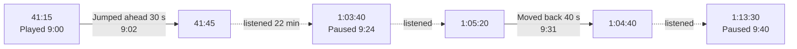

# Which place a history entry goes to

Ticket: boo-hyl4, under epic boo-fs0n. Status: built, 2026-11-11. The user chose design B (see "Decision"). The section "Built" at the end records the details of the build. The sections before it describe the sheet as it was before the build.

The user reported on 2026-11-11, in their own words:

> "investigate how to make it clearer when you tap a history location whether you're going to the location just after the operation was done or to the location just before. Currently we have two buttons but I don't think they're labeled super clearly and they can sometimes not quite align with things and also having two buttons itself is a little bit awkward if there's a way to unify it."

Read this with `docs/plans/reading-history.md` (the shared timeline and its kinds of moves) and the ticket boo-z3is (Go to on an entry of the other edition).

## Terms

- Place: one point in one edition, as in `docs/plans/reading-history.md`. An audio place is a time. A text place is an anchor in an ebook file.
- Move: one record of the history (`HistoryEvent`). It has a kind, a time, a before place and an after place, both of one medium.
- Before place: where the person was just before the move.
- After place: where the move put the person. This document also calls it the landing.
- Entry: one line of the History sheet. Today each entry is one move or one bookmark.
- Open entry: the entry that the person tapped. It shows a detail line and its choices.
- Choice: a button under an open entry, such as Go to, Rename or Delete.
- Place text: the short words for a place in a row or a choice, such as "1:02:15", "p. 12" or a quote.
- Stretch: the listening or reading between two moves. The person plays or turns pages, so the place changes without a move.

## What the two choices do today

The open entry of a move builds its choices in `lib/playback/timeline.dart`:

```dart
    String place(Place place) => widget.describe(place).short;
    return switch (entry) {
      ActionEntry(:final event) => [
        if (event.changesPosition)
          choice(
            'Go back to ${place(event.before)}',
            () => widget.onGoBack(event),
          ),
        choice('Go to ${place(event.after)}', () => widget.onGoTo(entry)),
        delete,
      ],
      ...
```

where

- `entry` = the entry that is open.
- `event` = the move of that entry.
- `event.before`, `event.after` = the before place and the after place of the move.
- `event.changesPosition` = whether the move can change the place. It is true for a seek, a jump, a chapter change, an undo and an open. It is also true for a history restore, a bookmark restore, a link and a search result. It is false for Paused, Played, Interrupted, Stopped, Finished and Closed. Paused, Stopped and Closed record one place. Played, Interrupted and Finished go from the position sample before the change to the sample that changed it, so their two places can differ by a fraction of a second.
- `widget.describe(place).short` = the place text of a place (see below).
- `choice(text, report)` = a compact `TextButton` with the label `text`. A tap calls `report`.
- `widget.onGoBack`, `widget.onGoTo` = the callbacks to the controller `openHistory`.
- `delete` = the Delete icon button.

The controller `openHistory` turns the two callbacks into one call of the owner of the place:

```dart
            onGoBack: (event) => go(
              event.before,
              () => switch (event.before) {
                AudioPosition() => playback!.restoreHistory(event.id),
                TextPosition() => reader!.restoreHistory(event.id),
              },
            ),
            onGoTo: (entry) => switch (entry) {
              ActionEntry(:final event) => go(
                event.after,
                () => switch (event.after) {
                  AudioPosition() => playback!.restoreHistory(
                    event.id,
                    previous: false,
                  ),
                  ...
```

where

- `go(place, restore)` = closes the sheet, shows the player or the reader for the medium of `place`, and runs `restore`.
- `restoreHistory(id, previous:)` = the owner's verb. If `previous` is true (the default), it shows the before place of the move `id`. If `previous` is false, it shows the after place. It records a new move of the kind `historyRestore`, with the label "Went back in history", in both cases.

So "Go back to X" goes to the before place, and "Go to Y" goes to the after place. The row itself shows only the after place, because `TimelineEntry.place` of a move is `event.after`.

The place text comes from two functions:

| Medium | Function | Place text |
| --- | --- | --- |
| Listening | `Playback.describe` | The time in the edition, in whole seconds, rounded down: "1:02:15" |
| Reading, in the open ebook | `describeTextPlace` | "p. 134". If the book map does not know every page yet, "37%". |
| Reading, any PDF place | `describeTextPlace` | The source page: "p. 12" |
| Reading, another ebook edition | `describeTextPlace` | The first six words of the quote, in curly quotes. If more words follow, it ends in "…". |

The label of a move says how far it went. For listening, it rounds the difference in milliseconds:

```dart
      (
        AlongAudio(milliseconds: final from),
        AlongAudio(milliseconds: final to),
      ) =>
        '$verb ${to >= from ? 'ahead' : 'back'} ${_span((to - from).abs())}',
  ...
  static String _span(int milliseconds) => milliseconds < 60000
      ? '${(milliseconds / 1000).round()} s'
      : duration(milliseconds);
```

where

- `from`, `to` = the before place and the after place, in milliseconds from the edition's start.
- `verb` = "Moved", "Jumped" and so on, by the kind of move.
- `_span(milliseconds)` = the distance in words. Under a minute, it rounds to whole seconds. From a minute up, `duration` rounds to whole minutes, such as "2 m".

## What does not line up

A scratch widget test drew the real `HistoryTimeline` on a Pixel 8 sized screen of 411 by 914 points. It used the app's Outfit font and both themes. It opened five kinds of entries, measured the positions of the row text, the detail line, the choices and Delete, and saved screenshots. The test is not in the repository. It is at `~/.cache/bookfin/previews/boo-hyl4/scratch_history_choice_test.dart`.

| Finding | Evidence | Cause |
| --- | --- | --- |
| 1. "Back" means two things. | On "Moved back 40 s · 1:02:15", "Go back to 1:02:55" goes 40 seconds ahead in the book. On "Went back in history", "Go back" undoes the restore. | "Go back" names the before place, which is back in time, not back in the book. The row's verb uses "back" for the book. |
| 2. The before place is not on the row. | Several closed rows read "1:02:15" (Went back in history, Moved back 40 s, Paused). The row of a move never shows where it began. | The row shows `entry.place`, which is the after place. The before place appears only on the Go back button. |
| 3. The distance disagrees with the two places. | A seek from 3,775,900 ms to 3,735,100 ms reads "Moved back 41 s". Its choices read "Go back to 1:02:55" and "Go to 1:02:15", which are 40 seconds apart. A seek from 10:00 to 11:31 reads "Moved ahead 2 m". | `_span` rounds the difference of the exact times. The place text rounds each time down to whole seconds. Above a minute, `duration` rounds to whole minutes. |
| 4. The choice line changes shape from entry to entry. | Row text starts at x = 116 points. The detail line and the first choice's text start at x = 122. For "Go back to 1:02:55" and "Go to 1:02:15", Delete drops alone to a second line at x = 112. For a PDF move, Delete stays on the first line. For two quote places, each button takes its own line, the first wraps inside itself, and Delete sits after the second. | The choices are a `Wrap` with left padding `_timeWidth + 20`, while the row text starts at `_timeWidth + 24` and the detail line at `_timeWidth + 30`. Button labels can be any length, because a quote place has up to six words. |
| 5. Two moves in a row do not share a place. | "Jumped ahead 30 s · 41:45" at 9:02 and "Moved back 40 s" from 1:02:55 at 9:31. Go to on the first goes to 41:45, which the person then listened past for 20 minutes. | A stretch lies between the two moves. The after place of a move is the start of a stretch, not the place where the person stopped. |

Finding 3 is a defect, and both designs below keep its fix. Ticket tc-p3j8 (Make a move's distance agree with its two shown places) fixes it now.

A side finding: the timeline labels an open from another device only "Opened". Tickets t9-4vsl and t9-gtps expected "Opened at the place from A", and `HistoryEvent.device` holds the name, but `_label` never reads it. This entry is the one where the before place and the after place matter most, because they come from two devices. Ticket tc-butt (Name the other device on an Opened history entry) records it.

Screenshots of today's sheet, all under `~/.cache/bookfin/previews/boo-hyl4/`:

- `current-closed-light.png` and `current-closed-dark.png`: no entry open.
- `current-moved-back-light.png`: "Moved back 40 s" open. Delete drops to a second line.
- `current-epub-elsewhere-light.png`: a move between two places in another ebook edition. Both buttons are quotes. The first button wraps.
- `current-pdf-search-light.png`, `current-went-back-light.png`, `current-paused-light.png`, and a dark copy of each.

## How other apps present this

Each of these apps gives one place per entry. None of them offers two go targets on one entry.

- Web browsers: the back list holds the pages that the person left. A tap on one goes there.
- Kindle e-readers (2021 firmware): after a jump, a box at the foot of the screen offers "back to page X" and "stay here". It offers only the first place to return to ([the-ebook-reader.com](https://blog.the-ebook-reader.com/2021/10/07/new-kindle-update-5-14-1-released-with-new-navigation-options-to-go-back/)).
- Apple Books: an arrow at the top left returns to the previous reading place. Then an arrow at the top right returns to where the person was. The second target appears only after the first is used ([Apple support](https://support.apple.com/fr-ca/HT201478)).
- Audiobookshelf for Android: each Listen History row is one event with one position. A tap on its time jumps there, for example after an accidental seek or a sync that overwrote progress ([audiobookshelf.org](https://audiobookshelf.org/docs/documentation/mobile-apps/listen-history)).
- Smart AudioBook Player: its playback history returns the person to a place after an accidental tap ([release notes](https://www.apkmirror.com/apk/alex-kravchenko/smart-audiobook-player/smart-audiobook-player-11-6-7-release/)).
- Undo history panels in editors, such as the History panel of an image editor: each row is the state after one step, and a click restores it.

The approved mockup (`docs/mockups/bookfin.html`) also had one button per entry: "Restore". On "Paused" it went to the pause. On "Chapter jump · From 1:02:09 to 1:12:00" it went to 1:02:09, the place before the jump.

## The model under both designs

History exists so that the person never loses a place (`docs/plans/bookfin.md`, engine rule 3 in AGENTS.md). The person's path through a book is a chain of stretches joined by moves. A place can be lost in only one way: the person leaves it by a move. Then that place is the before place of the move.



In the diagram, a solid arrow is a move and a dotted arrow is a stretch. Every place where a stretch ends is in the history: as the before place of the next move (41:15, 1:05:20), or as a Paused or Closed entry (1:03:40, 1:13:30). The after places (41:45, 1:04:40) start stretches. The person listened past them, so they are rarely the place that the person wants back.

Three facts follow, and design A builds on them:

- A landing that the person leaves by a later move becomes the before place of that later move. So it stays reachable.
- A landing that the person listens or reads past is not lost. The place where that stretch ended is reachable.
- The newest landing is where the person is now.

## Design A: each entry is one place where you were

Every entry names exactly one place: the place of the person at the time of the entry. For a move, that is the before place. For Paused, Played, Opened, Closed and the other entries that do not move, it is their one place. For a bookmark, it is the bookmark's place. A bookmark already works this way today.

- The closed row shows the time, the medium glyph, what happened, and the one place. For a move, the row's place changes from the after place to the before place.
- The open entry shows the chapter, the quote, and one line about the landing: "Where you were before this move. It went to 1:04:40."
- The choices are the same for every entry: one "Go to <place>", Delete, and Rename for a bookmark. The button's text starts at the row text's left edge. Delete sits at the end of the button line. A button label never wraps. A long place ends in "…".
- "Go back" disappears, so "back" means only a direction in the book again.
- The Undo pill and the History sheet agree. Undo goes to the place that the newest entry of a move shows.

The interface of the timeline gets smaller. `HistoryTimeline` loses `onGoBack`, and `onGoTo(entry)` reports every go choice. `TimelineEntry.place` of a move becomes `event.before`. `restoreHistory(id)` loses its `previous` parameter, because nothing asks for an after place any more.

Usage: at 9:31 the person bumped the slider back 40 seconds and listened on. At 9:45 they open History, tap "Moved back 40 s · 1:05:20", read "Where you were before this move. It went to 1:04:40", and tap "Go to 1:05:20". The player shows 1:05:20, and the sheet gets a new top entry "Went back in history · 1:13:30", the place that they left.

Cross-edition Go to (boo-z3is): an entry has one place, so it needs one mapping. In the reader, the listening entry "Paused · 1:13:30" keeps its headphones glyph and its audio time in the row. Its button reads "≈ Go to p. 141", and the detail line says "The audiobook's 1:13:30 is near p. 141 of this ebook."

What design A costs:

- An after place is no longer a go target. A landing that the person left by a later move is that move's place. Any other landing is reachable only with the tool that made the move, such as Search, Contents or the bookmark. Example: after "Went to a search result", the search result page is not a target until the person moves away from it.
- The row of a move changes meaning. Today it shows where the move went. With A, it shows where the move began. People who know today's sheet must learn this once.
- One label reads oddly. "Opened at the place from Pixel 8 · p. 120" shows this phone's own place, p. 120, while its words name Pixel 8's place. The detail line must say "Where you were before Bookfin opened Pixel 8's place, p. 200."

Mockup: `~/.cache/bookfin/previews/boo-hyl4/design-a-places.html`.

## Design B: each move is a route with two ends

Every entry is still one move, and both ends stay go targets. The design makes the two ends easy to tell apart.

- The closed row shows the after place behind an arrow, such as "→ 1:04:40". The arrow says that the place is where the move went. An entry that does not move shows its place without an arrow.
- A tap opens a route under the row: two tiles of equal width, Before on the left and After on the right, joined by an arrow, in the order that they happened. Each tile shows its role word, its place and its chapter or quote, each on one line. A tap on a tile goes to its place.
- The route spans the sheet's full width, from the time column's left edge. So each tile is about 145 points wide on a 360-point phone, and 170 points on a Pixel 8.
- While the route is open, Delete takes the place of the row's place text, at the row's right end. It is in the same place on every entry.
- "Go back" and "Go to" disappear from moves. A bookmark and an entry that does not move keep one full-width tile.

The interface of the timeline keeps both callbacks. Only the widgets of the open entry change.

Usage: the person opens History and taps "Moved back 40 s · → 1:04:40". The route shows "Before 1:05:20" and "After 1:04:40". They tap Before, and the player shows 1:05:20.

Cross-edition Go to (boo-z3is): each end of a listening move maps to the ebook on its own. A short move can map both ends to one page: "≈ p. 139 → ≈ p. 139". One end can map while the other cannot, so a tile needs its own "cannot map" state.

What design B costs:

- Two go targets stay. The person still decides between two places on every move. The role words and the left-to-right order help, but the choice remains.
- An open entry is taller, about 60 points for the route, against 44 points for one button line.
- The route breaks the row's text column on purpose: it starts at the left edge of the sheet, not at the row text.
- Cross-edition Go to needs two mappings per move, with three outcomes: both ends map, one end maps, or neither maps.

Mockup: `~/.cache/bookfin/previews/boo-hyl4/design-b-routes.html`.

## Where the two designs differ

| Point | Design A: one place per entry | Design B: a route per move |
| --- | --- | --- |
| What an entry stands for | A place where you were | A move from one place to another |
| The place on a closed row of a move | The before place | The after place, behind an arrow |
| Go targets on an open move | One: "Go to <before place>" | Two tiles: Before and After |
| Where the after place appears | One line of text in the open entry | The After tile |
| Callbacks of `HistoryTimeline` | `onGoTo(entry)` only | `onGoBack(event)` and `onGoTo(entry)`, as today |
| Mappings per entry for boo-z3is | One | Two |
| Height of an open move | About 44 points of choices | About 60 points of route |

A side-by-side page of today, A and B is at `~/.cache/bookfin/previews/boo-hyl4/compare.html`.

## What both designs share

- One entry per record, newest first, grouped by day, on the same glass sheet. The headphones and book glyphs keep the two tracks apart.
- A tap opens an entry before anything moves, so the person sees the chapter and the quote first.
- No change to records, storage or sync. A move keeps its before place and its after place.
- The words "Go back" leave the sheet.
- A choice label stays on one line, and Delete has one fixed place.
- The distance in a move's label agrees with the shown places (tc-p3j8).
- An open from another device names that device (tc-butt).

## Hybrids

The questions below let the user take a different side on each point. Two hybrids are worth naming:

- A with landing entries: design A, plus one more entry for each landing that the person did not leave by a later move. Every place is then a one-tap target, but a day of jumps shows up to twice as many entries.
- A that goes at once: design A, where a tap on an entry goes there at once, as in a browser's back list. Undo covers a wrong tap. Delete and Rename then move to a long press, which opens a glass menu.

## Questions for the user

1. What does one history entry stand for? A place where you were (design A: one Go to per entry, the landing is text), or a move between two places (design B: Before and After tiles on every move)?
2. If A: must a move's landing also be a go target? No: fewer entries, and a landing that you left later stays reachable. Or yes, as its own entry: every place is one tap away, with up to twice the entries.
3. If A: does a tap on an entry go there at once? No: the entry opens first and shows the chapter and the quote. Or yes: one tap, and Delete and Rename move to a long press.
4. If B: is the Before tile or the After tile the larger, first target, or do both stay equal?

## Order of work

| Order | Ticket | Work | Waits for |
| --- | --- | --- | --- |
| 1 | tc-p3j8 | Make a move's distance agree with its two shown places | Nothing |
| 2 | tc-butt | Name the other device on an Opened history entry | Nothing |
| 3 | A new ticket after the decision | Build the chosen design in `HistoryTimeline` and `openHistory` | The user's answers above |

Tickets 1 and 2 survive both designs, so they ship first. The alignment of the choice line waits for the decision, because design B replaces that line.

## Decision (user, 2026-11-11)

The user chose design B: each entry is a move with two ends. A closed row
shows the after place behind "→". An open move shows two tiles of equal
size, Before on the left and After on the right, in the order that they
happened. Tickets tc-p3j8 and tc-butt ship with it.

## Built (2026-11-11)

The timeline follows design B with these details, which the decision did not settle:

- An entry has two ends when `HistoryEvent.moved` is true: its kind can change the place (`changesPosition`), and its two places differ (`samePlace`). So Played, Paused, Closed and "Opened" at the start of a reading visit show one place. "Opened at the place from Pixel 8" shows two.
- The tile of an entry with one place has the role word "Go to".
- The route spans its row, from the left edge of the time column to the right edge of the place text.
- An open row has the same height and content as a closed row: the time, the mark, the label and the place text. Only its highlight shows that it is open.
- A swipe of a row toward its start (right to left) reports Delete, on an open row or a closed row. The swipe shows a delete glyph on the theme's error color behind the row. A swipe toward the end does nothing.
- The swipe does not remove the row. The sheet asks for confirmation, so the row springs back. The entry leaves the timeline when its records change.
- Each row has a "Delete" accessibility action that reports the same Delete, so a TalkBack user can delete without a swipe.
- Name or Rename on a bookmark is a pencil button at the right end of its Go to line. The button has the height of the tile and is at least 48 points tall.
- The rail runs beside the rows. It does not cross the tiles of an open route.
- A tile shows the chapter and the quote of its place on its third line. For a place outside the open book, that line shows more of the quote than the place text. If the quote has six words or fewer, the place text shows all of it, so `describeTextPlace` gives no separate quote.
- `HistoryTimeline.onGoBack` is now `onGoBefore`. `onGoTo` reports the After tile and the tile of an entry with one place.
- A listening move's distance subtracts the whole seconds that its two place texts show (`audioSeconds`). It names every unit from the largest one that is not zero to the smallest one that is not zero, such as "40 s", "1 m 31 s" or "1 h 0 m 5 s". A move within one shown second reads as its verb alone, such as "Moved".
- The method `_end` in `lib/playback/timeline.dart` describes the place of every tile. Cross-edition Go to (boo-z3is) can map a place there.

The first build put Delete, Name and Rename in the open row as buttons with touch targets of 48 points. The user found that this made the open row's highlight too tall (about 56 points against 29) and crowded the tiles. So Delete became the swipe and Name moved beside the tile.

Screenshots of the first build are in `~/.cache/bookfin/previews/boo-hyl4/built/`. Screenshots of the swipe build, with one frame in the middle of a swipe, are in `~/.cache/bookfin/previews/boo-hyl4/built2/`.

## Short row labels (2026-11-11)

A narrow phone with large text cut the labels of a timeline with two lanes. At 360 points wide and 130% text, "Jumped ahead 30 s" and "Went to a search result" ended in "…". The user asked for the shortest labels that keep one meaning, and for lanes that are only as narrow as the labels still need.

A visible label now names only what set the new place:

- "Ahead" or "Back" with a distance names a move whose distance is known. "Back" is a direction in the book, never a step back in time (finding 1).
- "From" with a source names a move to a place that the source gave: History, a bookmark, the other edition, a search result, a link or another device.
- Every other kind keeps its words.

A screen reader reads the full words, and the book's title in a timeline of several books. A move to a place of the other edition that the chapters estimate keeps "about" in its spoken words.

| Old visible label | New visible label | Spoken label |
| --- | --- | --- |
| Moved ahead 40 s | Ahead 40 s | Moved ahead 40 s |
| Moved back 40 s | Back 40 s | Moved back 40 s |
| Jumped ahead 30 s | Ahead 30 s | Jumped ahead 30 s |
| Jumped back 30 s | Back 30 s | Jumped back 30 s |
| Moved ahead 12 pages | Ahead 12 pages | Moved ahead 12 pages |
| Moved back 1 page | Back 1 page | Moved back 1 page |
| Went back in history | From History | Went to a place from History |
| Went to a bookmark | From bookmark | Went to a bookmark |
| Went to about where you listened | From audiobook | Went to about where you listened in the audiobook |
| Went to about where you read | From ebook | Went to about where you read in the ebook |
| Went to about a listening bookmark | From audiobook bookmark | Went to about a bookmark in the audiobook |
| Went to about a reading bookmark | From ebook bookmark | Went to about a bookmark in the ebook |
| Opened at the place from Pixel 8 | From Pixel 8 | Opened at the place from Pixel 8 |
| Went to a search result | From search | Went to a search result |
| Followed a link | From link | Followed a link |

The spoken words of a move from History changed too, because "Went back in history" used "back" for time.

These labels did not change: "Changed chapter", "Undid a move", "Paused", "Played", "Interrupted", "Stopped", "Finished", "Opened" and "Closed". A move without a known distance keeps its verb: "Moved ahead" and "Moved back" for a reading move before the pages are known, and "Moved" or "Jumped" for a move within one shown second.

A listening place has no leading zero under an hour, as the approved mockup shows: "00:30" is now "0:30", and "05:00" is now "5:00". From an hour on, it reads "1:02:15" as before. `audioTime` makes this change in every screen: the timeline, the player, the chapter list, the bookmarks and the sync choices.

The row layout:

- One lane stays 24 points wide. Each of two lanes is 16 points wide, down from 18. A medium glyph is 12 points, down from 13, so it keeps 2 points of space on each side. The bookmark mark stays 13 points.
- 16 points is the widest lane that keeps the usual labels in full. With 18-point lanes, "Ahead 12 m 40 s" ends in "…" even after the shorter labels. With 14-point lanes, the reading glyph almost touches the label.
- The rows sit 8 points inside the sides of the History's glass sheet, down from 16. The sheet itself keeps 8 points from the screen edges. With the old 16 points, a row on a 360-point phone is 312 points wide, and "Ahead 12 m 40 s" next to "→ 1:14:55" lacks about 14 points. The lanes cannot give that room back, because each lane must hold its 12-point glyph.
- The inset is the space between the highlight of an open row and its content, on each side. It is max(6, 68 − w) points, where w is the width of the time "10:58 PM" in the shown text size and the phone's clock format.
- The time sits at the end of a column that is w + inset wide, at least 68 points. So the widest time starts one inset from the highlight's left edge.
- Every row's place text ends one inset before the row's right edge. So an open row's place text keeps the same inset from the highlight's right edge, and closed rows keep their column.
- The row formats its time with the phone's clock format, as the rest of the app does. Before this change, the row showed "10:58 PM" on a phone set to 24-hour time.

At 360 points and 130% text, in the History's glass sheet and the Outfit font, the labels need this room. The room depends on the width of the row's place text.

| Label | Needs (points) | Room (points) | Shows in full |
| --- | --- | --- | --- |
| Ahead 12 m 40 s, with → 1:14:55 | 134.7 | 137.1 | Yes |
| Ahead 120 pages, with → p. 254 | 142.2 | 147.7 | Yes |
| Changed chapter | 145.0 | 147.7 | Yes |
| From History | 107.9 | 147.7 | Yes |
| From audiobook | 135.6 | 147.7 | Yes |
| From ebook bookmark, with → 1:14:55 | 187.9 | 137.1 | No |
| From audiobook bookmark | 224.1 | 147.7 | No |

`test/playback/timeline_fit_test.dart` draws the timeline in its glass sheet. It keeps the first five in full, and it keeps the inset equal on both sides of an open row on a 12-hour clock and on a 24-hour clock. The two labels of a bookmark of the other edition still end in "…" on such a phone. The user decides between two ways out: keep them as they are, or show "From bookmark" for every bookmark and keep the edition only in the spoken words.
