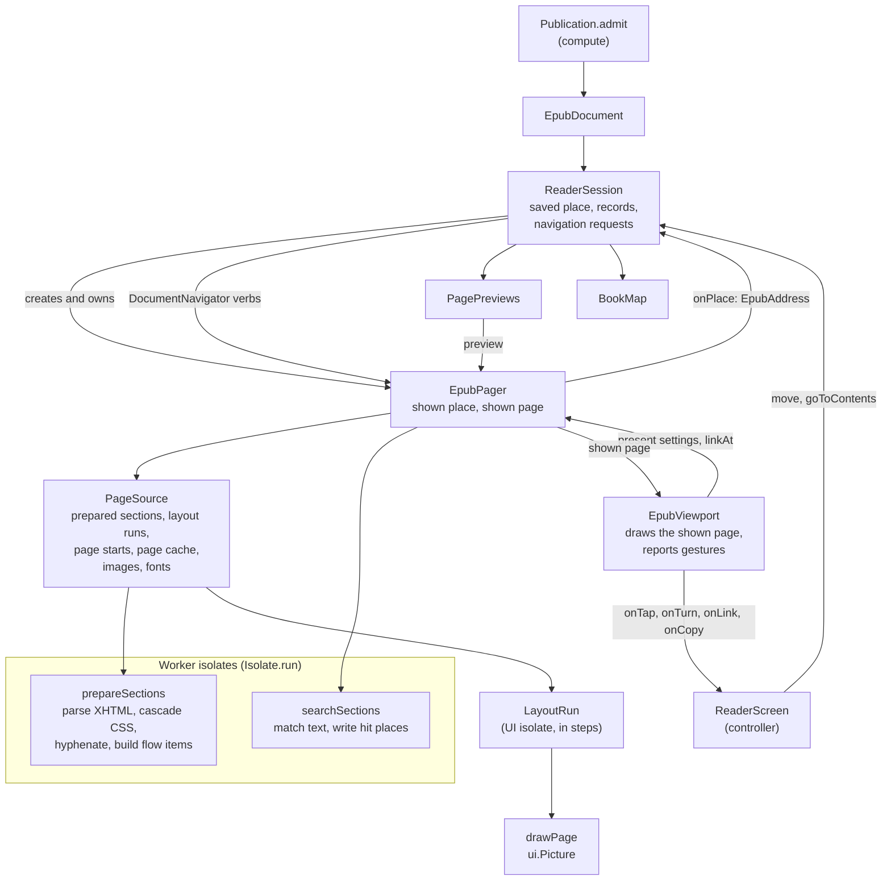
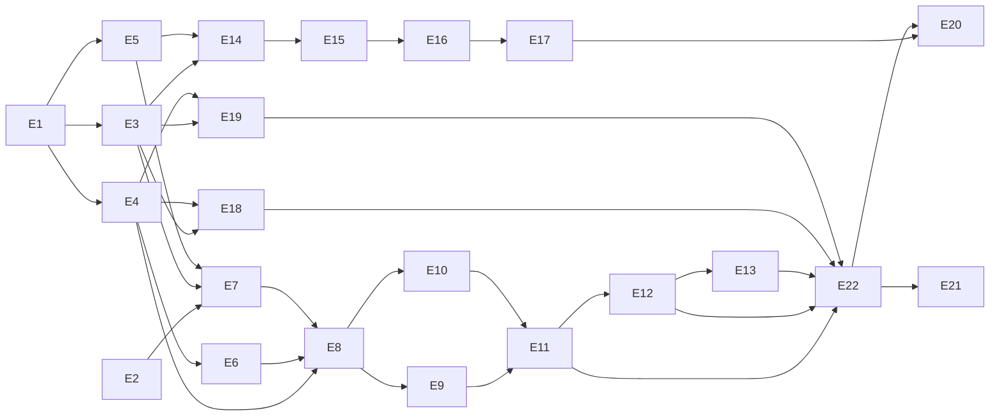

# The native EPUB reader

Date: 2026-11-08. Epic: boo-b2ey. Parent: boo-fs0n. Research: `docs/research/native-epub.md` (ticket boo-ju83).

## Decision

On 2026-11-08 the user decided to go all in on the Flutter renderer that the boo-ju83 trial measured. It becomes Bookfin's only EPUB and MOBI reader on Android, macOS, Linux, Windows and iOS. The WebView reader and epub.js are removed at the end. No book falls back to a WebView. A book that uses a feature outside the renderer's subset renders as well as Flutter allows. Saved places, bookmarks, history and sync keep the EPUB CFI format, so nothing that a user saved moves.

This document decides seven things:

- the modules and the owner of each piece of state
- how layout stays off the frame path
- the viewport
- places
- the coverage that "all in" needs
- testing and removal
- the order of work

Ticket keys E1 to E22 name the tickets. The table in "Order of work" maps each key to its ticket id.

## What stays the same

- The look of a page. The native reader draws the pages that the WebView reader draws today. It uses Source Serif 4 at the reader's text size, line height 1.65, the same margins, and the same night and cream colors. It keeps two Chromium details that the trial copied. Bold text is the regular face thickened, as the WebView draws it. `break-before: page` does not start a new page, because Chromium ignores it in the reader's columns. Reason: the user approved this look, and the fidelity check (E18) can compare only like with like. A change of typography is separate work after epub.js is gone.
- The saved data. A saved place has the same JSON fields and values as today (see "Places").
- The admitted publication. `Publication.admit` keeps its output byte for byte, so the publication identity of every book stays the same.
- The owners around the reader. `ReaderSession` stays the one navigation owner. `DocumentNavigator` stays, without `configure`. `BookMap`, `PagePreviews`, `ScrubDeck`, `ReaderDock` and `ReaderScrubBar` stay.
- The features. Contents, bookmarks, search, text size, night and cream themes, the scrub bar with its deck of pages, and the chapter arrows all stay.

## Terms

| Term | Meaning |
| --- | --- |
| Section | One spine item of the book: an XHTML file. Sections count from 0. |
| Place | `EpubPlace`: a section index, a node's document order in that section, and a character offset in a text node (0 for an element). Nodes are named by number, so a place stays valid across two parses of the same section. |
| Page settings | `PageSettings`: the page width and height in logical pixels, the text size in pixels after the system text scale, and night or cream. Every layout depends on all four. |
| Prepared section | `PreparedSection`: one section parsed, styled for one page settings value, and turned into flow items. It holds no `dart:ui` object, so a worker isolate can build it. |
| Flow item | One step of block layout: a block start, a block end, a paragraph of styled runs, a block image, a rule or a table. |
| Styled run | Text in one style, after white space collapsing and text transform, with a map from each code unit to its DOM character. |
| Strip slice | The trial's `Slice`: one line, image, rule or table row on the section's strip. A page holds whole strip slices. |
| Layout run | `LayoutRun`: lays out a prepared section forward from a page start, one paragraph at a time, and cuts pages as it goes. |
| Step | One call of `LayoutRun.step`: the run lays out paragraphs until a time budget is spent. Steps run between frames. |
| Page start | `PageStart`: a flow item and a line in it where a page begins. |
| Laid page | `LaidPage`: one cut page of one section for one page settings value, with its start and end places. |
| Shown page | `ShownPage`: the laid page on screen and its recorded picture. |
| Main run | The layout run of a section that starts at the section start. |
| True page | A page that a main run cut. |
| Anchored page | A page that starts at the line that holds a given place. While the true page of the place is not known, the pager shows an anchored page. |
| Page source | `PageSource`: the owner of prepared sections, layout runs, page starts, laid pages, decoded images and embedded fonts for one open book. |
| Pager | `EpubPager`: the owner of the shown place and the shown page. It implements `DocumentNavigator`. |

## Modules

All new code lives in `lib/reader/epub/`. The trial in `lib/reader/native_epub/` moves there in E1 and then goes away.



| File | Job | Runs on |
| --- | --- | --- |
| `publication.dart` | Admission. It stays in `packages/flutter_epub_viewer/lib/` until E22 moves it to `lib/reader/epub/`. | A worker (`compute`) |
| `dom.dart` | The DOM of one section, `EpubPlace`, and visible character counts | Any isolate |
| `css.dart` | Style sheets, selectors, at-rules and the cascade | A worker |
| `prepare.dart` | `PageSettings`, `SectionSource`, `PreparedSection`, flow items, styled runs and `prepareSections` | A worker |
| `hyphenate.dart` | Liang hyphenation and its patterns | A worker |
| `fonts.dart` | `BookFonts`: the face list, WOFF conversion and face registration | A worker and the UI isolate |
| `layout.dart` | `LayoutRun`, `PageStart`, `LaidPage` and `lineStart` | The UI isolate |
| `table.dart` | The grid layout of a table item | The UI isolate |
| `paint.dart` | `drawPage`: a laid page into a `ui.Picture` | The UI isolate |
| `places.dart` | CFI, quote, progress, chapter title, `placeAt`, destinations, and the saved address of a page | Any isolate |
| `search.dart` | `searchSections` | A worker |
| `page_source.dart` | `PageSource` | The UI isolate |
| `pager.dart` | `EpubPager` | The UI isolate |
| `viewport.dart` | `EpubViewport`: drawing, gestures, keys and links | The UI isolate |
| `semantics.dart` | The semantics of a page | The UI isolate |
| `selection.dart` | Text selection on a page | The UI isolate |

## State and owners

Each piece of state has one owner. Only the owner changes it. Everyone else reads it or asks the owner.

| State | Owner | Readers | Lifetime |
| --- | --- | --- | --- |
| Admitted publication: section XHTML, resources, identity, spine. Beside it: book style sheets, image sizes, contents. | `Publication` | Page source, pager, `BookMap`, session | The open book |
| Parsed DOM of a section | `PreparedSection`, built by a worker and never changed | Layout runs, places, pager | The page source's cache |
| Style cascade result: computed styles, styled runs, flow items | `PreparedSection` | Layout runs | The page source's cache |
| Laid-out pages, page starts and their cache | `PageSource` | The pager asks for pages. Deck previews go through the pager. | The open book, current and previous settings |
| Decoded images | `PageSource` | `drawPage` | Least recently used |
| Embedded fonts | `BookFonts`, inside the page source | Layout | The process. Flutter cannot unload a font. |
| Current page settings | `EpubPager`. The viewport presents new values. | Page source | The open book |
| Shown place and shown page | `EpubPager` | The viewport draws the page. The session receives each new place as an `EpubAddress`. | The open book |
| Page index of the shown section | Nobody stores it. It follows from the shown page. | | |
| Saved place: visible address, position, resumes | `ReaderSession` | Scrub bar, bookmarks, store | The account |
| Selection | `EpubViewport`, as ephemeral UI state | | Until the page changes |
| Search results | `ReaderSession` (`hits`) | Search panel | Until the next search |
| Search work | `EpubPager`, which runs worker isolates | | One search |
| Scrub deck page images | `PagePreviews` | `ScrubDeck` | One drag |
| Whole-book fractions and chapter starts | `BookMap`, which the session keeps | Scrub bar, chapter arrows | The open book |
| Contents entries | `Publication.contents`, which the session publishes | Contents panel, `BookMap` | The open book |

The session keeps a copy of the shown place: its visible address and the position that it saves. The copy has one source. The pager reports each new place once, through `onPlace`, as the PDF viewport does today through `onAddress`.

Two designs for the shown place were compared:

| Design | Who owns the shown place | Page turn | PDF | Cost |
| --- | --- | --- | --- | --- |
| Pager owns it (chosen) | `EpubPager` | The session calls `move`. The pager shows the page and reports the place. | Same model: `PdfViewport` owns its page and reports addresses. | The session keeps a reported copy, as today. |
| Session owns it | `ReaderSession` | The session asks the document for the next place and stores it. The viewport draws the page of the stored place. | A second model, unless the PDF viewport is rebuilt the same way. | Two navigation models, or a PDF rewrite. |

## Navigation

`ReaderSession` stays the one navigation owner. It decides what to show next from the person's actions, it saves places, and it handles failures. A navigator carries out its requests.

`DocumentNavigator` stays. Its verbs are what the session asks for, and they do not depend on the engine. The PDF viewport implements the same verbs. The verbs stay asynchronous because a page can need layout first. The WebView was the only reason for `configure`, and no caller uses it: each viewport takes the text size and the theme as parameters. E10 removes it.

```dart
abstract interface class DocumentNavigator {
  Future<void> move(bool forward);
  Future<void> display(ReaderAddress address);

  /// Shows the destination [href]: a contents entry or an internal link,
  /// relative to the package document's directory, with an optional
  /// fragment. A PDF uses `page:N`.
  Future<void> contents(String href);
  Future<void> seek(int part, double progress);
  Future<PagePreview> preview(
    BookPlace place,
    double width,
    Future<void> abandon,
  );
  Future<ReaderSearchReport> search(String query, int request);
  Future<void> cancelSearch(int request);
}
```

How the session uses the pager (E10):

1. `open` admits the book as today. For an `EpubDocument`, the session creates `EpubPager(document, initial: initialAddress, onPlace: ..., onWarning: ...)`. `onPlace` calls `acceptAddress(token, address)`. `onWarning` calls `warn(token, message)`.
2. The session calls `attachDocument(token, pager, publication.contents)` at once. The book is ready without waiting for a WebView.
3. `_clear` disposes the pager.
4. The session exposes the pager to the screen (`EpubPager? get pager`). The screen passes it to the viewport, which uses only `shown`, `present` and `linkAt`.
5. An internal link uses the contents verb: the screen calls `reader.goToContents(href)` with the href that `linkAt` returned.

## Pages

The trial's strip model stays. A section flows down one strip as wide as the page. Each line, image, rule and table row is a strip slice. A page is a window of the strip that holds whole strip slices. The cut follows Chromium's block fragmentation, as the trial does.

The design rests on one property. A page cut depends only on the strip slices from the page's start down to one page height below it. So a layout run that starts at a true page start cuts the same pages after it as the main run. Two rules make the property hold, and E3 makes both rules hold:

- At each strip slice that it adds, a run applies `break-inside: avoid` and `break-after: avoid`. The trial lowers the appeal of a block's breaks after the block ends. The result is the same.
- A run that starts inside a paragraph lays out the whole paragraph, and then keeps only the lines from its start line. The orphans and widows rules then see the whole paragraph.

The rules of pages:

1. A section's main run starts at the section start and runs to the section end, in steps. Its page starts are true page starts.
2. A run can start at any page start. A page laid out again from its page start is the same page. The page source uses this to rebuild a page that its cache dropped.
3. To show a place whose true page is not known yet, the pager shows an anchored page. It starts at the line that holds the place. Pages after it are cut forward from it.
4. When the main run passes an anchored page's start, one of two things holds. If that start is a true page start, the anchored pages are true pages. A saved place is the start of a page, so this is the normal case for a saved place that opens with the same settings. If the start is not a true page start, the shown page stays on the screen. The next turn shows the true page that holds the first place after the shown page. A turn back shows the true page that holds the last place before it. A turn never skips text. It can repeat some lines once.
5. Before the main run reaches an anchored page, a turn back from it waits for the main run. As soon as the page is ready, it shows.
6. A page never spans two sections. A turn past the last page of a section shows the first page of the next section. That page always starts at the section start, which is always a true page start. A turn back past the first page of a section shows the last true page of the previous section. That page needs the previous section's main run, which step 4 of the order of work runs early.

Three designs for showing a place deep in a long section were compared:

| Design | Open at a place deep in a large section | Turn back right after opening | Extra state | Cost |
| --- | --- | --- | --- | --- |
| Lay out the section up to the place, then show | Waits for the section up to the place. The 430,000-character Keats section took 0.9 s on the host, so about 1.5 to 2.5 s on a phone (an estimate). | Instant | None | Slow opens of large sections |
| Anchored pages (chosen) | One paragraph plus one page | Waits once, until the main run passes | The anchored run in the page source | Some repeated lines once, after a settings change |
| Anchored pages and a page map on disk | One page | Instant | A derived store on disk with its own invalidation | More code and a new store to keep safe |

The page map on disk waits. If the phone shows a wait of more than 0.5 s on a turn back in real books, E20 adds a ticket for it.

## Layout off the frame path

Flutter builds and lays out `dart:ui` paragraphs only on the UI isolate. Everything else moves to worker isolates.

| Work | Where | Cost on the host (trial) | Why there |
| --- | --- | --- | --- |
| Admission: unzip, sanitize, identity | `compute`, as today | | It needs no `dart:ui`. |
| Parse XHTML, cascade CSS, hyphenate, build flow items | `Isolate.run`, one call per batch of sections | Median 1.0 ms per section | It needs no `dart:ui`. `Isolate.run` returns its result through `Isolate.exit`, so the prepared section comes back without a copy. |
| WOFF to SFNT conversion | The prepare worker | | It needs no `dart:ui`. |
| Search | `Isolate.run`, one call per batch of sections | | It needs no `dart:ui`. A batch boundary is where a cancel takes effect. |
| Build paragraphs, shape, break lines, flow blocks, cut pages | The UI isolate, in steps | Median 5.5 ms per section, 927 ms for 430,000 characters | `dart:ui` paragraphs exist only on the UI isolate. |
| Record a page picture | The UI isolate | 0.05 ms per page | Small |
| Decode images | `instantiateImageCodec` with a target width | | The engine decodes on its own threads. |
| Draw a deck card | `Picture.toImage` | 0.7 ms per page | It runs on the raster thread. |
| Register a font face | `ui.loadFontFromList` | | Once per face for the process |

Phone numbers are not measured. The phone is probably 1.5 to 2.5 times slower than the host for shaping. E20 measures it.

### Steps

- A step lays out paragraphs until its time budget is spent. The budget starts at 4 ms. The Pixel 8 can draw at 120 Hz, so a frame has 8.3 ms. E20 tunes the budget on the phone.
- A paragraph is the unit of work. A step stops after the paragraph that crosses the budget. A paragraph whose shaping alone takes longer than the budget runs in a step of its own. The corpus test (E19) lists such paragraphs.
- A table row is a unit of work too (t1-um08). A table's column widths need each of its rows measured, so the run first measures one row per unit, once per table item, and keeps the widths for the other runs of the section. A page start inside a table names a row and a fragment of that row, so a run from it lays out no row above it. `LineSearch` finds the line of a place in steps for the same reason.
- The page source schedules steps with `SchedulerBinding.instance.scheduleTask`. Work for the shown page and its two neighbors is urgent, so it runs while the scrub deck animates. Other work is idle work, and it waits while an animation runs.
- Both kinds of step use `Priority.animation`. An idle step that runs while transient frame callbacks are registered does no layout. It waits for the end of the next frame in a post-frame callback, and then goes back into the task queue. So it wakes the event loop at most once a frame. With `Priority.idle`, Flutter's default strategy keeps the task in the queue and asks again at once with a zero timer, a busy loop between frames for as long as the animation runs (t7-hufl).
- The page source takes the scheduler as a constructor parameter, so tests run steps one at a time.

### Order of work, from the shown place outward

1. Prepare the shown section, then lay out the shown page (anchored or true).
2. Lay out the next page and the previous page.
3. Run the main run of the shown section.
4. Lay out the first page of the next section, then run the main run of the previous section.
5. While a drag runs, a deck preview comes before items 3 and 4.

Nothing lays out the whole book.

### Cache policy

| Cache | Key | Limit to start | Never evicted | Empties on |
| --- | --- | --- | --- | --- |
| Prepared sections | Section and settings | 6 sections and 1.5 million visible characters | The shown section | Book close. A settings change keeps the previous settings' entries until the next change. |
| Page starts | Section and settings | Every section laid out in this session. They are integers only. | | Book close. The previous settings' starts stay as above. |
| Laid pages: paragraphs, strip slices and the picture | Section, settings and page start | 24 pages | The shown page and its two neighbors | Eviction disposes the paragraphs and the picture. |
| Decoded images | Path and decode width | 32 MiB | Images of the shown page | Book close |
| Embedded fonts | Book identity and face | None | All | Process exit |

The previous settings stay so that a toggle of the reader dock costs nothing. Hiding the dock makes the page area taller, which is a settings change. E20 measures memory on the phone and changes these limits.

### Settings changes

A change of text size, theme, page size or orientation keeps the shown place. The pager anchors the new page at the shown place, and the viewport keeps the last drawn page until the new page is drawn. Nothing is saved, because the place did not move.

The theme is part of the key for two reasons. Each Flutter paragraph's style holds its text color. A book's `prefers-color-scheme` rules can change its styles. A theme change is rare, and the shown page lays out in milliseconds.

## The viewport

`EpubViewport` (E9) is a leaf widget. It draws what the pager shows and reports what the person did.

```dart
class EpubViewport extends StatefulWidget {
  const EpubViewport({
    super.key,
    required this.pager,
    required this.fontSize,
    required this.night,
    required this.onTap,
    required this.onTurn,
    required this.onLink,
    required this.onCopy,
  });
  final EpubPager pager;

  /// The text size in pixels, after the system text scale.
  final double fontSize;
  final bool night;

  /// A tap that hit no link and ended no selection.
  final VoidCallback onTap;

  /// A swipe or key that asks for the next page (true) or the previous one.
  final ValueChanged<bool> onTurn;

  /// A tap on an internal link, with its destination for `contents`.
  final ValueChanged<String> onLink;

  /// The person chose Copy for the selected text.
  final ValueChanged<String> onCopy;
}
```

The pager's side of the viewport:

```dart
/// The page on screen with its picture, or null before the first page is
/// drawn.
ValueListenable<ShownPage?> get shown;

/// Asks for pages for [settings]: the viewport's size, the text size and the
/// theme. It keeps the shown place. It notifies `shown` later, never during
/// the call.
void present(PageSettings settings);

/// The destination of the link under [point] of the shown page, relative to
/// the package document, or null.
String? linkAt(Offset point);
```

`present` is a request for pages, like an `Image` widget that resolves its image. It changes no record, saves nothing and moves no place. So whenever its size, the text size or the theme changes, the viewport calls `present` from its own layout.

| Need | Behavior |
| --- | --- |
| Drawing | A render object paints the shown page's picture. Before the first page it paints paper only. |
| Page turn | Instant, as today. No turn animation. |
| Tap | A tap on a link calls `onLink`. Any other tap, with no selection, calls `onTap`. The screen hides or shows the dock and the app bar, as today. |
| Swipe | A horizontal drag of more than 60 logical pixels, with less than 50 vertical, calls `onTurn`. A drag to the left asks for the next page. These are reader.js's numbers. |
| Desktop | Left and right arrows, Page Up, Page Down and Space call `onTurn`. A horizontal trackpad scroll past a threshold calls `onTurn`. |
| Links | `linkAt` finds the paragraph under the point, the code unit at the point, its DOM character, and the nearest `a[href]` ancestor. It resolves the href against the section's path. |
| Selection and copy (E13) | A long press selects a word. Handles extend the selection within the page. The menu offers Copy, which calls `onCopy`. The screen writes the clipboard (E11 wires it). A page turn clears the selection. On desktop, a mouse drag selects, and Ctrl+C or Cmd+C copies. |
| Images | The page picture draws each image once it is decoded. Until then it draws an outline. As soon as the image arrives, the page draws again. |
| Themes and text size | The screen passes them. The viewport presents them. |
| Scrub deck | The viewport stays the deck's `page` child. `PagePreviews` asks `pager.preview`, which lays out the true page, records its picture and draws it with `Picture.toImage` at the card width. No JPEG and no bridge. |

## Places

### The saved form stays

A saved EPUB place is the same JSON as today. `ReaderDocument.save` writes it. If every field matches, `ReaderDocument.restore` accepts it. Otherwise it refuses it.

```json
{"version":1,"processed":"<publication identity>","original":"<sha-256 of the download>",
 "policy":"bookfin-passive-epub-1","engine":"epubjs-0.3.93-bookfin.1",
 "cfi":"epubcfi(/6/4!/4/26/1:0)","resource":"epub/text/chapter-1.xhtml",
 "quote":"<the first 120 characters from the place on>","progress":0.25}
```

- `engine` names the CFI dialect. The native renderer writes the same dialect, epub.js's word-start rule. So the value stays, and an older Bookfin on another device keeps accepting places that the new version writes.
- `processed` is a hash of every admitted file. If admission output changes by one byte, every saved place of that book stops matching, and the reader starts at the beginning. So admission stays byte for byte. E2 adds a test that pins the identity of the fixture books.
- What the native renderer needs beyond the admitted files comes beside them, outside the identity. These are the book's own style sheet texts, image sizes and the contents.
- Do not fix te-9m1y in the sanitizer, because that changes the identity of every Standard Ebooks book.
- The Content-Security-Policy meta element that admission adds to each section stays, though nothing reads it.

### Rules

`places.dart` (E4) holds every rule that reader.js applies today.

| Need | Rule |
| --- | --- |
| Page start to saved place | `wordStart` of the page start, then the CFI (`cfiOf`), the quote (120 characters), the progress (6 decimals) and the chapter label |
| CFI to place | `positionOf`. An offset past the end of its text node stops at that end. A range resolves to its start. |
| Open a saved place | Resolve the CFI. The text at the place must start with the saved quote (reader.js `verifyLocation`). If it does not, see rule 4 below. |
| Progress to place (scrub bar) | `placeAt`: the visible character at `floor(progress × total)`, at most the last one |
| Contents entry or link to place | The element with the fragment's id, or the body. The place is its first text node at offset 0. If it has no text, the place is the element. |
| Search hit to place | The start of the match |
| Chapter label | The last contents entry of the same section at or before the place, else the section's first `h1` or `title`, else "Chapter N" |
| Page end | The progress of the last visible character on the page. It is for display only and is not saved. The chapter arrows use it (t6-0cjf). |
| Whole-book fraction | `BookMap`, unchanged: section byte shares and text progress |

### Data safety

Places follow the engine rule: never lose a place in a book.

1. Opening at a saved place reports the saved address itself, unchanged. The store sees an equal record and adds no sync action. This also ends an old drift: epub.js reported the start of the page that held the saved place, so a place moved back a little whenever the layout had changed.
2. A settings change keeps the shown place and reports nothing.
3. A turn, a seek, a contents entry, a link, a bookmark or a search hit reports the new page's place, as today.
4. A saved place whose quote does not match opens the book at its beginning with today's warning. The pager reports nothing until the person moves, so the old place stays saved.
5. The pager reports a place only for a page that it shows.

### Places that epub.js saved

The trial showed that every epub.js place lands on the page that shows it (661 of 661 at 20 pixels, 706 of 706 at 23). E18 makes this a permanent test. While epub.js exists, it records the places that epub.js writes: each page start at 20 and 23 pixels, search hits and contents targets. It records them for the committed fixture books of `tool/showcase_media.dart` and for the corpus books. The committed fixture file stays after epub.js is gone. The native renderer must open each place on a page whose first line holds the start of its quote.

## Coverage beyond the trial

### Book style sheets (E2, E5; absorbs te-9m1y)

- Admission keeps the original text of each style sheet in the manifest (`Publication.bookStyles`), outside the identity. The page source gives the prepare worker this text for linked sheets.
- `<style>` elements and `style` attributes come from the admitted DOM, because the DOM is part of the identity. Standard Ebooks books use linked sheets only.
- The native CSS parser is the safety boundary. It resolves `url()` and `@import` only to files in the publication and loads nothing else. It limits rules per sheet, selector length and nesting depth. It runs in a worker, so a slow sheet cannot stall a frame.
- The trial parser already skips `@namespace` and matches `epub|type` attributes. So Standard Ebooks books get their small caps, verse indents and title blocks.
- E5 adds `@import` and `@font-face`, and sets `prefers-color-scheme` from the theme.

### Embedded fonts (E5)

- A `@font-face` rule names a family and a `src: url()` to a font file in the publication.
- The worker converts WOFF 1 to SFNT (zlib per table). WOFF 2 needs Brotli and table transforms, so such a face uses the reader font, and the corpus report lists it.
- The page source registers each face once with `ui.loadFontFromList`, before a section that uses it lays out. The family name is per book: `bookfin-<first 12 hex digits of the identity>-<family>`.
- The prepare worker resolves each run's family list to one family. That family is a registered face, the reader font, or `monospace`, as in the trial.
- A face whose file does not load draws in the reader font, as a WOFF 2 face does. `BookFonts` records which families registered, and layout draws a family that did not register in the reader font.
- Layout sets the `opsz` axis of every font to the text size, as Chromium does. It sets the `wght` axis of an embedded face to the CSS weight, as Chromium does. The reader font keeps `wght` 400, because its `@font-face` rule names no weights.
- Flutter cannot unload a font, so faces stay for the process. A character that a face lacks draws in the reader font.

### Hyphenation (E16)

- The renderer hyphenates where CSS asks for `hyphens: auto` and the language has patterns. The language comes from `lang`, then `xml:lang`, then the package's `dc:language`.
- Liang's algorithm with TeX patterns, English (US and GB) first. The patterns are Dart data, and their license goes into `assets/licenses/reader/`.
- The worker inserts soft hyphens (U+00AD) into styled runs. The text map skips them, so places do not change.
- A line that ends at a soft hyphen gets a drawn hyphen. E16 first finds out whether Flutter's paragraph already draws one.
- Words of fewer than 5 letters do not break. A break keeps at least 2 letters before it and 3 after it, the TeX defaults for English.

What E16 found and decided (tc-z7au):

- Flutter's paragraph breaks a line at a soft hyphen but draws no hyphen. So layout writes a hyphen (U+2010, as Chromium draws when the font has it) in place of each soft hyphen that ends a line, and lays the paragraph out again. The line then holds its hyphen: the hyphen must fit, and a justified line ends at it, as in Chromium. A drawn decoration after the line would hang past the right edge of justified text.
- Before it lays out again, layout checks that each hyphen fits: the line's width before justification plus the hyphen's width must not pass the line width. A justified line's width before justification follows from one gap between words, because Flutter widens each gap by the same amount. A soft hyphen whose hyphen does not fit becomes a word joiner (U+2060), and its line breaks earlier. A paragraph with hyphenated lines lays out at least twice, and once more for each word joiner.
- Cost on the host (2026-11-08, under load): with hyphenation, layout of whole Standard Ebooks books (Frankenstein, Moby-Dick, Pride and Prejudice) takes 2.4 to 2.6 times as long, and prepare about twice as long. Frankenstein lays out in 622 ms instead of 242 ms, about 1 ms per page.
- An inserted soft hyphen, hyphen or word joiner maps to the letter before it in the text map. So a line that ends with one ends at that letter. Places, quotes, search and CFIs read the DOM, which never holds them.
- `xml:lang` wins over `lang`, as in HTML and in the `:lang()` selector. An empty value names an unknown language.
- As in Chromium, a word runs between spaces, hyphens and dashes, without the punctuation around it. Only words of the letters a to z break, so a word with the book's own soft hyphen breaks only there. A capitalized English word does not break. `-webkit-hyphens` is another name of `hyphens`, and `hyphens: none` also removes the book's own soft hyphens.
- `SectionSource.language` carries `dc:language`. Admission reads the package's first `dc:language` that is not blank into `Publication.language`, beside `bookStyles` and outside the identity, and the page source passes it to prepare (t0-2yee).
- The fidelity fixtures were recorded with hyphenation turned off (compare.cjs). So `fidelity_test.dart` turns it off in the book's style sheets too.

### Fractional line positions (E15)

Flutter rounds each line's height to a whole pixel. Chromium does not. Layout records each line's exact top: the sum of the unrounded CSS line heights before it. Paint draws each line at its exact top, clipped to that line. Page cuts use the exact positions. Pages then match Chromium at every text size, not only at sizes whose line height is a whole pixel.

### Tables and other layout (E14)

- A table with rows lays out as a grid. Column widths come from each cell's minimum and maximum content widths (Flutter's `minIntrinsicWidth` and `maxIntrinsicWidth`), in a simple form of CSS automatic table layout.
- `colspan` works. `rowspan` counts as 1. A caption is a block above the table. Cell padding and borders follow the computed style. A table inside a cell lays out as blocks.
- `border-spacing` spaces the columns and rows, 2 pixels unless the book sets it (te-orei). With `border-collapse: collapse`, the table has no spacing and no padding. Two cells that touch share one border, the widest of the cell, row and table borders that meet there, as CSS 2.1 collapses borders. Each cell and the table draw their half of each border. Row group and column borders and `hidden` borders do not take part (t6-hwgc).
- A row is one strip slice, so a page breaks between rows. A row taller than a page splits into fragments between the lines of its cells (te-4cez), so no text is lost. Each fragment but the last fills one page, and each cell goes on from its first line that did not fit. A split cell starts at the top of the row, because no page shows the whole row that vertical-align centers in. A fragment is a strip slice, and a page can start at it.
- Every cell's text has places, so CFIs, quotes and search work in tables.
- Flex rows, grids, floats, and absolute or fixed boxes flow as blocks. A box moved off the page by a negative offset stays out, as in the trial.

### Images and SVG (E7, E17)

- Admission keeps PNG and JPEG images. It replaces an SVG wrapper of a JPEG with the JPEG. It replaces inline SVG and other images with a span "[Unsupported image: alt]". The native renderer draws that span as text.
- The page source decodes each image at its drawn size. A page draws an outline until its image arrives, then draws again.
- E17 adds `filter: invert()` on images. Standard Ebooks sets it on black line art in its dark color scheme, so line art stays visible in the night theme. An image that fails to decode draws its alt text.

What E17 decided (tc-cl77):

- The computed style keeps one value of `filter`: how far it inverts, from 0 to 1. Each `invert()` composes with the ones before it (by a, then by b, inverts by a + b − 2ab). The other filter functions are ignored. `filter` is not inherited, so only the image's own filter counts.
- Image items and inline image runs carry a `DrawnImage`: the path, the invert amount and the alt text. Paint draws an inverted image through a color matrix.
- A page's images have three states: decoded, not decoded yet (an outline), and unable to decode (the alt text in the reader font, clipped to the image's box, or an outline without alt text). Admission already decodes every image that it keeps, so the third state is rare. A palette PNG without its palette is one example.

### Footnote links

This is a product fork. See "Product fork for the user".

### MOBI

The libmobi conversion stays. A MOBI or AZW3 book converts to an EPUB, admission admits it, and the same renderer reads it. The MOBI identity rule (`EpubDocument.mobi`) stays. macOS needs the converter bundled (tf-mqh6). Linux and Windows build it in their runners (boo-0i64, boo-0wnc).

### Accessibility (E12)

- The page has one semantics node for each text block on it, in reading order. Each node holds the text of the block's lines on this page.
- Headings are marked as headers. Each link is its own node with a tap action. Each image has its alt text as its label.
- The page node has scroll actions that turn pages, which TalkBack's scroll gestures use.
- The system text size already reaches the reader through the text scale.
- A device check with TalkBack needs t2-u76g.

### What stays unsupported

Vertical writing and right-to-left page order lay out as left-to-right pages. Flutter still shapes right-to-left words within a line. MathML is removed by admission. Inline SVG shows its label. `::first-letter`, generated content and multiple columns render as plain text in one column. `text-wrap: pretty` breaks lines greedily. A WOFF 2 face uses the reader font. A `rowspan` counts as 1.

## Testing

### Behavior tests

Each ticket writes its tests first, in the language of the domain. These are the behaviors that the product needs:

- A page holds whole lines that fit its height, and pages cover a section's text in order with nothing left out.
- A run that starts at any true page start cuts the same pages as the main run.
- A run stopped after any step and resumed cuts the same pages as a run that never stopped.
- A step ends within its budget plus one paragraph.
- A saved place opens on a page whose first line holds it, before the main run of its section ends.
- A turn after an anchored page never skips text.
- A page turn crosses into the next and the previous section.
- A text size, theme or page size change keeps the shown place and saves nothing.
- Opening at a saved place saves no new place.
- A place that epub.js saved opens on the page that shows its quote.
- Contents entries, internal links, bookmarks and search hits open on the page that shows their target.
- The chapter arrow skips a chapter that starts on the shown page.
- Search finds the same hits as the WebView's rules: lowercase matching, white space as one space, block boundaries as a space, 500 hits at most.
- A tap toggles the dock, a swipe turns, a tap on a link follows it, and keys turn pages on desktop.
- TalkBack reads the text of the shown page in order, and its scroll actions turn pages.
- A long press selects text, and Copy reports the selected text.
- The scrub deck draws the true page of a place, with neighbors that exactly one page holds each.
- Standard Ebooks books get their own styles, and embedded fonts draw their glyphs.
- A simple table lays out as a grid, and a page breaks between rows.
- Hyphenated words break where the patterns allow and show a hyphen.

### Corpus test (E19, on demand)

A list of 50 to 100 public-domain books in `tool/reader/epub_corpus.json` gives each book's source URL and SHA-256. It mixes Standard Ebooks, Project Gutenberg EPUB 3 books with images, tables and poetry, and a few Gutenberg Kindle files for MOBI. `tool/reader/fetch_epub_corpus.py` downloads them into `.cache/epub-corpus/`, which git ignores. `BOOKFIN_EPUB_CORPUS=1 flutter test test/reader/epub/corpus_test.dart` runs over every book at two page settings. It reports:

- every exception (the target is none),
- the share of page starts whose CFI opens the same page again (the target is all of them),
- the features that each book uses and the renderer approximates,
- slow paragraphs and the layout time per 10,000 visible characters.

### Fidelity check against epub.js (E18, before E22)

E18 runs the trial's Chromium comparison against the product renderer, with the WebView look. Body text must keep the trial's agreement: at least 99.9 percent of line starts and 98 percent of page starts at 20 pixels. E18 commits what Chromium measured: the line starts and page starts of each compared section at 20 and 23 pixels, keyed by the book's SHA-256. The comparison then runs on demand without Chromium, after epub.js is gone. E15 uses it: with exact line positions, page starts at 23 pixels must agree as well as at 20. E18 also records the epub.js places described in "Places that epub.js saved". The results go into `docs/research/native-epub-fidelity.md`.

### Data-safety tests

- Admission pins the identity of the fixture books (E2).
- The anchor JSON that the native reader writes equals the JSON that epub.js wrote for the same page start (E4, E18).
- Opening at a saved place, and a settings change, add no record to the store (E8, E10).
- A place saved at the last turn opens on the same page after a restart (E10).
- A place whose quote does not match keeps the old record until the person moves (E8, E10).
- A bookmark made on a page opens on that page (E10).

## Removal (E22)

E22 deletes:

- `packages/flutter_epub_viewer/`, which holds these parts:
  - the WebView viewport and `resources.dart`, the WebView's resource serving
  - `navigation.dart`
  - the epub.js and reader.js assets, the engine sources and the license files
  - the engine tests (`engine/test/*.cjs`) and the Chromium comparison (`engine/trial/compare.cjs`).
- `publication.dart` moves to `lib/reader/epub/publication.dart`, unchanged. `ReadingLocation`, `ContentsEntry`, `SearchHit` and `SearchReport` move to `lib/reader/document.dart`, unchanged.
- The `flutter_epub_viewer` and `flutter_inappwebview` dependencies in `pubspec.yaml`.
- `EpubNavigator` and the `PagePicture` decoding in `lib/reader/document.dart`. This is the WebView path of the page previews.
- `ReaderSession.attach` (the `NavigatorPort` adapter) and the export of `navigation.dart`.
- The epub.js license line in `lib/main.dart`.
- The `ReaderResources` tests in `test/reader/publication_test.dart`, `test/reader/page_preview_sources_test.dart`, and the `NavigatorPort` fakes in `test/reader/screen_test.dart` and `test/reader/session_test.dart`.
- `test/reader/epub/trial/`: the trial tooling that E1 moved there, including the step that writes a plan for Chromium. The on-demand comparison against the committed Chromium data (`fidelity_test.dart`) and `saved_places_test.dart` stay.
- `nodejs_22` in `flake.nix`. If something else uses it, it stays.
- The WebView text in `docs/reader-implementation.md` and `docs/plans/platforms.md`.

E1 already deleted the trial app (`tool/epub_trial/`) and moved the rest of the trial out of `lib/reader/native_epub/` and `test/reader/native_epub/`.

### Tickets that this epic makes obsolete

| Ticket | Title | Status | Why | Ticket that removes the cause |
| --- | --- | --- | --- | --- |
| t6-rt20 | Cut the time to draw an EPUB scrub deck page below 0.3 s | Absorbed | The deck draws pages from the native renderer. E8 keeps the 0.3 s goal in its acceptance. | E8, then E22 deletes the old path |
| tf-z3wm | Serve the reader WebView's resource requests without the main thread | Obsolete | No WebView, so no resource requests | E22 |
| t6-6gej | Measure the reader's frame rate on hardware graphics | Absorbed | The WebView redraws go away. E20 measures the native reader's frames on the phone. | E20 |
| tf-gnuk | Read EPUB books in the Apple WebKit reader on macOS and iOS | Obsolete | The native reader runs on macOS and iOS without WebKit. | E11 |
| tf-mqh6 | Bundle the libmobi converter in the macOS app | Still needed | MOBI still converts with libmobi. It now follows E11 instead of tf-gnuk. | |
| tf-4fv5 | Close the engine test browser and fixture when Chromium fails to start | Obsolete | The engine tests are deleted. | E22 |
| tf-1quf | | Not found | No ticket has this id. | |
| t6-0cjf | Next chapter can stay on the same page when a chapter starts in the middle of a page | Absorbed | The pager reports the shown page's end, and the chapter arrows use it. | E10 |
| te-9m1y | Keep Standard Ebooks style sheets that declare a CSS namespace | Absorbed | Admission keeps the book's own sheets beside the identity, and the native parser reads them. The scrub deck draw failure in its notes was a reader.js fault. | E2, E5 |
| boo-ohud | Complete Android EPUB resource denial and accessibility acceptance | Partly obsolete, partly absorbed | Resource, navigation and permission denial were WebView checks. TalkBack, publisher fonts, SVG fallback, large text and offline reading need a new check on the native reader. | E11, E12, E22 |
| boo-eisp | Run Bookfin on iOS | Still needed | Its EPUB part now follows E11 instead of tf-gnuk. | |
| boo-0i64, boo-0wnc | Run Bookfin as a Linux or Windows desktop app | Still needed | EPUB on these platforms comes from E11, not from a WebView plugin. | |
| t2-u76g | Allow real TalkBack acceptance alongside the Android snapshot helper | Still needed | E12's device check needs it. | |
| t3-5o5r | Find why the reader session restart test failed once | Still needed | The session code stays. | |

## Order of work

Each ticket names its files. Tickets that run at the same time edit different files. `test/reader/epub/helpers.dart` belongs to E1. Later tickets put new helpers in their own test files.

| Key | Ticket | Title | Files | Depends on |
| --- | --- | --- | --- | --- |
| E1 | tc-bsen | Promote the trial renderer into lib/reader/epub and split prepare from layout | `lib/reader/epub/{dom,css,places,prepare,layout,paint}.dart`, `test/reader/epub/`, delete `lib/reader/native_epub/`, `test/reader/native_epub/`, `tool/epub_trial/` | |
| E2 | tc-acl5 | Keep book style sheets, image sizes and contents beside the pinned publication identity | `packages/flutter_epub_viewer/lib/publication.dart`, `test/reader/epub/admission_test.dart` | |
| E3 | tc-nang | Lay out a section in resumable runs that start at any page start | `lib/reader/epub/{layout,paint}.dart`, `test/reader/epub/layout_run_test.dart` | E1 |
| E4 | tc-sqp7 | Find and write every saved place through the native DOM | `lib/reader/epub/places.dart`, `packages/flutter_epub_viewer/lib/navigation.dart` (`ReadingLocation.end`), `test/reader/epub/places_test.dart` | E1 |
| E5 | tc-nh0b | Read each book's own style sheets, @import and embedded fonts | `lib/reader/epub/{css,prepare,fonts}.dart`, `test/reader/epub/{css,prepare,fonts}_test.dart` | E1 |
| E6 | tc-866u | Search the book in worker isolates with today's matching rules | `lib/reader/epub/search.dart`, `test/reader/epub/search_test.dart` | E4 |
| E7 | tc-tjtc | Make pages in a page source that lays out between frames and keeps a bounded cache | `lib/reader/epub/page_source.dart`, `test/reader/epub/page_source_test.dart` | E2, E3, E5 |
| E8 | tc-mxfp | Move through the native EPUB with a pager that owns the shown place | `lib/reader/epub/pager.dart`, `test/reader/epub/pager_test.dart` | E4, E6, E7 |
| E9 | tc-1iap | Show the pager's pages in a native viewport with turns, taps, links and keys | `lib/reader/epub/viewport.dart`, `test/reader/epub/viewport_test.dart` | E8 |
| E10 | tc-zevb | Open EPUB and MOBI books in the native pager from the reader session | `lib/reader/{document,session,book_map,pdf_viewport}.dart`, `lib/reader/epub/pager.dart` (`configure` only), `test/reader/session_native_test.dart`, `test/reader/book_map_test.dart` | E8 |
| E11 | tc-1yif | Make the native viewport the EPUB and MOBI reader on every platform | `lib/reader/screen.dart`, `test/reader/{screen,dock,appearance,shared_appearance}_test.dart`, `docs/plans/platforms.md` | E9, E10 |
| E12 | tc-fz4n | Read native pages with TalkBack and other screen readers | `lib/reader/epub/{viewport,semantics}.dart`, `test/reader/epub/semantics_test.dart` | E11 |
| E13 | tc-iwqp | Select and copy text on a native page | `lib/reader/epub/{viewport,selection}.dart`, `test/reader/epub/selection_test.dart` | E12 |
| E14 | tc-txyr | Lay out simple tables as grids and other unsupported layout as plain flow | `lib/reader/epub/{table,prepare,layout}.dart`, `test/reader/epub/table_test.dart` | E3, E5 |
| E15 | tc-n6wv | Place lines at fractional positions | `lib/reader/epub/{layout,paint}.dart`, `test/reader/epub/line_position_test.dart` | E14 |
| E16 | tc-z7au | Hyphenate text that asks for it | `lib/reader/epub/{hyphenate,hyphenation_en,prepare,layout}.dart`, `assets/licenses/reader/`, `test/reader/epub/hyphenate_test.dart` | E15 |
| E17 | tc-cl77 | Draw images in both themes and keep the fallbacks for unsupported images | `lib/reader/epub/{css,prepare,paint}.dart`, `test/reader/epub/image_test.dart` | E16 |
| E18 | tc-pshi | Check the native renderer against epub.js and keep epub.js places as fixtures | `packages/flutter_epub_viewer/engine/trial/compare.cjs`, `test/reader/epub/trial/fidelity_test.dart`, `test/reader/epub/fidelity_test.dart`, `test/reader/epub/saved_places_test.dart`, `test/reader/epub/fixtures/`, `docs/research/native-epub-fidelity.md` | E3, E4 |
| E19 | tc-4f3q | Run the native renderer over a 50 to 100 book corpus on demand | `tool/reader/epub_corpus.json`, `tool/reader/fetch_epub_corpus.py`, `test/reader/epub/corpus_test.dart`, `test/reader/epub/corpus/` | E3, E4 |
| E20 | tc-ptuo | Tune step budgets and cache limits on the Pixel 8 | `lib/reader/epub/page_source.dart` (limits only), `docs/research/native-epub-phone.md` | E17, E22 |
| E21 | tc-406m | Footnote links (product decision needed) | Depends on the decision | E22 |
| E22 | tc-rap6 | Remove the WebView reader, epub.js and their tests | See "Removal" | E11, E12, E13, E18, E19 |



Tickets that can run at the same time:

| Wave | Tickets | Starts when |
| --- | --- | --- |
| 1 | E1, E2 | Now |
| 2 | E3, E4, E5 (E2 can still run) | E1 merges |
| 3 | E6, E7, E14, E18, E19 | Their dependencies merge |
| 4 | E8, E15 (E18, E19 can still run) | E7 and E6 merge, E14 merges |
| 5 | E9, E10, E16 | E8 merges, E15 merges |
| 6 | E11, E17 | E9 and E10 merge, E16 merges |
| 7 | E12 | E11 merges |
| 8 | E13 | E12 merges |
| 9 | E22 | E13, E18 and E19 merge |
| 10 | E20, E21 | E22 merges. E21 also needs the user's decision. |

Two tracks run side by side. The renderer track (E14 to E17) edits `prepare.dart`, `layout.dart`, `paint.dart` and `css.dart`. The navigation track (E7 to E13) edits the page source, the pager, the viewport, the session and the screen. Neither track edits the other's files. The page source and the pager call `layout.dart` and `paint.dart` through `LayoutRun`, `LaidPage`, `lineStart` and `drawPage`, whose signatures E3 fixes. The renderer track must keep those signatures.

## Product fork for the user

Footnote links are the one open product choice. EPUB 3 books mark a note reference with `epub:type="noteref"` and the note with `footnote`, `endnote` or `rearnote`. Standard Ebooks puts notes in an endnotes section with a back link after each note.

| Option | What the person gets | Cost |
| --- | --- | --- |
| A. Follow the link, as today | A tap on a note reference goes to the note, like any internal link. The note's back link returns to the text. The saved place moves to the note. | No new code beyond E9's links |
| B. Show the note over the page | A tap on a note reference shows the note's text in the reader's plain bottom sheet. The page and the saved place do not move. The sheet has "Go to note" for a long note. | Note detection, a sheet that lays out note content with the native renderer, and tests. About one more ticket of work. |

E21 waits for this choice. Nothing else depends on it.

## Risks

- Phone speed is not measured. The host numbers come from JIT code and CPU raster. E20 measures the Pixel 8 and tunes the budget and the limits.
- Memory of laid paragraphs is not measured. Flutter keeps paragraphs in native memory. The cache limits bound it, and E20 measures it.
- Embedded fonts stay registered for the life of the process. Opening many books with fonts grows memory a little each time.
- Selection needs a custom `Selectable` render object for pages drawn from pictures. It is the largest piece of new UI code.
- After a settings change, the first turn past an anchored page can repeat a few lines once.
- Admission is frozen. A later change to admission output stops every saved place of the books that it changes from matching. Such a change needs its own migration design first.
