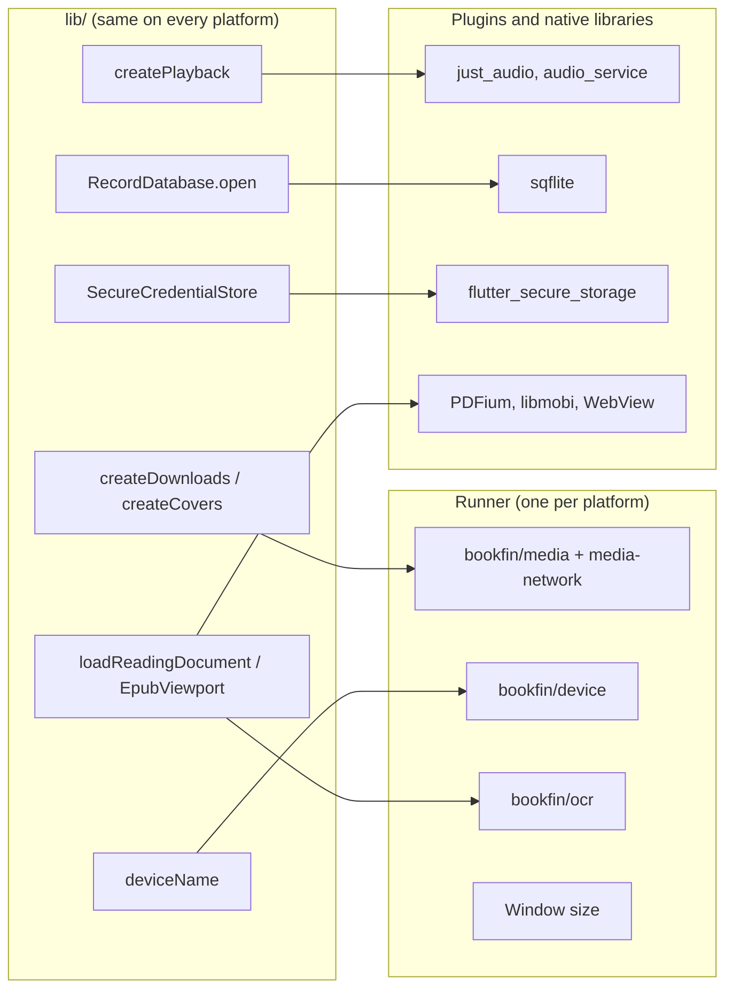

# Platforms

Date: 2026-11-08. Ticket: boo-gnx9. Epic: boo-fs0n.

Bookfin targets Android first. This document records which parts of the app depend on the platform. It records how each part behaves on Android, iOS, macOS, Linux and Windows. It also records the one platform model that every port follows. The macOS port (boo-gnx9) follows this model. The iOS (boo-eisp), Linux (boo-0i64) and Windows (boo-0wnc) ports reuse it.

## The platform model

The Dart code under `lib/` is the same on every platform. The platform differences sit behind seven seams. Each seam has one Dart owner, and the owner alone decides what its platform supports. No other module asks which platform runs.

| Seam | Dart owner | Platform side | How the owner decides |
| --- | --- | --- | --- |
| Media host: download directory, free space, network kind | `createDownloads` in `lib/downloads/platform_io.dart`, `createCovers` in `lib/catalog/covers_io.dart` | The runner implements the `bookfin/media` method channel and the `bookfin/media-network` event channel | The channel answers. A runner without the channel gives unavailable downloads and no saved covers. |
| Device name | `deviceName` in `lib/sync/device.dart` | The runner implements the `bookfin/device` channel | The channel answers. A runner without it gives no name. |
| Personal records | `RecordDatabase.open` in `lib/playback/database.dart`, chosen in `lib/main.dart` | sqflite's `databaseFactory` | Every native platform keeps records in the database. sqflite has a plugin on Android, iOS and macOS. Linux and Windows must set `databaseFactory` to sqflite_common_ffi's factory first. |
| Credentials | `SecureCredentialStore` in `lib/catalog/store.dart` | flutter_secure_storage, with options per platform | The plugin supports all five platforms. The options choose the keychain or keystore. |
| Listening | `createPlayback` in `lib/playback/native.dart` | just_audio, audio_service and audio_session | `_playingPlatforms` lists the platforms where just_audio and audio_service both have a native implementation: Android, iOS and macOS. On iOS and macOS, `createPlayback` also gives the engine a link directory, because AVFoundation picks its decoder by the file extension (`lib/playback/apple_audio_files.dart`). |
| Reading | `loadReadingDocument` in `lib/reader/platform_io.dart`, `epubViewportSupported` in `packages/flutter_epub_viewer` | PDFium code asset, the libmobi converter library, the `bookfin/ocr` channel, a WebView | PDF works wherever PDFium loads. Recognition of scanned pages is on where the runner has an OCR worker (Android). The EPUB viewport says itself where its WebView can serve the reader. |
| Window | The runner | `macos/Runner/MainFlutterWindow.swift` and the later desktop runners | The runner sets the starting size and the minimum size. The Dart layout stays phone-shaped. |

The runner channels form one contract. A port implements the contract in its runner, and the Dart side needs no change:

| Channel | Method or event | Reply |
| --- | --- | --- |
| `bookfin/media` | `storage` | `{"path": <directory>}`. Downloads live in it. Covers live in `bookfin-covers` beside it. |
| `bookfin/media` | `freeBytes` | The bytes free on the volume of that directory. |
| `bookfin/media` | `network` | `wifi` for an unmetered connection, `mobile` for a metered one, `disconnected`, or `unknown`. |
| `bookfin/media-network` | event stream | The network kind on each change. |
| `bookfin/device` | `name` | The name that the owner gave the device, or null. |
| `bookfin/ocr` | `recognize`, `close` | hOCR text of one BGRA page image, and the end of the worker. |

Android implements the media and device channels in `android/app/src/main/kotlin/dev/bookfin/bookfin/MainActivity.kt` and the OCR channel in `OcrChannel.kt`. macOS implements the media and device channels in `macos/Runner/MediaChannel.swift` and `macos/Runner/DeviceChannel.swift`. These two Swift files use no AppKit, so the iOS runner can compile them unchanged.



### Data safety on every platform

The data-safety rules of `AGENTS.md` hold on every platform through the same code:

- Personal records live in one SQLite database (`bookfin-personal-records-v1.sqlite` in sqflite's database directory). SQLite transactions make each change atomic.
- Downloads, covers, the MOBI cache and the OCR cache write a temporary file, then rename it. A rename inside one directory is atomic on ext4, APFS and NTFS.
- The catalog snapshot, the layout and the appearance choice live in shared_preferences.
- If the app leaves the foreground, `_BookfinAppState.didChangeAppLifecycleState` saves the listening and reading places. A desktop app can also quit from its menu while it is in the foreground. Before such a quit, `didRequestAppExit` saves both places.

## Survey per platform

Each table lists the platform-specific parts, whether they work, what blocks them, and the cheapest fix. "Works" means that a run on that platform showed it. "Builds" means that the code compiles for that platform, but no run showed it.

### Android

| Part | State | Blocker | Fix |
| --- | --- | --- | --- |
| Media host, device name | Works | None | `MainActivity.kt`. Storage is `filesDir/bookfin-media`. |
| Records, credentials | Works | None | sqflite, EncryptedSharedPreferences. |
| Listening and background audio | Works | None | audio_service foreground service in `AndroidManifest.xml`. |
| PDF | Works | None | PDFium `android-arm64` from Nix, seeded by `tool/reader/native_package.py prepare`. |
| EPUB | Works | None | `shouldInterceptRequest` serves `https://bookfin-runtime.invalid` and `https://bookfin-publication.invalid`. |
| MOBI and AZW3 | Works | None | Gradle builds `native/mobi/CMakeLists.txt` with the NDK. |
| OCR | Works | None | Tesseract4Android AAR from Nix (`nix/ocr.nix`), `OcrChannel.kt`. |
| Nix build | Works on aarch64-darwin and x86_64-linux | No emulator on Linux (t9-ifmy) | `bash tool/bookfin build-android` in the default shell. |

### macOS

`tool/bookfin accept-macos` ran `integration_test/macos_desktop_test.dart` on this Mac on 2026-11-08 and passed. The run drives the real app against the fixture server. It signs in, opens the library, downloads and plays First Frost, pauses, downloads and opens the Windfall PDF, syncs twice, lays out the library at two window sizes, and signs out. The images are in `docs/evidence/macos/`.

`screencapture` cannot take these images here, because the process that runs the commands has no Screen Recording permission. The test draws each frame to a PNG file instead. That image shows only Flutter's own layers. An embedded WebView, such as the EPUB reader, shows as an empty area in it.

| Part | State | Blocker | Fix |
| --- | --- | --- | --- |
| Build | Works | Xcode is not in Nix. openrsync and the Nix store's read-only files broke Flutter's framework copy. | The `macos` shell (`nix/macos-desktop.nix`) uses the system Xcode, Nix rsync and Nix CocoaPods. |
| Media host, device name | Works | None | `MediaChannel.swift` (Application Support in the App Sandbox container, NWPathMonitor), `DeviceChannel.swift`. |
| Records | Works | None | sqflite_darwin. |
| Credentials | Works, with a dialog after a rebuild | The data protection keychain needs a signing team. The login keychain asks the user again after each ad-hoc signed rebuild. | `MacOsOptions(useDataProtectionKeyChain: false)`. A stable signing identity removes the dialog (ticket). |
| Listening | Works | AVFoundation picks its decoder by the file extension, and Downloads names every file `complete`. | The engine plays each download through a temporary link whose extension names the format of the file's first bytes. Ogg and Opus files have no such extension, so they do not play. |
| PDF | Works | None | pdfium_flutter's PDFium XCFramework, pinned by its Swift package checksum. |
| EPUB | Blocked | WKWebView cannot intercept `https`. The plugin's custom-scheme replies carry no HTTP status or headers, so the reader loses its Content-Security-Policy and cross-origin rules. | Design decision (ticket). The reader shows its existing message. |
| MOBI and AZW3 | Blocked | Needs the EPUB viewport. The app does not bundle the converter library yet. | Follows the EPUB ticket. |
| OCR | Not available | No macOS worker for `bookfin/ocr`. | Ticket. Scanned pages show the original page and the existing note. |
| Window | Works | None | Opens at 430 × 820 points. The minimum is 360 × 600 points. At 1280 × 800 points the library grid shows six columns. |
| Quit | Works | A desktop app quits from its menu with no lifecycle change. | `didRequestAppExit` saves the listening and reading places first. `test/durability/background_test.dart` tests it. |

### iOS

| Part | State | Blocker | Fix |
| --- | --- | --- | --- |
| Build | Not tried | No `ios/` runner. Xcode is not in Nix. | Reuse the `macos` shell pattern with the iOS target platform. |
| Media host, device name | Not built | None in the code | Compile `MediaChannel.swift` and `DeviceChannel.swift` in the iOS runner. |
| Records, credentials | Not built | None in the code | sqflite_darwin. `IOSOptions(first_unlock_this_device)` is already set. |
| Listening and background audio | Not built | Background audio needs `UIBackgroundModes` `audio` in `Info.plist`. | audio_service and audio_session support iOS. The extension links of macOS apply unchanged. |
| PDF | Not built | None in the code | pdfium_flutter's XCFramework, as on macOS. |
| EPUB, MOBI | Blocked | The same WKWebView limit as macOS. | The EPUB ticket covers both Apple platforms. |
| OCR | Not available | No iOS worker. | The macOS OCR ticket can share a Vision-based worker. |

### Linux

| Part | State | Blocker | Fix |
| --- | --- | --- | --- |
| Nix shell | Works on x86_64-linux (boo-2sev) | No Android emulator (t9-ifmy) | The default shell builds the Android APK. It runs the host tests with a real libmobi `.so`, PDFium `linux-x64` and Tesseract. |
| Build | Not tried | No `linux/` runner. The shell's Flutter has no `linux` target. | Add a `linux` shell beside the `macos` one, with GTK and the Linux Flutter target. |
| Media host, device name | Not built | No runner channels | Implement the channel contract in the GTK runner: `statvfs`, the XDG data directory, NetworkManager or `unknown`. |
| Records | Not built | sqflite has no Linux plugin. | Set `databaseFactory = databaseFactoryFfi` (sqflite_common_ffi) in `main`. |
| Credentials | Not built | Needs libsecret at run time. | flutter_secure_storage_linux. |
| Listening | Not available | just_audio and audio_service have no Linux implementation. | just_audio_media_kit, and audio_service_mpris for media keys. |
| PDF | Builds in tests | None | The pdfium_dart hook bundles PDFium `linux-x64`. |
| EPUB, MOBI | Blocked | flutter_inappwebview_linux is a beta on WPE WebKit. Its request interception is unknown. | Decide with the EPUB ticket. CMake builds `native/mobi` directly in the runner. |
| OCR | Not available | No worker. | Tesseract from Nix can back a host worker. |

### Windows

| Part | State | Blocker | Fix |
| --- | --- | --- | --- |
| Build | Not tried | No `windows/` runner. Nix does not run on Windows. WSL2 builds only the Android APK. | Build with Flutter and Visual Studio on Windows. Pin the toolchain outside Nix. |
| Media host, device name | Not built | No runner channels | Implement the contract in the Win32 runner: `GetDiskFreeSpaceExW`, `%LOCALAPPDATA%`, the Network List Manager. |
| Records | Not built | sqflite has no Windows plugin. | sqflite_common_ffi, as on Linux. |
| Credentials | Not built | None | flutter_secure_storage_windows. |
| Listening | Not available | just_audio and audio_service have no Windows implementation. | just_audio_media_kit, and a System Media Transport Controls plugin. |
| PDF | Not built | None | The pdfium_dart hook bundles PDFium for Windows. |
| EPUB, MOBI | Blocked | flutter_inappwebview_windows (WebView2) is a beta. | Decide with the EPUB ticket. CMake builds `native/mobi` in the runner. |
| OCR | Not available | No worker. | Same as Linux. |

## Nix

The default shell (`devShells.<system>.default`) builds Android on aarch64-darwin and x86_64-linux and runs the host tests. On macOS its `nix/darwin-native-tools.nix` replaces `xcrun` and `codesign` with Nix tools, and its compiler environment points `SDKROOT` and `DEVELOPER_DIR` at the Nix Apple SDK. Xcode cannot build an app with those, and Nix cannot supply Xcode.

So the macOS app has its own shell, `devShells.aarch64-darwin.macos`, in `nix/macos-desktop.nix`. It uses `mkShellNoCC`, the system Xcode, a Flutter with the `macos` target, CMake, CocoaPods for flutter_secure_storage_macos, and Nix rsync. `tool/bookfin` has three commands for it:

```sh
nix develop .#macos --command bash tool/bookfin build-macos
nix develop .#macos --command bash tool/bookfin run-macos
nix develop .#macos --command bash tool/bookfin accept-macos
```

`accept-macos` needs the fixture server `tool/showcase_fixture.dart` on port 18431. Start it first from the default shell:

```sh
nix develop --command dart run tool/showcase_fixture.dart 18431 --sync-conflict
```
