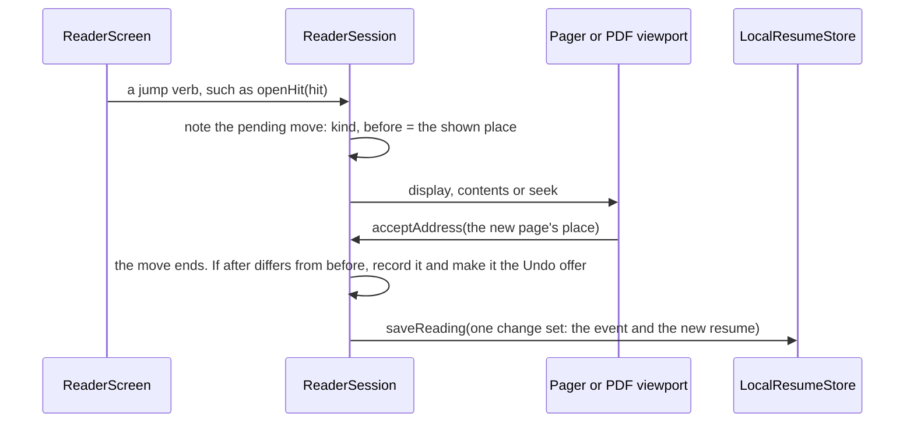

# Reading history and bookmarks for ebooks

Epic: boo-m27l, under boo-fs0n. Status: design, written 2026-11-09. Three product decisions are open. The order of work says which tickets wait for them.

The user asked on 2026-11-09 for bookmarks, location history, and jumps through history in ebooks, like audiobooks have. The user prefers to reuse as much of the audiobook interface as possible.

Read this with three other documents:

- `docs/plans/bookfin.md`: the personal record store, sync, and "Quick bookmarks, history timeline, and stacked glass".
- `docs/plans/native-epub-reader.md`: places and whole-book pages.
- AGENTS.md: UI rules 1 to 4 and engine rules 1 to 3.

## Open decisions

Each decision has two designs. A medium is listening or reading. A visit is the time from opening a book in the reader until leaving the reader.

### Decision 1: one timeline per book, or one per medium

| Design | What a timeline shows | Go to on an entry of the other medium | Book page and Listening tab | What it costs |
| --- | --- | --- | --- | --- |
| A: one timeline per book | The listening and reading entries of the book, newest first. A small headphones or book glyph on the rail marks the medium of each entry. | Opens the reader at that place, or the player at that time. | One History, as today, now with reading entries. With nothing open, the Listening tab's History shows the listening and reading of every book. | The timeline's controller needs Playback, the reader session, and navigation between the player and the reader. Each list is longer. A page and a time cannot be compared, so a change of medium is two entries, not one move. |
| B: one timeline per medium | The player shows listening entries, as today. The reader shows the reading entries of the book's ebook editions. | Not offered. | The book page gets two entry points: Listening history and Reading history. The Listening tab stays listening only. | The person sees two histories for one book. To find where they stopped last night, in the audiobook or the ebook, they open both. |

Usage of A: the person listens to chapter 4 in the car, then reads on the train. In the reader, History shows "Opened at the place from Pixel 8 · p. 88" over "Paused · 1:02:15". Go to on the pause closes the reader and opens the player at 1:02:15.

Usage of B: the same person opens History in the reader and sees only reading entries. The book page shows a button for each history.

Both designs share these points:

- The timeline groups entries by day and shows one line per entry, with the same choices and the same glass sheet.
- A book with several ebook editions, such as an EPUB and a PDF, shows the entries of all of them. Go to on an entry of another edition opens that edition.
- A reading entry never appears in the recently listened list.

### Decision 2: does a reading visit appear in history

| Design | Entries that a visit adds | What it costs |
| --- | --- | --- |
| A: jumps only | None. The one exception is "Opened at the place from Pixel 8", for a book that opens at a place that another device saved. | A book that the person reads straight through shows only bookmarks and such entries. The timeline does not say where each visit ended. |
| B: jumps and visits | Two: "Opened · p. 120" at the start of the visit and "Closed · p. 134" at its end. Back or the open of another book ends a visit. These are the reading forms of Played and Paused. | Two entries for each visit, so a day of short visits adds many lines. If Android stops Bookfin in the background, that visit has no Closed entry. |

Usage of A: the person reads for an hour without a jump. The timeline shows nothing new. Usage of B: the timeline shows "Opened · p. 120" at 8:02 and "Closed · p. 134" at 9:05.

Both designs share these points:

- When the app goes to the background, the reader records no entry. The place saves as it does today.
- A book can open at a place that another device saved. If that place differs from the last place that this phone showed, the reader records one entry and offers Undo. Engine rule 3 requires this: when two devices disagree, keep both moves.

### Decision 3: where History opens in the reader

| Design | The dock's tool row | The contents sheet | What it costs |
| --- | --- | --- | --- |
| A: a History tool | Contents, Search, Aa, Bookmark, History, then the open audiobook's cover button | Contents only. Bookmarks move into the timeline, as in the player. | Six buttons while an audiobook is open. Each keeps a 48-point touch target on a 360-point-wide phone, with less space between them. |
| B: a History tab | Unchanged: Contents, Search, Aa, Bookmark, cover button | Two tabs: Contents and History. History holds the shared timeline with its bookmarks. | History is two taps away. The timeline lives in a tab, not in its own sheet titled History, so the reader and the player open it in different ways. |

Usage of A: a tap on History in the dock opens the History sheet. Usage of B: a tap on Contents, then on the History tab.

Both designs share these points:

- The timeline widget, its entries and its choices are the player's.
- Today's Bookmarks tab goes away, because the timeline lists the bookmarks.

## Terms

- Place: one point in one edition of a book. An audio place (`AudioPosition`) names a file, its revision, and a time in milliseconds of recorded audio. A text place (`TextPosition`) names a file, its revision, and a saved anchor. The anchor of an EPUB place holds a CFI and a quote of up to 120 characters. The anchor of a PDF place holds the source page, a character and a quote.
- Move: one recorded action. It holds its kind, its time, the place where it began (before), and the place where it ended (after). Both places are of the same medium. The code calls a move a history event.
- Bookmark: a place with an id, a creation time, an optional title and note, and the book title and edition label.
- Timeline: the moves and bookmarks of a book, or of every book, newest first.
- Undo offer: the latest move that changed the place, which Undo can take back. It lives in memory only.

## The model

Listening and reading already use the same three ideas: a place, a move from one place to another, and a bookmark at a place. Today the code has two separate copies for bookmarks (`AudioBookmark` and `TextBookmark`) and a history for listening only (`ListeningEvent`). This design distills one model and rebuilds listening on it beside reading.

```dart
/// A place in one edition of a book.
sealed class Place {
  String get editionId;
}
// AudioPosition and TextPosition, in lib/catalog/model.dart, extend Place.

/// One move between two places of the same medium.
class HistoryEvent<P extends Place> {
  final String id;
  final DateTime at;
  final HistoryAction kind;
  final P before;
  final P after;
  final String bookTitle;
  final String editionLabel;
  ...
}

/// A place that the person marked.
class Bookmark<P extends Place> {
  final String id;
  final P position;
  final DateTime createdAt;
  final String? bookTitle;
  final String? editionLabel;
  final String? title;
  final String? note;
  ...
}
```

where

- `Place` = the union of the two kinds of place. A `switch` on it must cover both kinds, so a label that forgets reading does not compile.
- `P` = the medium of the move or the bookmark. It makes a move whose before is audio and whose after is text impossible to build.
- `HistoryAction` = the one closed set of move kinds, listed in "Kinds of moves" below.
- `bookTitle`, `editionLabel` = the names at the time of the record. A timeline of every book uses them, and so does a book that left the library. A reading bookmark from before this design has neither, so they are optional on a bookmark.

The renames are one refactor with no change of behavior or stored data:

| Today | After |
| --- | --- |
| `ListeningEvent` | `HistoryEvent<AudioPosition>` |
| `ListeningAction` | `HistoryAction` |
| `AudioBookmark` | `Bookmark<AudioPosition>` |
| `TextBookmark` | `Bookmark<TextPosition>` |
| `ListeningTimeline`, `openListeningTimeline` | `HistoryTimeline`, `openHistory` |
| `TimelineEntry` with an audio event or bookmark | `TimelineEntry` with a `HistoryEvent<Place>` or a `Bookmark<Place>` |

### Kinds of moves

Existing JSON names stay. Three names are new.

| Kind (JSON name) | Listening cause | Reading cause | Timeline label |
| --- | --- | --- | --- |
| `seek` | The position slider | The scrub bar | "Moved ahead 12 pages", "Moved back 40 s" |
| `jump` | The short jump buttons | None | "Jumped back 30 s" |
| `chapter` | The Chapters sheet | A contents entry, the chapter arrows in a book with chapters | "Changed chapter" |
| `link` (new) | None | A link on the page, Go to note | "Followed a link" |
| `search` (new) | None | A search result | "Went to a search result" |
| `bookmarkRestore` | Go to a bookmark | Go to a bookmark | "Went to a bookmark" |
| `historyRestore` | Before or After on a move | Before or After on a move | "Went back in history" |
| `undo` | Undo | Undo | "Undid a move" |
| `open` (new) | None | See decision 2 | "Opened", "Opened at the place from Pixel 8" |
| `close` (new, design 2B only) | None | Leaving the reader | "Closed" |
| `pause`, `resume`, `interruption`, `stop`, `completion` | As today | None | As today |

These are not moves:

- A page turn, by swipe, by tap, or by an arrow in a book without chapters (a PDF's arrows turn one page).
- A jump that ends on the page where it began.
- A change of the text size or the reflow choice. The shown place stays.

If another device saved the opened place, the `open` entry holds one more field, `device`: the name of that device.

### What causes a reading move

The reader session (`ReaderSession`) is already the one owner of navigation. Every jump goes through one of its verbs, so every jump can record its move in one place. The screen calls one verb for each cause:

| Cause | Session verb | Kind |
| --- | --- | --- |
| Scrub bar | `goTo(target)` | `seek` |
| Chapter arrow | `moveChapter(forward)` | `chapter` |
| Contents entry | `goToContents(href)` | `chapter` |
| Link, Go to note | `followLink(href)`, new. It replaces the screen's use of `goToContents` for links. | `link` |
| Search result | `openHit(hit)` | `search` |
| Bookmark | `restoreBookmark(id)` | `bookmarkRestore` |
| Timeline Before, After | `restoreHistory(id, previous:)` (new) | `historyRestore` |
| Undo | `undoMove()` (new) | `undo` |



The rules of a reading move:

1. The session notes the pending move before it asks the navigator. Its before is the shown place at that moment.
2. The first place that the navigator reports after that request ends the move. That place is its after.
3. If after equals before, the session records nothing.
4. The event and the new resume save in one `ReadingChanges`, so one store transaction holds both. A kill keeps both or neither.
5. If the navigation fails, or another book opens first, the session drops the pending move. It also drops it when the book opens at its start because the pager cannot find the place to open at.
6. The recorded move becomes the Undo offer. A page turn does not end the offer, as playing on does not end it in the player. The next move, Undo, Dismiss, or another book ends it.

### The opened place from another device

At the open of a book, the session compares two places: the place that it opens, and the last place that this installation saved for that edition. The store finds the second place in its journal, because the journal keeps every action and the installation that made it. Sometimes the two places differ, and another device saved the opened place. Then the session records an `open` move from this phone's place to the opened place, with the other device's name. The reader then offers Undo.

The reader still never moves an open book because of a sync. A synced place takes effect the next time the book opens, as today.

Listening has the same gap today: a book opens at another device's place without a move. Ticket 8 in "Order of work" applies the same rule to Playback.

## Storage and sync

The record store (`LocalResumeStore`) keeps one journal per account. Each record has an address `[domain, collection, id]`. The domain is `audio` or `reading`. Today `audio` has `bookmarks`, `history` and `resumes`, and `reading` has `bookmarks` and `resumes`.

Reading history adds the collection `history` to the `reading` domain, at `["reading", "history", "<id>"]`. Its value has the shape of a listening event, with text places:

```json
{"id": "9f3c…", "at": "2026-11-09T21:40:00.000Z", "kind": "search",
 "before": {"edition": "…", "source": "…", "revision": "…", "anchor": "{…}"},
 "after":  {"edition": "…", "source": "…", "revision": "…", "anchor": "{…}"},
 "bookTitle": "Middlemarch", "editionLabel": "EPUB"}
```

These parts of the store change:

- `ReadingChanges` carries `history`, by id, beside `resumes` and `bookmarks`. A null value deletes an entry.
- `_flatten`, `_snapshot` and `_records` read and write the new collection. So salvage of a damaged store keeps every reading history entry that still parses.
- `_validateActionValue` accepts reading history and decodes it as `HistoryEvent<TextPosition>`.
- The sync choice labels (`lib/sync/labels.dart`) name such a record "Reading history entry". They already read the place of an event from its `after`.

### No migration

- Every audio record keeps its address and its JSON byte for byte. Golden tests pin the JSON of existing listening events and bookmarks.
- Reading bookmarks keep their address. A bookmark that the reader creates or edits from now on also saves `bookTitle` and `editionLabel`. A bookmark without them still decodes. An older build ignores the extra fields.
- Retention does not change: every entry stays until the person deletes it.

### Older builds

An older build rejects an action at `["reading", "history", …]`, so its discovery stops at the first one, and its Sync page reports a failed sync. Its uploads run before discovery, so its own records still reach the server, and no record is lost. Records from other devices stop arriving on it until it updates.

Bookfin has no release yet, so every installation is a development build. At the release of reading history, update every installation. The first ticket also makes each later build keep a valid record that it cannot read yet, without showing it. After that, a new kind of record never stops the sync of an older build again.

## Owners

| Fact or decision | Owner | Readers |
| --- | --- | --- |
| Reading history, the pending move, the reading Undo offer, reading bookmarks | `ReaderSession` | Reader screen, timeline controller |
| Listening history, the listening Undo offer, listening bookmarks | `Playback` | Player, timeline controller |
| Durable records, sync actions, the last place that this installation saved | `LocalResumeStore` | The two sessions |
| The shown page, its start and its end | `EpubPager`, `PdfViewport` | `ReaderSession` |
| A place's whole-book share, page number and chapter | `BookMap` | Scrub bar, the reader's place text |
| A text place in words | `ReaderSession.describe` (new) | Timeline, bookmark editor |
| An audio place in words | `Playback.editionTime` with `audioTime` | Timeline, bookmark editor |
| Which entries one timeline shows | The timeline controller `openHistory`, derived on demand | `HistoryTimeline` |
| Which entry shows its choices | `HistoryTimeline`, as ephemeral UI state | None |

## A reading place in words

`ReaderSession.describe(TextPosition)` gives three parts: a short place, the chapter, and a short quote. The timeline, its move labels and the bookmark editor all use it.

| Place | Short place | Chapter | Quote |
| --- | --- | --- | --- |
| In the open edition, every page known | "p. 134", from the book map | From the book map | The anchor's quote |
| In the open edition, pages not all known | "37%", the whole-book share | From the book map | The anchor's quote |
| A PDF place in any edition | "p. 12", the source page | None | The anchor's quote |
| An EPUB place outside the open edition | The first words of the quote, in quotation marks | None | The anchor's quote |

The short place follows the rule of the scrub bar's drag label, so the same place reads the same in both. Page numbers depend on the text size and the screen. So the timeline computes them at the time that it draws a row, and no record stores a page number.

A move's label follows three rules, in this order. The listening labels stay as they are.

1. If both places have a page number, the label gives the distance in pages: "Moved ahead 12 pages".
2. If the book map can place both places, the label gives the direction: "Moved ahead".
3. Otherwise the label is the verb alone: "Moved".

An open entry, the one whose choices show, gets a detail line between its row and its choices. It shows the chapter and the short quote of the place where the entry ended. A listening entry shows its chapter there. Both media use this one widget.

## The interface

The reader has no top bar, and full screen hides every control. This design keeps both rules. Every new control lives in the glass dock at the foot of the page, and full screen hides it with the rest.

### The dock, today and after

| Part | Today | After |
| --- | --- | --- |
| Undo | None | A row above the place label while an Undo offer exists. It is the player's `UndoNotice`. |
| Place label | Chapter and page | Unchanged |
| Scrub bar | Chapter arrows, chapter marks, bookmark marks | Unchanged. The bookmark marks already exist. |
| Tool row | Contents, Search, Aa, Bookmark, cover button | Decision 3 |
| Bookmark tool | Adds an untitled bookmark at once | Also shows Bookmarked, see below |

The dock lies over the page. When the Undo row comes or goes, the page does not move or lay out again.

### The quick Bookmark tool

A tap on Bookmark already saves an untitled bookmark at once. The change is the Bookmarked state:

- While the shown page holds a bookmark of the open edition, the icon fills, and its tooltip reads Bookmarked.
- A tap in that state opens the shared bookmark editor to name that bookmark.
- If the bookmark's place lies from the page's start to its end, the page holds the bookmark. The session decides this (`bookmarkHere`), from the book map and the pager's page end.

The player counts a bookmark as here for 15 seconds of audio after it. In the reader, the page is that reach. So the person can name a bookmark while its page shows. A page turn ends the state.

### Undo after a jump

The Undo row says "Your previous place is saved" or "Saving your previous place", as in the player, with Undo and Dismiss. Undo goes back to where the move began and records an `undo` move.

A link that the person follows in full screen keeps its offer. The row appears the next time that the person shows the controls. boo-0ot1 (full-size touch targets for this pill) applies to the same widget.

### The History timeline

The reader uses the player's History sheet and widget:

- A glass sheet titled History, over the open book, with the entries grouped by day.
- Each entry is one line: the time of day, a dot or a bookmark on the rail, what happened, and the short place.
- A tap on an entry opens it. A move shows two tiles: Before, where it began, and After, where it ended. Any other entry shows one tile with its one place. A tap on a tile goes to its place. The open row offers Name or Rename for a bookmark, and Delete. `docs/plans/history-choice.md` (design B) gives the details.
- Delete asks for the same confirmation as in the player.
- A choice that goes to a place closes the sheet. The reader then shows the place and offers Undo.
- The header shows the save status of the reading records. If a save failed, it offers Retry saving.

Which entries the sheet shows follows decision 1. Where it opens follows decision 3.

### The shared bookmark editor

The reader keeps the glass editor (`showBookmarkEditor`). t7-49bp removes its plain variant first. Both media use the same headings, "Add bookmark" and "Edit bookmark". The place line of a reading bookmark comes from `describe`: "On p. 134 · Chapter 4" in the open book, and the quote elsewhere. Today the line shows the day and time of the save.

## Data safety

Engine rule 3 applies to reading history and to reading bookmarks with the new fields. Each case below has a test:

| Case | What must hold |
| --- | --- |
| A kill during the save of a jump | The store holds the old place without the move, or the new place with the move. It never holds the new place without the move. |
| A failed save | The move and the place stay pending in the session, the reader says that records are not saved, and the next save retries them. |
| A failed sync | The move stays in the journal and waits for upload. The next sync uploads it once. |
| Two devices offline | Each device records its own moves. After both sync, each timeline shows the moves of both, ordered by time. |
| A deletion on one device | The entry goes away on the other device after sync. Other entries stay. |
| A damaged record file | Salvage keeps every reading history entry that parses. Kept copies bring back the rest at the next launch. |
| An older record format | A reading bookmark without a book title decodes and shows. Audio records keep their JSON byte for byte. |
| An older build | Its own records still upload. It loses no record. |
| A record kind that a build does not know | The build keeps the record and syncs past it without showing it. |

## Order of work

| Order | Ticket | Work | Depends on |
| --- | --- | --- | --- |
| 1 | t9-of05 | Keep personal records that this build cannot read yet | None |
| 2 | t9-mdsj | One record model for places, moves and bookmarks (refactor) | None |
| 3 | t9-mqtx | Store and sync reading history | 1, 2 |
| 4 | t9-nnon | Record reading jumps in the reader session, with Undo | 3 |
| 5 | t9-4vsl | Record the opened place from another device, and reading visits | 4, decision 2 |
| 6 | t9-9ffz | Share the History timeline between listening and reading | 2, 3, decision 1 |
| 7 | t9-7fxw | Put History, Bookmarked and Undo in the reader's dock | 4, 6, t7-49bp, decision 3 |
| 8 | t9-gtps | Record a listening move for a book that opens at another device's place | 5 |

Tickets 1 and 2 can run in parallel. Ticket 4 does not wait for a decision. Ticket 6 builds the reader's timeline with its own entries first, and decision 1 decides whether it also merges the listening entries.

## Decisions (user, 2026-11-09)

1. Timeline scope: design A. One timeline per book mixes listening and reading moves, each entry shows a glyph for its medium, and Go to opens the player or the reader there.
2. Reading visits: design B. Jumps, plus "Opened · p. N" and "Closed · p. N" for each visit.
3. History in the reader: design A. A History tool in the reader's bottom bar.
