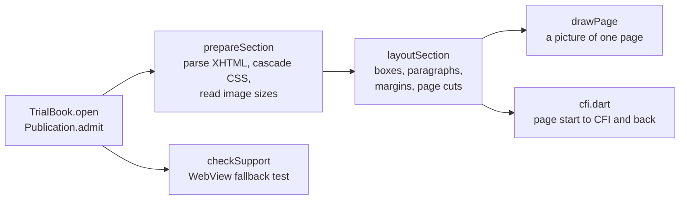
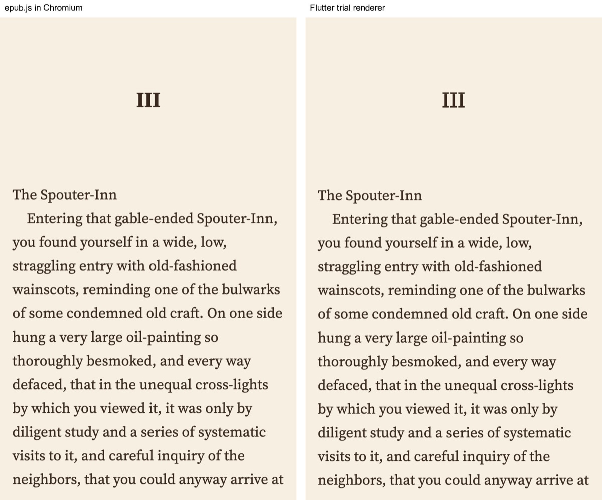
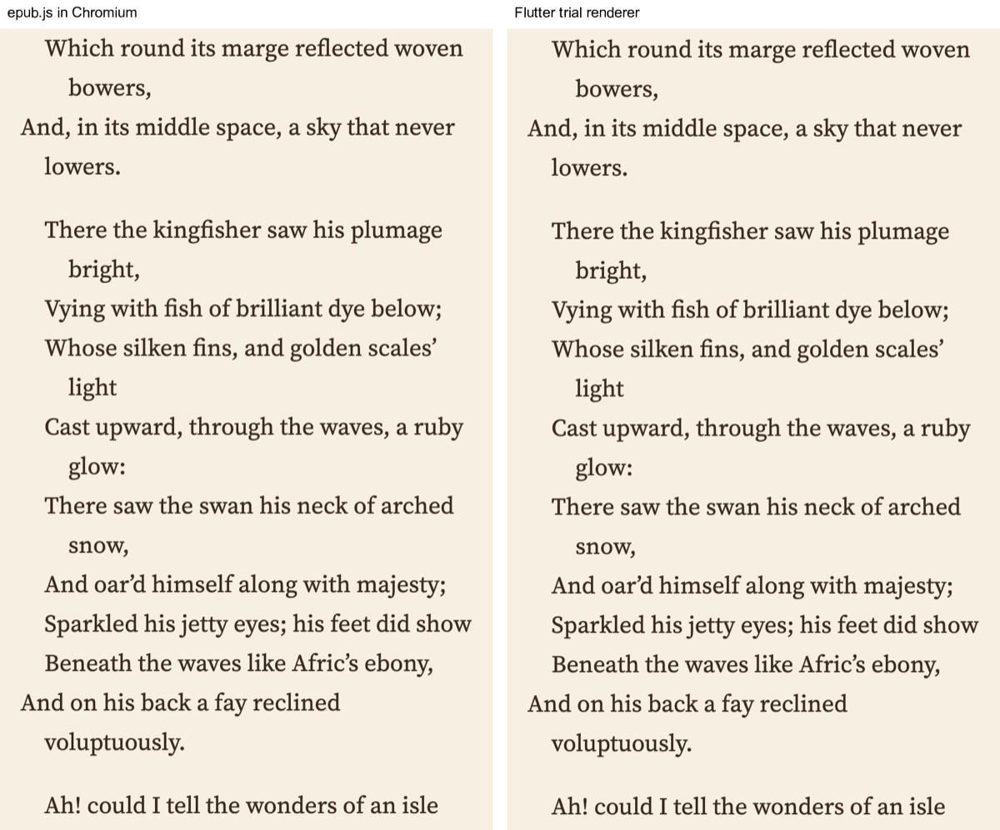

# A Flutter-native EPUB renderer: measured trial

Date: 2026-11-08. Ticket: boo-ju83. Epic: boo-fs0n.

The question: can Bookfin lay out typical reflowable EPUB books (novels and similar prose) in Flutter alone, without a WebView, with good fidelity and much faster? In that plan, the WebView reader stays as a fallback for books that the native renderer cannot lay out.

The short answer is yes for prose. On 18 body sections of seven public-domain books, the trial renderer breaks 26,544 of 26,548 lines where epub.js breaks them. It starts 1,468 of 1,490 pages on the same character. Every saved place moves between the two renderers. On the host, a chapter lays out in about 7 ms and a page draws in about 1 ms. The WebView takes about 235 ms to show a chapter and about 100 ms to draw a scrub page on the same host. The phone measurement did not run, because another session held the Pixel (see "Not measured").

The trial changes nothing in the app. Its code is in `lib/reader/native_epub/`, and nothing in the app imports it.

## Situation check

Before the build, the trial checked where the idea comes from and whether that situation matches Bookfin's.

| Reader | How it lays out EPUB | What it skips |
| --- | --- | --- |
| KOReader | crengine, a C++ HTML and CSS engine, with its own FreeType and HarfBuzz text stack | Scripts. Floats and tables came late. |
| MuPDF | Its own HTML and CSS layout code | Scripts, positioning, most floats |
| FBReader | Its own C++ engine with a CSS subset | Scripts, complex layout |
| Apple Books | WebKit | Nothing: it is a browser |
| Readium mobile, Thorium | A WebView | Nothing: it is a browser |

Native engines exist and work well for prose. They run on weak e-ink processors, so the approach does not need a fast device. Their large cost was the text stack: shaping, bidirectional text and line breaking. Bookfin does not pay that cost.

Flutter's paragraph engine (SkParagraph, with HarfBuzz and ICU) is the same text stack that Chromium uses. What remains is the CSS cascade, block layout and page cutting. For prose that is a modest amount of code: the trial is about 3,800 lines of Dart.

The CSS of real novels is small. The test books use box properties: margins, padding, text-indent and text-align. They use font weight, style and size, small caps and line-height. Their blocks are headings, `hgroup`, blockquotes, rules, lists, figures with images, and verse lines with hanging indents. A few sections use tables. Front matter uses `inline-block`, a column flex box and text moved off the page. No book used floats for text, absolute layout, vertical writing or multiple columns.

Bookfin's sizes are small. A chapter has 10,000 to 120,000 visible characters, and one book is open at a time. The question of asymptotic cost does not arise: a whole chapter lays out in milliseconds.

## The trial renderer

The files in `lib/reader/native_epub/`:

| File | Job |
| --- | --- |
| `dom.dart` | A small DOM of one section. It keeps the element and text indices that epub.js CFIs count. |
| `css.dart` | Style sheet parsing, selectors, and the cascade that gives each element its computed style. |
| `layout.dart` | Box building, Flutter paragraphs, margin collapsing and page cutting. |
| `paint.dart` | Draws one page into a `ui.Picture`. |
| `cfi.dart` | Converts a DOM position to and from the CFI, quote and text progress that Bookfin saves today. |
| `support.dart` | The support check. |
| `book.dart` | Loads a test book through the app's `Publication.admit`. |
| `benchmark.dart` | The benchmark, which runs under `flutter test` and in the phone app. |

The model: a section flows down one strip as wide as the page, as in a scrolled document. Each line, image and rule is a slice of the strip. A page is a window of the strip that holds whole slices, so a paragraph splits between two of its lines. The page cut follows Chromium's block fragmentation:

- A margin at an unforced break is dropped.
- Each break has an "appeal" (how good a place it is). The cut takes the latest break with the best appeal.
- Orphans and widows default to two lines. Chromium keeps the orphans rule first. If a paragraph is long enough to keep both rules, Chromium also keeps the widows rule. The trial does the same.
- `break-after: avoid` and `break-inside: avoid` lower the appeal of the breaks that they cover.

The trial matches the WebView reader's page: 412 × 671 pixels, a side padding of 17 pixels (half of epub.js's column gap), Source Serif 4 at 20 pixels and line height 1.65. It applies the same rules that the reader and epub.js add to each section.

### The supported subset

| Area | Supported |
| --- | --- |
| Selectors | Type, class and id. Attributes with namespaces (`[epub|type~="x"]`). Descendant, child, `+` and `~`. The pseudo-classes `:first-child`, `:last-child`, `:only-child` and the `-of-type` forms. Also `:nth-child()`, `:not()`, `:is()`, `:where()`, `:root`, `:empty`, `:lang()` and `:link`. An invalid selector drops its whole rule, as in a browser. |
| At-rules | `@media` (screen, all, width, height, orientation, color scheme), `@supports` (taken as true), `@import` and `@font-face` skipped |
| Cascade | Chromium's default sheet for book elements, origin, importance, specificity, order, style attributes, inheritance, `inherit`, `initial`, `unset`, `all` |
| Boxes | Block, inline, list item, `display: none`, anonymous blocks, blocks inside inline content, margins with collapsing, `auto` margins, padding, borders, `width`, `max-width`, `box-sizing` |
| Text | `text-indent` (positive and hanging) and `text-align` with justify. The font properties `font-weight`, `font-style` and `font-family`. Also `font-size` in px, em, rem, %, pt and keywords. Spacing with `line-height`, `letter-spacing` and `word-spacing`. Also `text-transform` and `white-space`. Underline and line-through. Small caps (the font's `smcp` feature) and old-style figures. |
| Inline | Emphasis, ` `, superscript and subscript (raised by Chromium's amounts), inline images |
| Blocks | Headings, `hgroup`, blockquote, `hr`, lists with markers (disc, circle, square, decimal, alphabetic, roman), figures, block images scaled to fit |
| Pages | Orphans, widows, `break-inside: avoid`, `break-after: avoid`, `break-before: avoid`. Page breaks (`break-before: page`) are ignored by default, because Chromium ignores them in the reader's columns. `PageTheme(pageBreaks: true)` honors them. |
| Approximated | An `inline-block` and a column flex box become a shrink-to-fit block. A `display: table` on a non-table and a float become a block. Text moved off the page is left out. |
| Not supported | Tables with rows, inline SVG, MathML and ruby. Absolute and fixed position, flex rows, grid and multiple columns. Vertical writing and right-to-left text. Generated content, `::first-letter` and embedded fonts. Automatic hyphenation and `text-wrap: pretty`. |

Two font details decide line breaks. Chromium sets a variable font's optical size axis to the text size. Without that axis, Flutter's Source Serif 4 is 8 percent wider at 20 pixels. Chromium also draws bold as a thickened regular face with regular widths, because the reader's `@font-face` rule names no weights. Flutter picks the font's true bold, which is 3 percent wider. The trial sets both axes, and plain, bold and italic widths then match Chromium to 0.01 pixel.

## Test books

The books are public-domain EPUBs in `.cache/epub-trial/books/`, which git ignores:

| Book | Source | Why |
| --- | --- | --- |
| Moby-Dick | Standard Ebooks | Long novel: 145 sections, 1,000,000 visible characters |
| Pride and Prejudice | Standard Ebooks | Dialogue-heavy novel |
| Frankenstein | Standard Ebooks | Novel with letters and epigraphs |
| Alice's Adventures in Wonderland (Tenniel) | Standard Ebooks | 45 images in figures, a shaped poem |
| Keats, Poetry | Standard Ebooks | Verse with hanging indents, one 430,000-character section |
| Frankenstein | Project Gutenberg (EPUB 3) | Plain Gutenberg markup and CSS |
| A Christmas Carol | Project Gutenberg (EPUB 3) | Gutenberg illustrations and a contents table |
| First Frost, Salt and Lantern, The Winter Ledger | Bookfin's test fixture | Small EPUBs that Bookfin made for its own tests |

A finding about the app came first. Bookfin's sanitizer (`Publication._css`) empties any style sheet that contains `@namespace`. Every Standard Ebooks sheet starts with one. So the WebView reader shows every Standard Ebooks book with no book styles today. The trial reads each book through `Publication.admit` and then puts each book's own style sheets back, so that both renderers see real CSS. Ticket te-9m1y records the sanitizer fault.

## Support check

`checkSupport` reports a feature only where a section uses it: an element of the section, or a rule whose selector matches an element of the section. A rule that matches nothing changes nothing on the page.

| Book | Passes | Sections that pass | Unsupported |
| --- | --- | --- | --- |
| Moby-Dick | No | 143 of 145 | Tables in "Etymology" and chapter 101 |
| Pride and Prejudice | Yes | 65 of 65 | None |
| Frankenstein (SE) | Yes | 38 of 38 | None |
| Alice | Yes | 20 of 20 | None |
| Keats, Poetry | Yes | 6 of 6 | None |
| Frankenstein (PG) | No | 31 of 32 | The contents table |
| A Christmas Carol (PG) | No | 3 of 4 | The contents table |
| Three fixture books | Yes | 7 of 7 | None |

With the book's own CSS, 7 of 10 books pass (70 percent) and 313 of 317 sections pass (99 percent). With the CSS as the app admits it today, the result is the same. Every failure is a table. Gutenberg books put their contents in a table. A simple table layout (cells in a grid, no spans) moves most Gutenberg books to "pass". The check reports approximations separately. The common ones are `inline-block` epigraphs, the full-page epigraph flex box, hyphenation, `text-wrap: pretty`, and the Gutenberg `all` property.

## Fidelity

`packages/flutter_epub_viewer/engine/trial/compare.cjs` opens each book with the built reader (`assets/epub.js` and `assets/reader.js`) in headless Chromium, on the same page and font. For each section it records where each line and page starts, as visible character indices. It also records epub.js's CFI for each page start, the time to show the section and to draw a scrub page, and page images. `test/reader/native_epub/fidelity_test.dart` compares that with the trial renderer.

Standard Ebooks sheets ask for `hyphens: auto` and `text-wrap: pretty`. The app drops those sheets today, and the trial has neither feature, so the comparison turns both off in Chromium.

The trial chose three sections per book: the two longest and the first with an image. The 25 sections fall into three groups.

| Group | Sections | Same line starts | Same page starts | Same page count |
| --- | --- | --- | --- | --- |
| Body text (chapters, poems, fixture books) | 18 | 26,544 of 26,548 | 1,468 of 1,490 | 17 of 18 |
| Standard Ebooks front matter (imprint) | 5 | 173 of 173 | 10 of 10 | 0 of 5 |
| A Christmas Carol (contents table, Gutenberg license) | 2 | 4,867 of 4,934 | 117 of 267 | 1 of 2 |

At 23 pixels, Flutter rounds every body line height. There, the body text gives 31,853 of 31,865 line starts and 2,034 of 2,058 page starts. Page counts are equal in 17 of 18 sections.

The causes of the remaining differences:

- Keats, Poetry, 22 of 1,073 pages. Flutter's text engine rounds each line's height to a whole pixel, and Chromium does not. A two-line heading at 30 pixels is 100 pixels high in Flutter and 99 in Chromium. So Chromium fits one more line on a few pages. At 20 pixels a body line is exactly 33 pixels, so body text does not drift. At other sizes body lines drift by up to half a pixel each. In the 23-pixel run that changed no body page start.
- The Standard Ebooks imprint. Its text and page starts match, but epub.js counts 75 pages for it, of which 73 are empty columns. That is an epub.js count, not a layout difference.
- A Christmas Carol. One section is the contents table, which the support check rejects. The other is the Gutenberg license, which sets `all: initial`, so Chromium draws it in its default Times font. The trial draws it in the reader's font.

Side-by-side images, epub.js left and the trial right, at twice the layout size:

| Image | What it shows |
| --- | --- |
| [se-moby-dick-8-0.jpg](native-epub/se-moby-dick-8-0.jpg) | A chapter opening: heading, title line, indented paragraph |
| [se-pride-and-prejudice-19-20.jpg](native-epub/se-pride-and-prejudice-19-20.jpg) | Dialogue in the middle of a chapter |
| [se-alices-adventures-in-wonderland-10-1.jpg](native-epub/se-alices-adventures-in-wonderland-10-1.jpg) | A figure with a Tenniel illustration |
| [se-poetry-2-1.jpg](native-epub/se-poetry-2-1.jpg) | Verse with hanging indents |
| [pg-84-frankenstein-30-30.jpg](native-epub/pg-84-frankenstein-30-30.jpg) | Justified Gutenberg text |
| [pg-46-christmas-carol-1-0.jpg](native-epub/pg-46-christmas-carol-1-0.jpg) | A known difference: the Gutenberg header, where Chromium draws the heading bold |

The images also showed one bug that the numbers did not show. A hanging first line is a paragraph of its own, and the trial drew all of its lines over the rest of the verse line. Each piece now clips to the lines that it owns, and a test covers it.

## Saved places: the CFI round trip

Bookfin saves an EPUB place as reader.js `visibleLocation` writes it, in three values. The first is a collapsed CFI. The second is a quote: the first 120 characters of the body's text from the place on. The third is the text progress: the share of the section's visible characters before the place. `cfi.dart` writes the same three values.

epub.js finds a page's start in a peculiar way. It trims each text node, splits the trimmed text at spaces, and uses the trimmed offsets on the untrimmed node. A node that starts with white space therefore gets word starts that sit before their words. `wordStart` copies that rule, so the trial writes the CFI string that epub.js writes.

| Test | Result |
| --- | --- |
| Every page start of all ten books: CFI, then back to a position, then the page that holds it (`corpus_test.dart`) | 5,597 of 5,597 pages open on their own page |
| epub.js's CFI for each page start, opened in the trial: the text lands on the page that shows it | 661 of 661 at 20 pixels, 706 of 706 at 23 pixels |
| The trial's CFI for each page start, opened in epub.js: same quote and same progress | 471 of 471 at 20 pixels, 522 of 522 at 23 pixels |
| The trial's CFI string equals epub.js's, where both pages start on the same character (body text) | 391 of 392 |
| The CFI of a harbour passage in the engine's own layout test | `epubcfi(/6/2!/4/26/1:0)`, the same string as epub.js |

Saved places and bookmarks therefore move between the two renderers unchanged. epub.js's `verifyLocation` accepts a place that the trial saved, because the quote matches.

## Speed

### Host

The host is this Mac. The trial ran under `flutter test`, which runs Dart in JIT mode and rasterizes on the CPU. A release build on a phone runs AOT code and rasterizes on the GPU. epub.js ran in headless Chromium.

| Renderer | Show or lay out a chapter | Draw a scrub page | Memory |
| --- | --- | --- | --- |
| Trial, flutter test | Median 6.6 ms (parse and style 1.0 ms, layout 5.5 ms), 90th percentile 12 ms, over 263 sections with more than 2,000 characters | Median 0.8 ms (record 0.05 ms, raster at 2.625 × 0.7 ms), max 4.5 ms | Not measured reliably (see below) |
| Trial, the largest sections | 106 ms for 119,440 characters, 927 ms for the 430,000-character Keats section | Same as above | |
| epub.js in headless Chromium | First show median 235 ms, max 3.4 s (Keats). A second show of the same section 23 ms. | Warm median 103 ms, first draw 181 ms. It failed for every Standard Ebooks section with its own CSS. | |
| WebView reader on emulator-5554 (t6-rt20, boo-duaq) | 185 to 450 ms in a section, about 1 s for a new section | Median 382 ms per scrub page | |

The trial lays out text at about 10 ms per 10,000 visible characters on the host. A whole 145-section Moby-Dick lays out in 0.84 s.

The memory numbers on the host are not usable. The test process's resident memory did not track laid-out sections: holding the five longest sections of a book changed it by -25 to +19 MiB. Flutter's paragraphs live in native memory, which the Dart heap and the test process report poorly.

### Not measured: the Pixel 8

The phone app is ready: `tool/epub_trial` builds `dev.bookfin.epubtrial` (a separate application id), and its release APK built (38.5 MB, arm64). The trial installed it on the Pixel 8 with `adb install`. The T3 device tools did not launch it: another agent's session (`t3-1d501db2f62c9df22f84352f`) held the phone for the whole two-minute wait. The host rules forbid other ways to launch it, so the trial removed the app with `adb uninstall dev.bookfin.epubtrial` and did not run it. The Bookfin app was not touched.

When the phone is free, run it with these steps:

1. Copy the books: `mkdir -p tool/epub_trial/books && cp .cache/epub-trial/books/{pg-46-christmas-carol,pg-84-frankenstein,se-alices-adventures-in-wonderland,se-frankenstein,se-moby-dick,se-poetry,se-pride-and-prejudice,showcase-frost}.epub tool/epub_trial/books/`.
2. Build in the dev shell: `nix develop --command bash -c 'cd tool/epub_trial && flutter build apk --release --target-platform android-arm64'`.
3. Install with `adb -s <serial> install tool/epub_trial/build/app/outputs/flutter-apk/app-release.apk`.
4. Launch `dev.bookfin.epubtrial` with the device-bound `agent-device open` command.
5. Read the results with `adb -s <serial> logcat -s flutter | grep EPUBTRIAL`. The app prints one line per book and one per section. A `retained` line gives the memory of the five longest sections of each book. A `done` line ends the run.
6. Remove it with `adb -s <serial> uninstall dev.bookfin.epubtrial`.

## Risks

- Line heights. Flutter rounds each line's height to a whole pixel. Pages can differ from the WebView by a line where line heights are fractional, for example headings. A product can place each line itself at fractional positions, or accept a page that differs by a line. Saved places do not depend on it.
- Text layout runs on the UI isolate. `dart:ui` paragraphs cannot be built in a background isolate. A typical chapter costs a few milliseconds, which fits in a frame. A 430,000-character section costs about a second on the host. A product must lay it out in slices, for example a few hundred lines per frame, from the place that the reader opens.
- No hyphenation. Flutter's paragraph engine does not hyphenate. Books that ask for `hyphens: auto` get unhyphenated text, as the app shows them today because of the sanitizer fault. Justified text with long words then has wider gaps.
- No `text-wrap: pretty`. If a book asks for it, Chromium avoids short last lines. The trial breaks lines greedily, as the app does today.
- CSS coverage. Each new book can use a feature that the subset lacks. The support check catches the large ones. The small ones (a margin rule, a selector) draw a page that differs slightly. A product needs a corpus test over many books.
- Two renderers. The WebView stays as a fallback, so the app keeps both engines. Saved places stay compatible because both write epub.js CFIs.
- Phone speed is not measured yet. The host numbers are JIT numbers with CPU raster. They are an upper bound for Dart, but not for text shaping on a slower phone CPU.

## Recommendation

Build the native renderer for prose, and keep the WebView reader for books that fail the support check. For prose chapters, the trial layout matches the WebView line for line. Saved places move both ways unchanged. On the host, the work is about 30 times faster per chapter and 100 times faster per scrub page. It also removes the WebView from the common path. For most books, that solves the Apple WebKit problem (tf-gnuk) and the beta WebViews on Linux and Windows. Run the phone benchmark first, because it is the one number that can change this.

A product version needs these tickets (not created):

1. Run the trial benchmark on the Pixel 8 and record chapter layout, page draw and retained memory.
2. Promote `lib/reader/native_epub` from trial to module: a `NativeEpubDocument` beside `EpubDocument` that writes the same `EpubAddress`, with tests that lock in its invariants.
3. A native EPUB viewport: page turns, taps, swipes, link taps and text selection, drawn from `drawPage` pictures.
4. Lay out in slices on the UI isolate, starting from the shown place, so that a large section never blocks a frame. Cache laid-out sections per font size.
5. Feed the scrub deck from the native renderer: `PagePreview` from `drawPage`, with no JPEG or WebView bridge.
6. Search, contents and internal links through the native DOM, writing the same CFIs.
7. Choose the renderer per book with `checkSupport`, store the choice with the document identity, and fall back to the WebView.
8. Simple tables (a grid of cells, no spans). They move most Project Gutenberg books to the native renderer.
9. Place lines at fractional positions, to match the WebView's line heights at every font size.
10. Hyphenation (Liang patterns per language), as soft hyphens that the line breaker can use, with a drawn hyphen at the break.
11. Embedded fonts from `@font-face`, loaded with `loadFontFromList` under a per-book family name.
12. Night mode, text size and appearance changes as a re-layout of the shown section only.
13. A corpus test over 50 to 100 public-domain books that reports the support rate and line-start agreement with epub.js, run on demand.

## Reproduce

All commands run in the dev shell (`nix develop --command bash -c '...'`) from the repository root.

1. Download the books into `.cache/epub-trial/books/` from Standard Ebooks (`https://standardebooks.org/ebooks/<author>/<title>/downloads/<author>_<title>.epub?source=download`) and Project Gutenberg (`https://www.gutenberg.org/ebooks/84.epub3.images`, `https://www.gutenberg.org/ebooks/46.epub3.images`).
2. The trial's own run (`test/reader/native_epub/corpus_test.dart`) wrote the support check, the CFI round trip and the host benchmark to `.cache/epub-trial/results/`. The corpus run replaced it. It holds the ten trial books, and `docs/research/native-epub-corpus.md` gives its commands.
3. Run `cd tool/epub_trial && dart run bin/unpack.dart ../../.cache/epub-trial/admitted ../../.cache/epub-trial/books/*.epub`. It writes each admitted publication, with its own style sheets, for Chromium.
4. Follow the three steps at the top of `test/reader/native_epub/fidelity_test.dart`: write the plan, run `compare.cjs`, compare. Set `BOOKFIN_EPUB_TRIAL_FONT_SIZE=23` for the second size. Chromium must be at `/Applications/Chromium.app`, or set `CHROME_BIN`.
