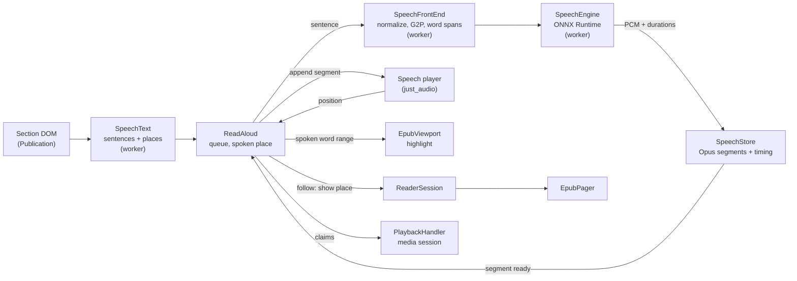

# On-device text-to-speech for reading an ebook aloud

Date: 2026-11-09. Ticket: boo-vv3b. Parent: boo-fs0n. Status: research and proposed design. No product code.

Raw data, scripts and audio samples are in `docs/research/on-device-tts/`.

## Answer

Kokoro-82M v1.0 is still the best-sounding text-to-speech model that a Pixel 8 can run, in November 2026. No newer model of phone size beats it in a published blind comparison or in a neural quality score. Supertonic 3, Pocket TTS and Kitten TTS 0.8 are newer, smaller or faster, and each one costs some quality or reading accuracy. Some larger new models sound better in some tests: Kitten TTS 2, NeuTTS, Chatterbox, Orpheus, Sesame CSM, Kani-TTS, VibeVoice and F5-TTS. But they run near or below real time on a desktop CPU, so they cannot keep ahead of a listener on a phone.

Kokoro is heavy for a phone. On the host Mac it needs about 0.7 seconds of computation per second of speech on two CPU threads. On the Pixel 8 it will probably need three or four threads to keep ahead, which costs heat and battery. Its int8 (8-bit) version is not a way out: it dropped a third of the test passage. The recommendation is Kokoro fp32 with a Bookfin-owned English text front end, gated by one measurement on the Pixel 8. The real product fork is Kokoro (best quality, about 330 MB, English) against Supertonic 3 (faster, 129 MB, 31 languages, more misreadings). Both designs share everything else in the design below.

## Terms

| Term | Meaning |
| --- | --- |
| RTF | Real-time factor: synthesis time divided by the duration of the audio that it makes. Below 1.0 is faster than real time. The synthesizer keeps ahead at playback speed s only while RTF × s stays below 1. |
| Time to first audio | The time from a press of play until the first sound. |
| G2P | Grapheme to phoneme: the step that turns written words into phonemes (speech sounds) for models that read phonemes. |
| Front end | Everything before the model: sentence splitting, text normalization, G2P. |
| Text normalization | Rewriting text into speakable words, for example "1882" to "eighteen eighty-two" and "Dr." to "Doctor". |
| Frame | One step of a model's output. Kokoro and Kitten frames are 600 samples at 24 kHz, that is 25 ms. |
| UTMOS | A neural network that predicts the mean opinion score (MOS), the 1 to 5 naturalness rating of human listeners. |
| Segment | One file of saved speech, holding one or more consecutive sentences. |
| Spoken place | The `EpubPlace` of the first character of the sentence that is playing. |

## Our situation

| Need | Value |
| --- | --- |
| Phone | Pixel 8: Tensor G3, one Cortex-X3, four Cortex-A715 and four Cortex-A510 cores, 8 GB RAM |
| App | Flutter, Android first. Native code through `dart:ffi` (libmobi) and platform channels (Tesseract OCR). |
| Books | 100,000 to 500,000 words. Mostly English, sometimes other languages. |
| Start | Speech within about one second of the press of play |
| Endurance | Hours of listening. Heat and battery matter. |
| Text | From the native EPUB renderer: sections, a DOM per section, `EpubPlace` per character |
| Saving | Compressed speech kept on the phone only. Never uploaded to Jellyfin. |

## Comparison of all candidates

Measured columns come from the host Mac (see "Measurements"). "Mac RTF" is at two threads, the setting closest to a phone budget. Other speed figures are published numbers on other hardware and are labeled.

| Model (date) | Size: parameters, download | Quality evidence | Speed | Book-text test (this study) | Timing output | Languages | License, GPL dependency | Fit for Bookfin |
| --- | --- | --- | --- | --- | --- | --- | --- | --- |
| Kokoro-82M v1.0 fp32 (2025-01, still the newest weights) | 82M, 326 MB model + 0.5 MB per voice | UTMOS 4.44 to 4.46 (best of four on CPU). Artificial Analysis open-weight Elo about 1061. First on the old Hugging Face TTS Arena at release. Lectern: "closest on-device gets to audiobook narration". | Mac RTF 0.69 to 0.78 (1 thread 1.07, 4 threads 0.32). Peak 600 MB. Load 0.8 s. First clause 0.8 s. Published: emulator RTF 0.59 (x86) and 0.58 (arm64, no acceleration). | Complete. Front-end errors from its espeak path: "XII" as "Roman 12", "St." as "Sint", "£3 10s." as "pound three tens", "Nos." as "noss". | Yes: frame durations per phoneme token (25 ms) | English US and UK. Others (es, fr, it, pt, hi, ja, zh) need their own G2P. | Apache-2.0 weights and code. Its reference front end pulls in espeak-ng (GPL-3.0). misaki itself is Apache-2.0. | Best quality. Speed on the Pixel 8 is the open question. |
| Kokoro-82M v1.0 int8 | 82M, 114 MB | Same model, quantized | Mac RTF 0.80 to 0.97: slower than fp32 | Failed: about 70 words in the middle came out as noise | Yes | Same | Same | Rejected. Matches the sherpa-onnx report of int8 garbage on ARM. |
| Supertonic 3 int8 (2026-04) | 99M, 129 MB pack | UTMOS 4.32 at 5 steps, 1.53 at 2 steps. Published English WER 2.06. | Mac RTF 0.14 (1 thread 0.28, 8 steps 0.22). Peak 410 MB. Load 0.4 s. First clause 0.37 s. Published: emulator RTF 0.18 to 0.23. | Several misreadings: "Chapter C", "Darwatson", "Sherlock Hawk Holmes", "Baker's Acres", "three town-towns", "Sir John" | Only the whole utterance's duration | 31 | Weights OpenRAIL-M (use restrictions passed to users, a disclosure clause). Code MIT. Reads characters, so no G2P and no GPL. Upstream archived on 2026-09-09. | Fast and multilingual. Lower reading accuracy. No maintenance. |
| Supertonic 2 (2026-01) | 66M | Superseded by 3 | Similar | Not tested | Same | 5 | Same | Superseded |
| Pocket TTS 100M (Kyutai, 2026-01) | 100M, 168 MB fp32, 98 MB int8 | UTMOS 4.10. Voice cloning from 5 s of audio. | Mac RTF 0.30 fp32, 0.21 to 0.24 int8 (1 thread 0.28). Peak 630 to 910 MB. Published: about 1x real time on a Pixel 8a GPU through LiteRT. | fp32: "Baker Saints", "12, 5 miles". int8: repeated "221 and", "Leave me", "St. Joan". | None. A community fork adds word timestamps. | English, fr, de, pt, it, es, nl | Weights CC-BY-4.0, code MIT. The sherpa-onnx export's README says non-commercial. No G2P. | Autoregressive with context across sentences. Repetition risk. Heavy memory. |
| Pocket TTS small English (2026-10) | 18.2M, 6.9M, 1.9M | No published score | "Up to 25x faster than real time on one CPU thread" (Kyutai) | Not tested: not in sherpa-onnx yet | None | English | Same as Pocket TTS | Worth a listen later. No evidence yet. |
| Kitten TTS 0.8 nano (2026) | 15M, 64 MB fp32 | Estimated MOS 3.2 to 3.5 (estimate, no listening test). The first nano was a distillation of Kokoro. | Mac RTF 0.10 (1 thread 0.22). Peak 210 MB. First clause 0.23 s. Published: emulator RTF 0.09. | Same front-end errors as Kokoro, nothing else wrong. Best intelligibility in this test. | Yes: frame durations per token | English | Apache-2.0. Reference front end uses espeak-ng. | Light and fast. Lower naturalness. |
| Kitten TTS 0.8 mini | 80M, 68 MB | No published score | Mac RTF 0.42 to 0.45 | "1882" as "in 82", "221" as "21" | Yes | English | Apache-2.0 | Slower than Supertonic, no clear gain |
| Kitten TTS 2 (2026-10) | 1.7B (1-bit), 492 MB | Vendor claims state of the art | "Real time on CPUs" with a llama.cpp fork. Needs about 6 GB RAM on CPU (README). | Not tested | Not known | 20 | Stellon Labs Community License. Commercial use can need registration. | Too large for a phone |
| Piper (libritts_r medium) | 82 MB | "Pleasant but synthetic" (Lectern) | Mac RTF 0.055 | "Two, hundred twenty-one", "Bakerson", "Leave me", "in the ring" | Not in the export | 30+ | Piper is now GPL-3.0 (OHF fork). Uses espeak-ng. Voice datasets vary, some research-only. | Fast but lower quality. GPL. |
| Matcha-TTS (sherpa-onnx pack) | about 77 MB | Older single-speaker voices | Fast (not measured) | Not tested | Not exposed | Few | Uses espeak-ng | Superseded by Kokoro |
| MeloTTS | about 52M | Below Kokoro in arenas | Published: 6.5x real time on an M4 CPU, 3.3 GB RAM in Python | Not tested | Not exposed | 6 | MIT | Superseded by Kokoro |
| StyleTTS 2 | about 148M | Kokoro's ancestor | Published: 3.8x real time on an M4 CPU | Not tested | Durations internally | English | MIT, uses phonemizer (GPL) | Kokoro replaces it |
| Soprano 1.1 (2026-01) | 80M | No arena score | Published: 7.2x real time on an M4 CPU, 1.2 GB RAM | Not tested | Not known | English | Apache-2.0 | No mobile runtime. Watch. |
| MOSS-TTS-Nano | about 100M | No arena score | Published: RTF below 1.0 on 4 CPU cores | Not tested | Not known | Multilingual | Apache-2.0 on model card, repository license not published | Too slow for a phone |
| Inflect-Nano-v1 | 4.6M | UTMOS 3.48, "buzzy and robotic" | Very fast | Not tested. Cuts output at 15 s. | Not known | English, one voice | Apache-2.0 | Research demo |
| NeuTTS Nano / Air | 229M / 748M | Voice cloning, realistic | Published: 45 and 20 tokens/s on a Galaxy A25. Desktop core-hour ratio 7.3 (Nano). | Not tested | None | English and others | Air Apache-2.0. Nano: NeuTTS Open License 1.0. | Too slow and too large |
| Chatterbox / Turbo | 744M to 1.2B (TTS Bench) | High (MIT) | Published: 0.4x and 1.1x real time on an M4 CPU | Not tested | None | Multilingual | MIT | Too slow |
| Orpheus | 3B released, smaller sizes listed | High expressiveness | No phone numbers. LLM with SNAC codec. | Not tested | None | English and others | Code Apache-2.0, Llama-based weights (not checked) | Too slow |
| Sesame CSM-1B | 1B | Conversational | Published: 0.24x real time on an M4 CPU | Not tested | None | English | Apache-2.0 | Too slow |
| Spark-TTS | 0.5B | LLM-based | No phone numbers | Not tested | None | en, zh | Not checked | Too slow |
| Kani-TTS | 370M | Expressive | Published only on a desktop GPU | Not tested | None | 6 | Apache-2.0 | Too slow |
| F5-TTS | 330M | Flow matching, cloning | Published: 0.09x real time on an M4 CPU | Not tested | None | en, zh | Code MIT, weights CC-BY-NC | Too slow |
| VibeVoice Realtime 0.5B | 0.5B | Streaming speech | Published: 0.36x real time on an M4 CPU | Not tested | None | English | MIT | Too slow |
| Android system TTS (Google speech services on the Pixel) | Installed with the phone | "Clear and functional, often flat in books" (Lectern) | Real time, light | Not tested | Word ranges through `onRangeStart` (API 26), from engines that give them | Many | Part of Android | Baseline and fallback for other languages |
| Picovoice Orca | 8 MB | Vendor benchmark | Very fast | Not tested | Not checked | Few | Commercial license only | Out of scope |

The Pixel 8 numbers in the next sections are estimates. No candidate was run on the user's phone.

## Measurements

### Host Mac

Hardware: Apple M1 Max (8 performance cores), macOS. Runtime: sherpa-onnx 1.13.8 command line tool from nixpkgs, with ONNX Runtime 1.27.1 on the CPU. Other agents shared the machine: the load average was 6 to 15 on 10 cores. So the numbers are pessimistic. Script: `on-device-tts/bench.sh`. Raw lines: `on-device-tts/mac-m1-max-runs.txt`.

The test passage (`on-device-tts/passage.txt`, 126 words) holds what books hold. It has a Roman numeral chapter title, dates, "Dr." and "Mr.", and "St." for Street and for Saint. It also has old currency, percentages, "Nos.", "i.e.", times, quotations, and the homographs "read" and "lead".

| Model | Threads | Synthesis s | Audio s | RTF | Peak memory MB |
| --- | --- | --- | --- | --- | --- |
| Kokoro fp32 | 1 | 44.2 | 41.5 | 1.07 | 603 |
| Kokoro fp32 | 2 | 28.4 / 32.3 | 41.4 | 0.69 / 0.78 | 596 / 612 |
| Kokoro fp32 | 4 | 13.2 | 41.5 | 0.32 | 663 |
| Kokoro int8 | 2 | 40.0 / 33.1 | 41.2 | 0.97 / 0.80 | 399 / 403 |
| Kitten nano fp32 | 1 | 11.2 | 51.4 | 0.22 | 180 |
| Kitten nano fp32 | 2 | 5.2 / 5.3 | 51.4 | 0.10 | 212 / 220 |
| Kitten nano fp32 | 4 | 3.7 | 51.4 | 0.07 | 222 |
| Kitten mini | 2 | 19.9 / 18.5 | 43.8 | 0.45 / 0.42 | 292 / 300 |
| Supertonic 3 int8, 5 steps | 1 | 15.2 | 54.9 | 0.28 | 408 |
| Supertonic 3 int8, 5 steps | 2 | 7.9 / 7.9 | 54.9 | 0.14 | 409 / 406 |
| Supertonic 3 int8, 5 steps | 4 | 7.5 | 54.9 | 0.14 | 411 |
| Supertonic 3 int8, 8 steps | 2 | 12.1 / 13.4 | 54.9 | 0.22 / 0.24 | 409 / 408 |
| Pocket TTS fp32 | 2 | 12.4 / 13.0 | 40.9 / 39.9 | 0.30 / 0.33 | 908 / 910 |
| Pocket TTS int8 | 1 | 11.4 | 40.9 | 0.28 | 624 |
| Pocket TTS int8 | 2 | 8.4 / 10.1 | 39.4 / 42.3 | 0.21 / 0.24 | 629 / 648 |
| Pocket TTS int8 | 4 | 12.2 | 42.4 | 0.29 | 628 |
| Piper libritts_r medium | 1 | 3.8 | 41.4 | 0.09 | 335 |
| Piper libritts_r medium | 2 | 2.2 / 2.4 | 41.3 / 40.9 | 0.05 / 0.06 | 334 / 327 |
| Piper libritts_r medium | 4 | 1.4 | 40.8 | 0.03 | 337 |

Two observations matter for the design:

- Supertonic and Kitten make longer audio for the same text (55 s and 51 s against 41 s). Part of that is slower speech and longer pauses. Their RTF looks better than their speed per word.
- Pocket TTS int8 did not get faster with more threads. Its decoder is a loop over frames.

Time to first audio depends on model load plus the first utterance. Model load is the process wall time minus synthesis time. The first utterance was the clause "He read the letter twice," (about 1.4 to 2.0 s of audio), three runs each at two threads:

| Model | Load s | First clause s |
| --- | --- | --- |
| Kokoro fp32 | 0.75 to 0.80 | 0.80 to 0.83 |
| Supertonic 3 int8, 5 steps | 0.40 | 0.37 |
| Pocket TTS int8 | 0.40 to 0.45 | 0.36 to 0.38 |
| Kitten nano fp32 | 0.32 | 0.23 to 0.24 |

### Book-text test

Each output was transcribed with whisper.cpp small.en. The transcripts are in `on-device-tts/asr-transcripts.txt`. A speech recognizer has its own errors, so this test finds broken or misread words. It is not a naturalness score. Listen to the samples instead:

- `on-device-tts/kokoro-16kbps.opus` and `kokoro-24kbps.opus`
- `on-device-tts/kitten-nano-16kbps.opus`
- `on-device-tts/supertonic5-16kbps.opus`
- `on-device-tts/piper-16kbps.opus`

What the test showed:

- Every espeak-based front end (Kokoro, Kitten, Piper in sherpa-onnx) failed on the same book conventions: Roman numerals in headings, "St.", pre-decimal currency and "Nos.". Bookfin needs its own text normalization for books, whatever the model.
- Supertonic reads raw characters, so it has no G2P step to fix. Its errors came from inside the model ("Darwatson", "Hawk Holmes", "three town-towns").
- Kokoro int8 replaced about a third of the passage with noise. The audio kept its length, so a duration check does not catch it.
- Pocket TTS int8 repeated a phrase, a known risk of autoregressive models.

### Saved speech size

Opus, mono, 24 kHz input, `--speech` mode, measured on the 41.4 s Kokoro passage. The size per book assumes 160 words per minute, which is a usual narration pace. Kokoro spoke the test passage at 182 words per minute.

| Bitrate | Measured size | Per hour | 100,000 words (10.4 h) | 500,000 words (52 h) |
| --- | --- | --- | --- | --- |
| 12 kbit/s | 65 KB | 5.7 MB | 59 MB | 296 MB |
| 16 kbit/s | 96 KB | 8.3 MB | 87 MB | 433 MB |
| 24 kbit/s | 136 KB | 11.8 MB | 123 MB | 614 MB |
| 32 kbit/s | 176 KB | 15.3 MB | 160 MB | 797 MB |

Recommendation: Opus at 16 kbit/s, mono. Compare `kokoro-16kbps.opus` and `kokoro-24kbps.opus` by ear before the choice is final.

### No emulator measurement

An arm64 Android emulator on this Mac runs on the same M1 Max cores through the hypervisor. It repeats the Mac numbers with more overhead and says nothing about Tensor G3 cores. So this study did not create one. The first follow-up ticket measures the user's phone.

## What published numbers say about phones

- The rtchat spike measured sherpa-onnx in a Flutter app on an x86_64 Android emulator. It found Kokoro fp32 RTF 0.59, Supertonic 3 int8 0.20, Kitten nano 0.09, and Kokoro int8 1.52. NNAPI and XNNPACK did not help and sometimes crashed. Its authors had no phone.
- Soniqo measured Kokoro at RTF 0.58 on an arm64 emulator without acceleration.
- NeuTTS reports 20 to 45 tokens per second on a Galaxy A25 CPU.
- A LiteRT port of Pocket TTS reports about 1x real time on a Pixel 8a GPU. That is slower than the CPU estimate for the Pixel 8 below.
- Lectern is an Android reader that ships Kokoro, Piper and Supertonic. It says that Kokoro "keeps up fine" on recent phones, and that Piper is the safer choice on older phones. NimbleEdge measured about 8 s to make 10 s of Kokoro audio on 2025 phones, with int8 weights.

Estimate for the Pixel 8. From public single-core benchmark scores, one Cortex-X3 core does roughly 0.6 to 0.75 of the work of an M1 performance core. An A715 core does less. So the Pixel needs roughly 1.5 to 2 times the Mac's time at the same thread count, before heat throttling:

| Model | Mac RTF, 2 threads | Pixel 8 estimate, 2 threads | Pixel 8 estimate, 4 threads |
| --- | --- | --- | --- |
| Kokoro fp32 | 0.69 to 0.78 | 1.0 to 1.6 (falls behind) | 0.5 to 0.7 |
| Supertonic 3 int8, 5 steps | 0.14 | 0.2 to 0.3 | 0.2 to 0.3 |
| Pocket TTS int8 | 0.21 to 0.24 | 0.3 to 0.5 | not better |
| Kitten nano fp32 | 0.10 | 0.15 to 0.2 | 0.1 to 0.15 |

At 1.5x playback speed, Kokoro needs a phone RTF below 0.67. That is likely at four threads and unlikely at two. Every second of Kokoro speech costs roughly 1.5 to 3 seconds of CPU core time on the phone, against about 0.4 to 0.6 for Supertonic. The CPU work per book is fixed, so caching matters: a second listen costs only Opus decoding.

## The situation each technique was made for

| Technique | Made for | Fit for Bookfin |
| --- | --- | --- |
| Kokoro (StyleTTS 2 with an iSTFTNet vocoder, one pass per sentence) | Fast English narration on desktops and servers, with a strong G2P front end (misaki). Quality target: human-like reading. | It fits the quality target. Its cost assumes a desktop CPU or a GPU. On a phone it is at the edge. It depends on a G2P that Bookfin must supply. |
| Supertonic (flow matching with N steps, reads characters) | Low-latency speech in many languages on CPUs, browsers and edge devices, without a G2P. Quality target: usable at very low cost. | It fits the phone budget. Few steps sound robotic (UTMOS 1.53 at 2 steps), so it needs 5 or more. Its character reading is weaker on book conventions. |
| Pocket TTS (autoregressive language model over audio codec frames) | Real-time speech with voice cloning on two desktop CPU cores, streaming for assistants. | Its streaming and cloning are not needs of ours. Its memory is high, and it gives no word timing. |
| LLM-based TTS (NeuTTS, Kitten 2, Orpheus, Spark, Kani, CSM) | Expressive speech and cloning on GPUs, or on desktop CPUs at about real time | A phone CPU is several times slower. They cannot keep ahead. |
| int8 dynamic quantization | Smaller downloads and faster x86 servers with int8 kernels | On these models it was slower on the Mac and broke Kokoro. Use it only where a phone test proves it. |
| NNAPI, NPU through LiteRT, ExecuTorch | Fixed-shape vision and LLM graphs on phone accelerators | TTS graphs have dynamic shapes. NNAPI is deprecated since Android 15. The rtchat spike saw no gain and some crashes. No TTS model for the Tensor NPU exists. Stay on the CPU. |
| Forced alignment with a speech recognizer | Aligning existing recordings to text | We make the audio ourselves, and Kokoro gives its own durations. An extra model is not needed. |

## Licenses and the GPL question

- espeak-ng is GPL-3.0. The prebuilt sherpa-onnx Android and iOS libraries link it statically, even for models that never call it (rtchat spike). A distributed app that ships it is a GPL-3.0 work.
- Bookfin already ships libmobi under LGPL-3.0-or-later and has no license file of its own. Bookfin is not on an app store. So GPL-3.0 is possible for Bookfin, but that is the user's decision. It is not needed.
- The GPL-free path for Kokoro: misaki's American and British lexicons (Apache-2.0, about 178,000 words in the sherpa pack) plus Bookfin's own rules for words outside them. The misaki BART fallback model has unclear provenance (the misakid port refuses it for that reason). A Dart port of misaki exists (`misakid`, pre-1.0, license to check).
- Supertonic, Pocket TTS and Soprano need no G2P, so they need no espeak-ng.
- Weights: Kokoro and Kitten 0.8 are Apache-2.0. Supertonic 3 is OpenRAIL-M: its use restrictions must be passed on to users, and one clause asks for disclosure that content is machine-made. A personal reader that says "read aloud by Kokoro" or "by Supertonic" in its licenses screen meets that. Pocket TTS weights are CC-BY-4.0, and attribution goes on the licenses screen.

## Runtimes from Flutter

| Runtime | State in November 2026 | Fit |
| --- | --- | --- |
| sherpa_onnx (pub.dev 1.13.8, Apache-2.0) | Supports Kokoro, Kitten, VITS, Matcha, Supertonic, Pocket, ZipVoice. CPU only on Android. 26.7 MB native library per arm64 ABI. Links espeak-ng. Returns samples per sentence, without durations. | Fast to prototype. It hides the durations that word highlighting needs and brings the GPL. |
| ONNX Runtime C API through `dart:ffi` (official `onnxruntime-android` library, MIT) | Runs every model above. Gives every model output, including Kokoro's durations. | Recommended. One code path on Android, macOS, Linux and Windows, testable on the host Mac. |
| flutter_onnxruntime (1.9.0, MIT) | Official ORT with NNAPI and XNNPACK, raw tensors only. Conflicts with sherpa_onnx over `libonnxruntime.so`. | Usable, but a plugin adds a platform channel hop per call |
| LiteRT, ExecuTorch | No TTS models for phones. A Kokoro ExecuTorch build ran out of memory with XNNPACK. | Not now |
| llama.cpp | For LLM-style TTS only (NeuTTS, Kitten 2) | Not needed |
| Android `TextToSpeech` | Installed voices. `synthesizeToFile` and word ranges where the engine gives them. | Fallback for languages outside the chosen model |

## Timing for highlighting

- Kokoro and Kitten return one duration per input token, in 25 ms frames. This study made sure of it on the sherpa-onnx exports: the sum of the durations times 600 equals the number of samples exactly. If Bookfin's G2P keeps the token range of each word, each word gets a start and an end in the audio with 25 ms resolution.
- Supertonic gives only the whole utterance's duration. If each sentence is one utterance, sentence highlighting is exact. Word highlighting then needs an estimate, for example time shared out by character count, which drifts by a few hundred milliseconds inside long sentences.
- Pocket TTS and Piper give nothing.
- If Bookfin synthesizes one sentence per call, every model gives exact sentence timing.

The player reports its position, and the reader finds the word by binary search in the segment's timing table. A word highlight can be within about 50 ms of the sound, which is under what a reader notices.

## Recommendation

1. Voice: Kokoro-82M v1.0 fp32, with a small set of voices (for example `af_heart` and `bm_george`). Gate: on the Pixel 8, with at most four threads, sustained RTF must stay at or below 0.6 for 30 minutes. That keeps ahead at 1.5x speed. Also try an fp16 export, which halves the download. If it is slower on the phone, keep fp32. If Kokoro fails the gate, use Design B below.
2. Front end: Bookfin owns sentence splitting, book text normalization and English G2P (misaki lexicons and Bookfin rules, no espeak-ng). This fixes the errors that the book-text test found and keeps word spans for highlighting.
3. Runtime: the official ONNX Runtime library through `dart:ffi`, in a long-lived worker isolate, on the CPU.
4. Saved speech: Opus at 16 kbit/s mono, in segments beside the download.
5. Highlighting: the spoken word from Kokoro's durations, and the spoken sentence as a lighter band.
6. Other languages: Android's system voice in Design A, or Supertonic 3 in Design B.

## Product fork for the user

| Design | Voice | Download | Speed on the Pixel 8 (estimate) | Reading accuracy on book text | Languages | Word highlight | Upstream |
| --- | --- | --- | --- | --- | --- | --- | --- |
| A: Kokoro | Kokoro-82M fp32 | About 330 MB (about 165 MB with a working fp16 export) | RTF 0.5 to 0.7 on four threads. Warmer phone, more battery. | Good after Bookfin's front end. Fewest model errors. | English. Other languages read with Android's system voice. | Exact, from durations | Weights final since 2025, Apache-2.0 |
| B: Supertonic | Supertonic 3 int8 | 129 MB | RTF 0.2 to 0.3 on two threads. Cooler phone. | More misreadings inside the model, which a front end cannot fix | 31, one voice set | Sentence exact, word estimated | Archived in 2026-09, OpenRAIL-M |

Example of A: the person opens a novel in English and presses Read aloud. The first time, Bookfin asks to download the Kokoro voice (330 MB, Wi-Fi). Speech starts after about 1.5 s. Each word lights up as it is spoken.

Example of B: the person opens a French novel and presses Read aloud. Speech starts after about 0.7 s in a French voice. The sentence lights up, and the word light moves by estimate.

What both designs share: the speech text and places, the queue, the speech store, Opus segments, the media session, progress saving, follow, and the sentence highlight. A hybrid is possible: Kokoro for English and Supertonic for other languages, at the cost of both downloads and two model paths.

## Design

### Owners

| State | Owner | Readers | Lifetime |
| --- | --- | --- | --- |
| Speech text of a section: sentences, words, and the `EpubPlace` range of each | `SpeechText`, built by a worker isolate from the section's DOM | `ReadAloud` | Cached for the open book |
| Normalized words and phoneme tokens with word spans | `SpeechFrontEnd`, pure functions on a worker isolate | `SpeechEngine` | Per sentence |
| Voice model session | `SpeechEngine`: one long-lived worker isolate that holds the ONNX Runtime session | `ReadAloud` sends sentences and receives audio and timings | Loaded at the first press. Released at the book's close. |
| Saved segments and their timing index | `SpeechStore` in `.bookfin-speech` beside the download | `ReadAloud` | Until the download is removed or the person clears the speech |
| Speech queue, playing state, spoken sentence and word | `ReadAloud`, a data source that `ReaderSession` creates for an open EPUB or MOBI book, as it creates the pager | Dock controls, viewport highlight, media session | The open book |
| Saved reading place | `ReaderSession`, unchanged | Everyone | The account |
| Shown page | `EpubPager`, unchanged | Viewport | The open book |
| Which source the media session shows | `PlaybackHandler`: it shows `Playback` or `ReadAloud`, whichever started last | Android | The process |

### Text from the renderer

- `SpeechText` walks the section DOM in document order and collects the text of each block. It does not use page layout, so it does not change with text size. It skips what the renderer hides, footnote reference marks, and image text. It reads the DOM's own characters, so `text-transform: uppercase` does not turn words into letters.
- Each code unit keeps its `EpubPlace` (section, node, offset), the same map that `TextRun.offsets` keeps for layout.
- A sentence splitter cuts blocks into sentences. It knows book abbreviations ("Mr.", "Dr.", "St.", "i.e.") and quotation marks. A heading is its own sentence.
- A sentence over Kokoro's 510-token limit is cut at clause punctuation.

### Starting and the queue

- Read aloud starts at the first sentence that starts on the shown page. If no sentence starts there, it starts at the sentence that holds the page's first visible character.
- `ReadAloud` first looks in `SpeechStore` for a segment that covers the start sentence. If one exists, playback starts at once, at that sentence's time in the segment.
- Otherwise it sends the first clause of the start sentence alone, so the first audio is short. Then it sends whole sentences.
- The queue keeps between 2 and 10 minutes of speech ready ahead of the listener. It works in bursts so that the CPU can rest between them. While the phone charges, it can prepare the rest of the chapter.
- If the phone reports a moderate or worse thermal state (Android's thermal status API), the engine uses fewer threads. If the queue empties, the player waits silently, and the dock shows a thin progress line.
- The model loads at the first press. If the person used Read aloud in this book before, the model loads when the book opens. Then the first audio comes from a warm model.

### Saved speech

- A segment holds the sentences of one paragraph, or up to about 30 s of a long paragraph. Each segment has a timing table: for each sentence and each word, its start and end in milliseconds and its place range.
- The key of a segment names the publication identity (`processed`), the section and the first sentence's place. It also names a hash of the text, the voice, the model version and the front-end version. If any of them changes, Bookfin does not reuse the segment.
- Segments are Ogg Opus at 16 kbit/s mono. Bookfin encodes them with libopus through `dart:ffi` (BSD license), so the same code works on every platform. Android's own Opus encoder needs Android 10. Apple players do not read Ogg, so Apple platforms need another container, probably CAF, which holds Opus there.
- `SpeechStore` writes each segment to a temporary file, then renames it. A crash loses at most a segment, which Bookfin makes again. Speech is derived data. Its loss is never data loss.
- The directory `.bookfin-speech` joins the derived directories of `DerivedBookFiles`. So removing a download removes its speech, and the storage figures count it. Settings shows the speech size per book and offers to clear it.
- Nothing in the speech store has a network dependency. Sync uploads records only. The app sets `allowBackup="false"`, so Android does not back the files up either. A test makes sure that no upload path reads `.bookfin-speech`.

### Progress and data safety

AGENTS.md engine rule 3 says: never lose a place in a book.

- `ReaderSession` stays the one owner of the saved place. `ReadAloud` never writes it. It asks the session.
- While speech plays and the app is in front, the pager follows the speech. When the spoken sentence starts after the shown page's end, `ReadAloud` asks the session to show the next page. The pager reports that page's place as for a page turn, and the session saves it. So reading aloud saves as often as reading by eye.
- At pause, stop, a seek, a chapter change, the app going to the background, and the book closing, `ReadAloud` gives the session the spoken place. The session saves it. A reopened book shows the page whose first line holds that sentence, as a bookmark does.
- In the background, no pages are drawn, so the follow does not run. The session saves the spoken place every 30 s of speech. When the app comes back, the pager shows the page that holds the spoken place.
- If the person turns pages by hand while speech plays, the speech goes on and the follow stops. A "Back to the voice" control returns to the spoken page. Pressing play on a page that the person chose starts from that page.
- Speech moves the saved place backward only on the person's request: a seek back, or a start on an earlier page.

### Highlighting

- `ReadAloud` publishes the spoken range as a narrow `ValueListenable`: the sentence range and the word range.
- `EpubViewport` subscribes to it and draws two marks under the text on the shown page: a light band for the sentence and a stronger mark for the word. It uses the same line geometry as text selection. A change of word repaints the overlay only. It never lays out the page again.
- With Supertonic, the word mark follows the estimate, or the setting can show the sentence only.

### Playback and the media session

- `ReadAloud` plays its segments with its own just_audio player, as a playlist that grows at its end. ExoPlayer joins Opus segments without gaps.
- Speed uses the player's time stretch, which keeps the pitch. So saved speech is reused at every speed, and the synthesis need is RTF × speed below 1.
- Bookfin has one media session. Starting Read aloud pauses `Playback` and attaches `PlaybackHandler` to `ReadAloud`. The notification shows the book, the chapter and "Read aloud". Starting an audiobook pauses `ReadAloud` and attaches the handler to `Playback`. Headset and lock-screen buttons go to the attached source.
- `ReadAloud` never reports to Jellyfin as audio playback. It changes only the ebook place, which syncs as the reader's place does today.
- Interruptions (a call, another app's audio) pause it, as they pause `Playback`.

### Background

- The `mediaPlayback` foreground service of audio_service keeps the process alive while speech plays. The speech engine's worker isolate keeps running with the screen off.
- Leaving the book with Back stops reading aloud, because the feature belongs to the reader. Locking the phone or switching apps does not stop it.
- The sleep timer of the player applies to reading aloud too.

### Reader controls

- The reader's glass dock gets a Read aloud button. While speech plays, the dock shows play and pause, sentence back and forward, and speed.
- A glass sheet holds the voice choice, the voice download and its size, and "Clear saved speech for this book".
- The download of a voice follows the media network policy: Wi-Fi only unless the person allows otherwise.

## Risks

- The Pixel 8 can be too slow or too hot for Kokoro over hours. The gate measurement decides. Design B is the fallback.
- Time to first audio with a cold Kokoro model is likely 1.5 to 2.5 s on the phone. Warm loading and a short first clause aim at about one second. Saved speech starts at once.
- A G2P without espeak-ng mispronounces rare words and names outside the lexicon. A pronunciation rule set and, later, a per-book pronunciation list reduce that.
- Homographs ("read", "lead", "live") need part-of-speech rules. misaki's tagger is spaCy, which is not on the phone. Bookfin needs simple rules or the misakid port.
- Supertonic is archived. Design B depends on unmaintained weights and code, and a later ONNX Runtime can break it with nobody to fix it.
- Long-form prosody: Kokoro and Supertonic read each sentence alone. The voice stays the same, but each sentence's tune starts fresh. Bookfin's pauses between sentences, paragraphs and sections carry the structure.
- Storage: a long series at 16 kbit/s can use several gigabytes. Settings must show the size, and the person can clear it.
- The sherpa-onnx export of Pocket TTS says non-commercial, which differs from Kyutai's CC-BY-4.0. It does not matter for the recommendation.
- Measurements ran on a shared, busy Mac. They rank the models but do not predict phone numbers exactly.

## Order of work

These tickets carry the work, in order, under the epic t0-t799 (parent boo-fs0n). The first one needs the user's Pixel 8 and the user's permission.

| Order | Ticket | Work | Depends on |
| --- | --- | --- | --- |
| 1 | t0-etnk | Measure Kokoro, Supertonic 3 and Kitten nano on the Pixel 8: sustained RTF over 30 minutes, heat, battery per hour, first audio cold and warm, fp16 Kokoro | None |
| 2 | t0-i4kg | Write the read-aloud plan from this research, the Pixel numbers and the user's choice of design | t0-etnk |
| 3 | t0-u3nc | Build the speech text of a section: sentences and words with their places | t0-i4kg |
| 4 | t0-bv9p | Read book text aloud correctly: English normalization and G2P without espeak-ng | t0-i4kg |
| 5 | t0-f9iu | Run the chosen voice through ONNX Runtime in a worker isolate, with durations | t0-i4kg |
| 6 | t0-bomb | Keep spoken audio beside the download as Opus segments | t0-i4kg |
| 7 | t0-4qhe | Read the open book aloud: queue, player, media session, follow and saved place | t0-u3nc, t0-bv9p, t0-f9iu, t0-bomb |
| 8 | t0-9nyn | Highlight the spoken sentence and word on the page | t0-4qhe |
| 9 | t0-sc6l | Read aloud for hours with the screen off: background, interruptions, heat | t0-4qhe |
| 10 | t0-ze9w | Read books in other languages aloud | t0-4qhe |

## Sources

Models:

- Kokoro-82M: https://huggingface.co/hexgrad/Kokoro-82M and https://github.com/hexgrad/kokoro
- Kokoro GPL question: https://github.com/hexgrad/kokoro/issues/247
- misaki G2P: https://github.com/hexgrad/misaki
- misakid Dart port: https://pub.dev/packages/misakid
- Supertonic (archive, Supertonic 3 tables and notice): https://github.com/supertone-inc/supertonic
- Supertonic 2 model card: https://huggingface.co/Supertone/supertonic-2
- Pocket TTS: https://github.com/kyutai-labs/pocket-tts and https://huggingface.co/kyutai/pocket-tts
- Kitten TTS (0.8 and 2): https://github.com/KittenML/KittenTTS
- Kitten TTS 2 license notes: https://betterstack.com/community/guides/ai/kitten-tts-2/
- NeuTTS: https://github.com/neuphonic/neutts/blob/main/README.md
- Soprano: https://github.com/ekwek1/soprano
- MOSS-TTS-Nano: https://github.com/OpenMOSS/MOSS-TTS-Nano
- Inflect-Nano-v1: https://huggingface.co/owensong/Inflect-Nano-v1
- Kani-TTS: https://huggingface.co/nineninesix/kani-tts-370m
- Orpheus: https://github.com/canopyai/Orpheus-TTS
- Spark-TTS paper: https://arxiv.org/abs/2503.01710
- Piper (GPL fork): https://github.com/OHF-Voice/piper1-gpl
- MeloTTS: https://github.com/myshell-ai/MeloTTS
- StyleTTS 2: https://github.com/yl4579/StyleTTS2
- F5-TTS: https://github.com/SWivid/F5-TTS
- Chatterbox: https://github.com/resemble-ai/chatterbox
- Sesame CSM: https://github.com/SesameAILabs/csm

Benchmarks and comparisons:

- Kokoro, Supertonic 3, Inflect-Nano and Pocket TTS on CPU with UTMOS: https://heyneo.com/blog/kokoro-supertonic-inflect-nano-pocket-tts-cpu-benchmark
- TTS Bench on an Apple M4: https://5uck1ess.github.io/tts-bench/mac-default/speed.html
- Picovoice on-device benchmark (a vendor of a competing product): https://picovoice.ai/blog/on-device-tts/
- Artificial Analysis open-weight leaderboard: https://artificialanalysis.ai/text-to-speech/leaderboard/provider-voice/open-weights
- rtchat sherpa-onnx spike, licenses and emulator numbers: https://github.com/muxable/rtchat/issues/1500
- rtchat runtime and accelerator analysis: https://github.com/muxable/rtchat/issues/1502
- Soniqo Android benchmarks: https://soniqo.audio/benchmarks/android
- Lectern, Piper and Kokoro in an Android reader: https://lecternreader.app/blog/piper-vs-kokoro-tts-android
- Lectern, Android TTS against Piper and Kokoro: https://lecternreader.app/blog/android-tts-vs-piper-kokoro
- NimbleEdge, Kokoro on phones: https://www.nimbleedge.com/blog/how-to-run-kokoro-tts-model-on-device/
- On-device speech in mid-2026: https://offlinetts.com/blog/tts-stt-landscape-h1-2026/

Runtimes and platform:

- sherpa-onnx: https://github.com/k2-fsa/sherpa-onnx
- sherpa-onnx TTS model packs: https://github.com/k2-fsa/sherpa-onnx/releases/tag/tts-models
- Android supported media formats (Opus encoder from Android 10): https://developer.android.com/media/platform/supported-formats
- MediaMuxer Ogg output (API 29): https://developer.android.com/reference/android/media/MediaMuxer.OutputFormat
- Android word ranges: https://developer.android.com/reference/android/speech/tts/UtteranceProgressListener
