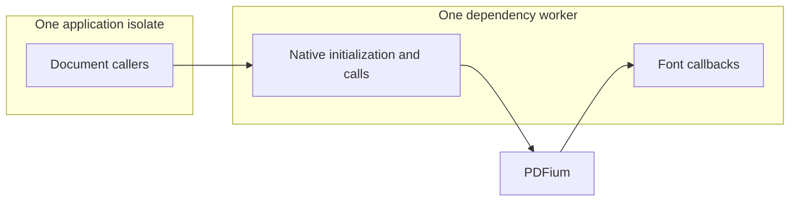

# Pinned PDF worker ownership on macOS

Date: 2026-11-02. Ticket: `t0-ebxa`. Baseline: `5815233235c0cf97999e1e7d00098494b7ccc557`.

## Result and boundary

One application isolate must own all calls into the PDF document API.
An isolate is a Dart execution context with its own global variables.
The dependency's worker must own native initialization, font callbacks, and native destruction.
A worker is the dependency-owned isolate that executes PDFium calls.
Multiple document callers can share that worker without creating additional workers.

This is a bounded host proof, not a production reader implementation.
The pinned engine remains `pdfrx_engine 0.9.0`, with `pdfium_dart 0.4.1` and the Nix-pinned PDFium Chromium 8125 macOS ARM64 library.
Neither package selection nor the production reader's interface changes here.

The isolated negative probe aborted with exit code `-6`, meaning termination by the abort signal on this host.
Its stack contains `Cannot invoke native callback from a different isolate.`, `CFX_ExternalFontInfo::MapFont`, and `FPDF_LoadPage`.
The positive probe exited normally with code `0`.
It used the default Dart font mapper and observed actual missing-font events before and after worker restart.

## Dependency evidence

The research package's unchanged `pubspec.lock` records these downloaded archive hashes:

| Package | Version | SHA-256 |
| --- | --- | --- |
| pdfrx_engine | 0.9.0 | 08d0d0843807b632f23836d6f021d1ff391b1988e124894067045242f03d7f96 |
| pdfium_dart | 0.4.1 | 3e250021b2f462058aae216837902fdc8b2cb7f0657e4ec2bc9ac541f960ff84 |

Dependency acquisition used `dart pub get --enforce-lockfile` in the research Nix shell.
The following observations come from that downloaded package, not a proposed replacement implementation.
Paths below are relative to the pinned `pdfrx_engine` package root.

| Source | Observed ownership rule |
| --- | --- |
| `lib/src/pdfrx_initialize_dart.dart` | Initialization caching belongs to each caller isolate, not the operating-system process. |
| `lib/src/native/worker.dart` | The worker singleton also belongs to each caller isolate. Its queue executes PDFium work on its worker isolate. |
| `lib/src/native/pdfrx_pdfium.dart` | Backend initialization installs the font mapper on that worker. Font functions use `NativeCallable.isolateLocal`. |
| `lib/src/native/pdfrx_pdfium.dart` | Backend shutdown destroys PDFium, releases font callbacks, then stops the worker. Document disposal does not stop the worker. |
| `lib/src/pdfrx_entry_functions.dart` | Public computation uses the same worker as document operations. Public worker shutdown requires prior release of PDFium resources. |

An isolate-local native callback can run only on its originating isolate.
Two caller isolates create two worker singletons but share native library state within the same operating-system process.
The negative probe initializes those callers in order, then asks the first caller to open the unchanged text fixture.
The second initialization has already installed another worker's font callbacks.
The abort follows without relying on random test-file scheduling.

The dependency also exposes a process-wide PDFium gate for multiple Flutter engines.
That mode skips the Dart font mapper and leaves PDFium alive until process exit.
It therefore changes callback and cleanup behavior rather than proving the requested ownership model.
The positive probe does not enable it or patch dependency source.

## Production integration requirement

The application isolate owns admission of document work and the engine lifetime.
The dependency worker owns execution of every native operation and its font callbacks.
Each document caller owns its document and rendered images until their disposal completes.



The production reader must preserve these rules:

1. Await application-level initialization before admitting any document callers. Flutter must use its documented Flutter initializer rather than this Dart-only probe's initializer.
2. Send all PDF document calls through that application isolate. Do not independently initialize PDFium from extraction isolates or extra Flutter engines.
3. Let the dependency schedule extraction and rendering. Do not create another native worker or move native handles to another isolate.
4. Keep documents alive until their extraction and rendering finish. Dispose rendered images, then await document disposal, including after a caller error.
5. Close and reopen documents without restarting the engine. Keep the font callback owner alive across document sessions.
6. Stop the worker only after admission stops and all document work and disposal finish. Never stop it while another caller retains a document or image.

A future caller in another isolate must send its request to the application isolate instead of calling the engine itself.
No cross-isolate request adapter is implemented or claimed here.
The proof covers concurrent asynchronous callers, not simultaneous native execution on several workers.

The public shutdown API is marked experimental by the dependency.
After explicit shutdown, opening a new document reinitializes the backend and installs new callbacks.
The probe observes that behavior through public document operations.
Calling the Dart initialization wrapper again alone is not a restart guarantee because its initialization flag remains cached.

## Executable observations

`tool/research/readers/dart_pdf/test/ownership_test.dart` launches the probes in separate operating-system processes.
Native aborts therefore cannot terminate the parent test runner or become ordinary parser rejection results.
Each child has a 45-second deadline; a timeout is a test failure, never an acceptable abort observation.
The positive probe returns normally without forcing process exit.

| Observation | Actual pinned-engine result |
| --- | --- |
| Independent initialization in two caller isolates | Native abort, exit `-6`; exact callback error and native page-loading stack retained. |
| Three asynchronous document callers | All three documents remain open before any caller reads. Each caller reports the same worker control port, source text, and a visible 120-pixel-wide render. |
| Default font mapper | Missing-font events contain `Helvetica` and `Helvetica-Bold`, requested by the unchanged fixture. These events originate from the installed Dart font callback. |
| Document close and reopen | Two successive openings preserve source text and worker identity. Each document's disposal callback runs once despite repeated disposal. |
| Failed document caller | The exact caller error propagates. Its document's disposal callback runs once, and subsequent extraction succeeds. |
| Truncated in-memory copy | Opening raises `PdfException`; the child remains alive and later extracts the original document. Original fixture bytes remain unchanged. |
| Worker shutdown and restart | Two actual isolate-exit notifications arrive. Reopening after the first shutdown uses a different worker control port and retains text, visible rendering, and font callback events. |

The probe obtains each worker's identity with this exact function:

```dart
Future<SendPort> workerIdentity() => PdfrxEntryFunctions.instance.compute(
  (_) => Isolate.current.controlPort,
  null,
);
```

where

- `workerIdentity()` returns an asynchronous identity query for the dependency worker.
- `Future<SendPort>` is a result that eventually contains a Dart message port.
- `PdfrxEntryFunctions.instance` is the native backend entry point in the application isolate.
- `compute` executes the supplied function on the dependency worker used for document operations.
- `_` is the unused message argument; `null` is the message sent to that function.
- `Isolate.current` is the worker executing the supplied function.
- `controlPort` identifies that isolate; the probe compares ports without sending control messages.

Control-port equality identifies the actual Dart worker, not a configured worker name.
Exit notifications come from listeners registered on that worker through its public computation API.
Document disposal callbacks follow the dependency's native document close operation.
These observations check cleanup ordering; they do not measure native heap leaks or long-running stability.

## Reproduction

Run from the checkout root on the same macOS ARM64 research host:

```sh
nix develop ./tool/research/readers --command bash -c '
  set -euo pipefail
  cd tool/research/readers
  mkdir -p _out/pdfium-host
  tar xf "$PDFIUM_HOST_ARCHIVE" -C _out/pdfium-host
  export PDFIUM_LIBRARY="$PWD/_out/pdfium-host/lib/libpdfium.dylib"
  cd dart_pdf
  dart pub get --enforce-lockfile
  dart test test/ownership_test.dart --reporter expanded
'
```

This command needs no corpus download, device, browser, credentials, or server.
The negative test intentionally aborts its child process.
The parent test passes only when that child has the expected nonzero status and native error.
Raw child output goes to ignored `_out/ownership/`, outside historical corpus evidence.
Captured standard output precedes captured standard error in these files; their combined order is not a chronological trace.

The new positive entry initially used the same independent-worker reproducer as the negative entry.
Its regression assertion expected exit `0` and failed with actual exit `-6`.
`evidence/ownership/red.txt` retains that meaningful failure before the positive entry adopted the supported single-owner path.
The later lifecycle checks characterize the pinned dependency; they are not claims of new production behavior.

## Verification and limits

The full existing reader research checks passed with the five added ownership checks: 43 checks total.
The counts are 17 Python checks, 13 PDF/Markdown checks, four original EPUB checks, and nine joint-parser checks.
The PDF/Markdown count includes all eight prior checks, unchanged.
Real-corpus checks were enabled, and all nine retained originals passed their manifest byte-count and SHA-256 checks.

The validation copied retained corpus originals, converted public books, raster derivative, and Markdown derivative into this worktree's ignored output directory.
It recreated original fixture MOBI conversions with the pinned converter.
It did not acquire revised originals, regenerate fixtures, or overwrite committed historical evidence.
The original serial PDF test-file setting remains necessary for the two older suites that initialize independent workers.
It is not the positive ownership proof, which runs in its own child process.

New evidence is under `tool/research/readers/evidence/ownership/`.
It includes the native abort, meaningful red run, final suite logs, positive JSON observations, input checks, and dependency-source fingerprints.
Build-hook messages about unavailable Windows and iOS tools remain nonfatal host diagnostics.
Neither platform was tested.

Android callback ownership and device acceptance remain unverified by this host proof. The earlier device attempt stopped under the host failure rule; the user subsequently authorized a separate fresh Android attempt.
No Android build, device, browser, production reader, production Jellyfin access, credentials, coverage, mutation testing, or PR was used.
The orchestrator owns integration, any Android follow-up, and ticket closure.
